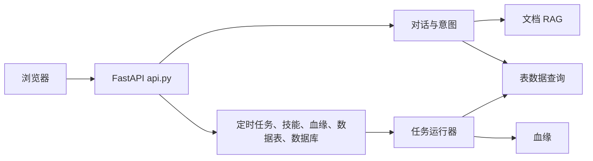
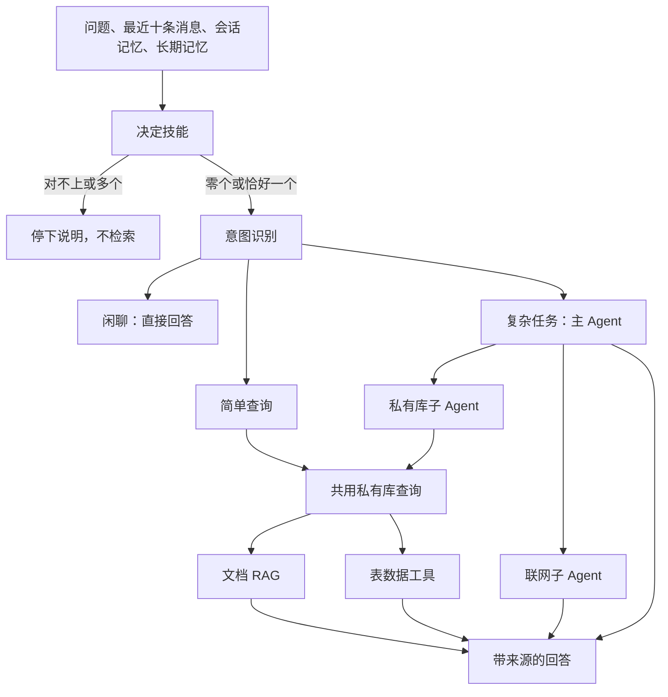
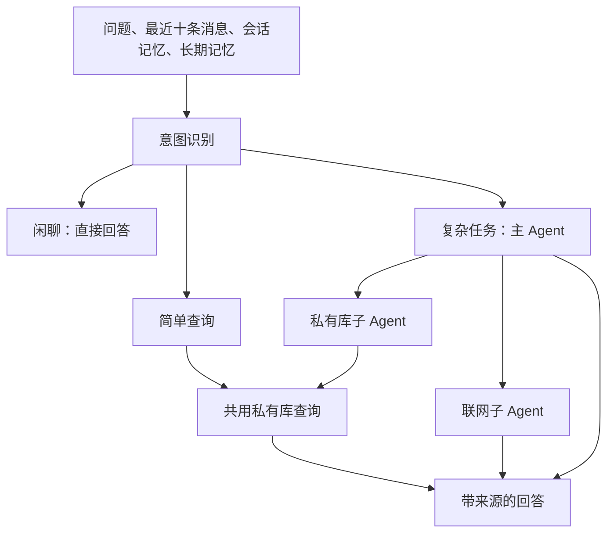
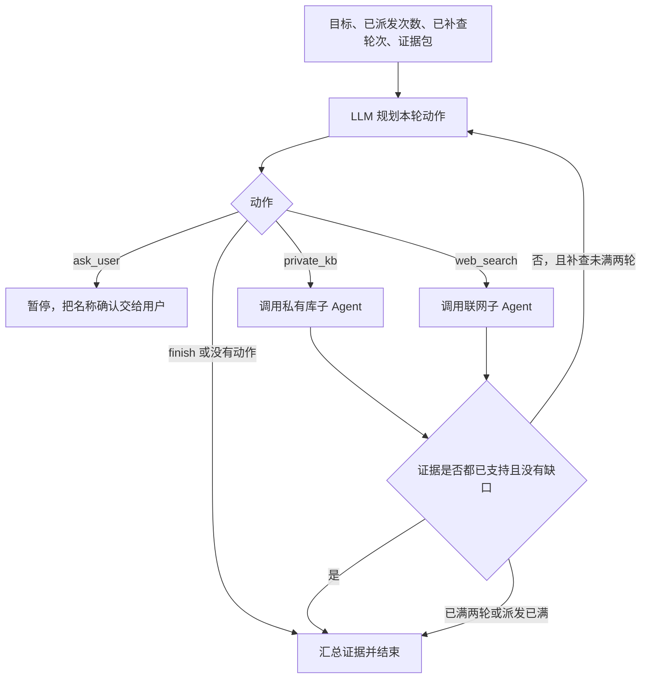
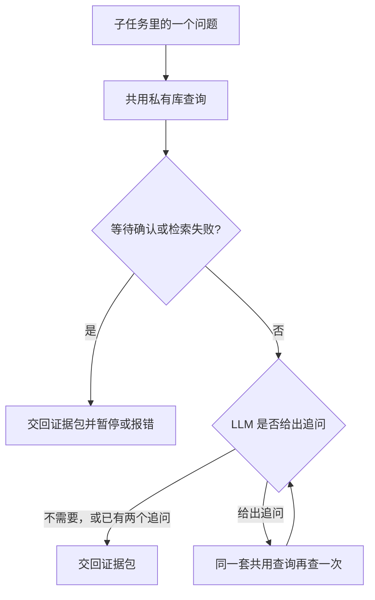
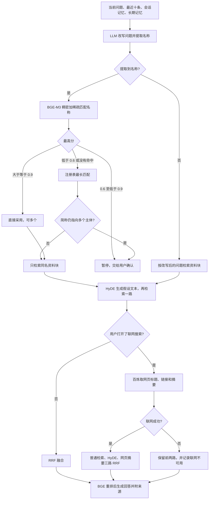
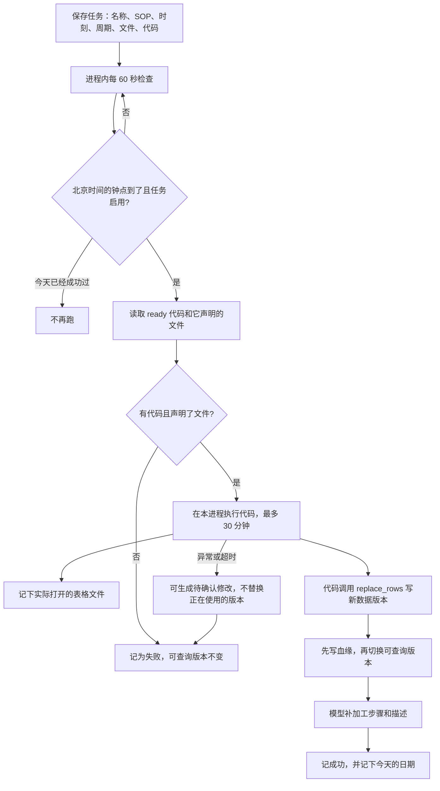
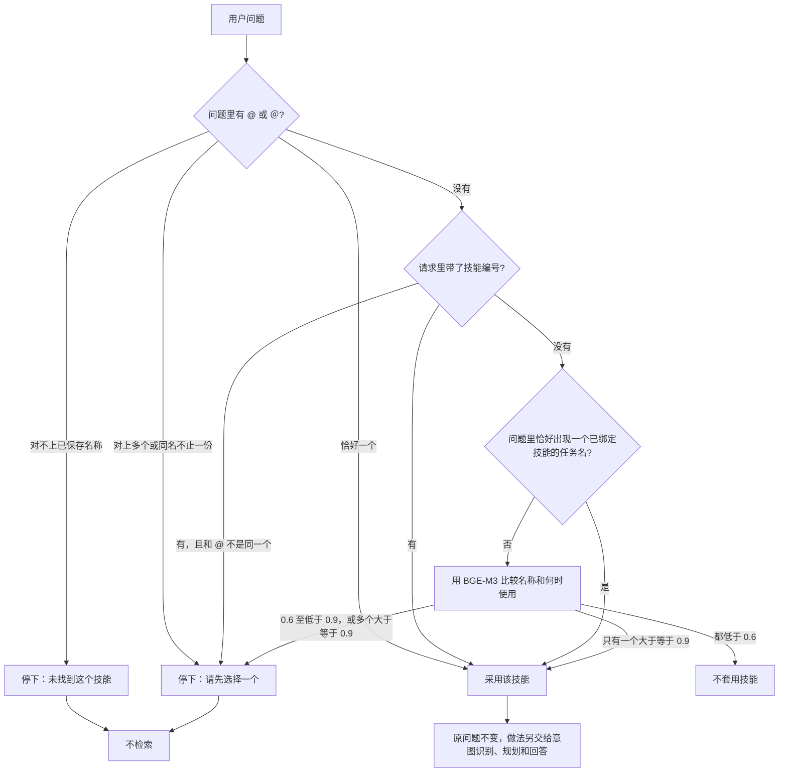
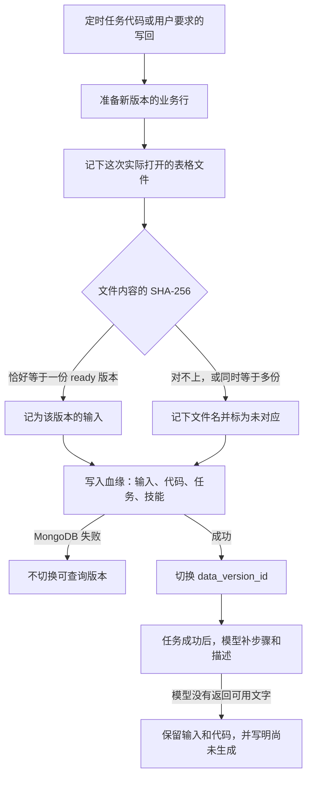

# 掌柜智库实践版

面向普通用户的金融知识库。用户上传产品资料、公告、政策和常见问题，再用自然语言提问。系统从已入库资料里检索，并给出可追溯的回答。

它是资料查询和解释工具：不提供个性化投资建议，不承诺收益，不替代正式产品文件、监管文件或人工判断。业务规则见 [docs/requirements.md](docs/requirements.md)，实现方案见 [docs/design.md](docs/design.md)。

## 能做什么

- **资料入库**：上传 PDF、Markdown 或 Word，解析后写入对象存储、向量库和知识图谱。
- **表格入库**：上传 xlsx、xlsm、xls 或 csv。人员确认文件简介、表角色、字段类型和说明后，行写入 PostgreSQL 业务表。
- **对话查询**：在已有对话里提问。浏览器保存匿名用户 Cookie，服务端为每段对话生成 `conversation_id`。
- **带来源的回答**：资料回答附来源；网页来源附链接。表里没有的数字不能用字段说明或文档里的数字补上。
- **名称确认**：主体名称相似度大于等于 0.9 直接采用；0.6 至低于 0.9 交给用户确认，可以多选。
- **长期记忆**：只保存用户明确要求记住，或在个性化设置里写入的内容。
- **定时任务**：按北京时间运行已经确认的代码，给已发布的表写入新的数据版本。对话里不执行这些代码。
- **技能**：用户写下何时使用和做法。点名、请求编号、任务绑定或足够相似时，模型按这些步骤工作。
- **数据血缘**：加工出的新数据版本可以倒查读过哪些文件、用了哪段代码，以及任务成功后由模型补上的步骤和描述。

规则以 [docs/requirements.md](docs/requirements.md) 为准，方案见 [docs/design.md](docs/design.md)。下面按当前代码说明运行过程。文档里的公司、产品和文件名只是例子，不代表系统只处理这些对象。

页面：

| 地址 | 用途 |
|---|---|
| http://127.0.0.1:8000 | 上传入库 |
| http://127.0.0.1:8000/chat | 对话 |

## 整体框架

网站由一个 FastAPI 进程提供。`api.py` 在启动时拉起名为 `data-jobs` 的后台线程，每 60 秒按北京时间检查一次定时任务。对话回答和定时任务跑在同一个进程里，但对话不会执行任务脚本。



数据分开放，互不替代：

| 存放 | 内容 | 不放什么 |
|---|---|---|
| PostgreSQL | 四张元数据表 `doc_info`、`table_info`、`column_info`、`metric_info`；每个已发布文件自己的业务行；`data_job`；`user_skill`；`code_version` 的名称和状态 | 对话原文、血缘正文 |
| MongoDB | 对话列表和消息；血缘集合，默认 `data_lineage` | 业务行、代码正文、密钥 |
| MinIO | 资料原件、表格原件、已上传的 `.py` | 可查询的业务行 |
| Milvus | 文档切片、主体名称、表元数据向量 | 业务行 |
| Elasticsearch | 仅对确认开启 `value_index` 的字段保存取值 | 未开启该开关的列 |
| Neo4j | 已有文档图谱 | 定时任务和血缘 |

一次提问、一次表格发布和一次定时任务共用 30 分钟上限。界面显示已运行时间。超时就停止，不把未完成结果当成成功。复杂任务里的子步骤共用这一次限额。

页面上的分工：

| 位置 | 作用 |
|---|---|
| `/` | 上传 PDF、Markdown、Word，走文档入库 |
| `/chat` | 提问。左侧有定时任务、技能、数据血缘；用户菜单里有个性化、上传文件、数据表、数据库 |
| `/api/tasks` | 文档上传队列，不是定时任务 |
| `/api/data-jobs` | 定时任务 |
| `/api/skills` | 用户技能 |
| `/api/data-lineage` | 血缘列表和按数据版本倒查 |
| `/api/tables` | 四张元数据表和当前可查询的业务表 |
| `/api/library` | 数据库文件管理：文件夹、移动、删除 |

## 问答怎么走

提问先决定本轮用不用技能，再由模型分成三类。入口在 `search/agent_workflow.py`。简单查询不经过主 Agent。技能的做法另传，不改写用户的原问题。





| 路径 | 代码 | 行为 |
|---|---|---|
| 闲聊 | `search/intent_classify.py` | 不查资料、不联网，直接回答 |
| 简单查询 | `search/shared_query.py` | 走一次共用私有库查询，然后组织回答 |
| 复杂任务 | `search/react_agent.py` | 主 Agent 编排两个子 Agent。补查最多两轮，派发少于 5 次 |

意图识别必须调用 LLM。模型只输出 `chat`、`simple`、`complex` 之一。输出无法解析时再调用一次；第二次仍无法解析则停止，并提示分类失败。

## 各 Agent 的内部结构

三个角色的分工：意图识别只分流；主 Agent 只编排；两个子 Agent 只取证。最终回答由 `search/agent_workflow.py` 在简单查询结束或主 Agent 结束时生成。

### 主 Agent

实现在 `search/react_agent.py`，规划提示在 `search/agent_workflow.py` 的 `_plan_with_llm`。它是一个有界 ReAct 循环：每轮先看已有证据，再决定动作，再读取该动作的结果。



允许的动作只有四种：

| 动作 | 作用 |
|---|---|
| `private_kb` | 把一个子问题交给私有库子 Agent |
| `web_search` | 把一个子问题交给联网子 Agent |
| `ask_user` | 暂停，等待用户确认名称 |
| `finish` | 停止派发，把已收集的证据交给回答步骤 |

内部状态只有四项：用户目标、已派发次数、已完成的补查轮次、各子任务交回的证据包。初始拆分不算补查。一轮里可以同时给出多个互不依赖的派发；私有库和联网合计达到 4 次后不再派发。证据全部为 `supported` 且没有缺口时提前结束。达到上限时仍用已有证据回答，并写明未完成的缺口。子 Agent 不能再创建子 Agent，也不能直接向用户发布最终回答。

### 私有库子 Agent

实现在 `search/self_ask.py` 的 `run_private_self_ask`。它用 Self-Ask 取证：先查主问题，再决定要不要追问。



每个追问都再执行一次共用私有库查询，追问结果并入同一证据包。追问最多两个。证据已经支持且没有缺口时不再追问。名称待确认或检索失败时立即返回，不再追问。返回内容是证据包：改写后的问题、已确认名称、资料块、追问列表、状态和缺口。它不调用回答模型。

### 联网子 Agent

实现在 `search/self_ask.py` 的 `run_web_self_ask`。结构与私有库子 Agent 相同，检索端口只有百炼 MCP。

1. 用子任务中的问题调用一次网页检索。
2. 丢掉没有链接的摘要。
3. 由同一个追问判断决定是否再查，最多两个追问。
4. 把标题、链接和摘要收进证据包交回主 Agent。

用户关闭联网搜索时，这一支直接返回缺口「未开启联网搜索」，不调用百炼。网页检索失败时写入联网不可用，已取到的带链接结果仍然保留。

## 简单查询流程

简单查询在意图被标成 `simple` 后，调用一次 `run_shared_query`，再由 `_finish_simple` 组织回答。私有库子 Agent 的主问题和每个追问走同一函数，停在证据包，不进入下面的回答步骤。



步骤对应 `search/shared_query.py` 和 `build_ports`：

1. **改写。** 最近十条消息、会话记忆和长期记忆一起交给模型。长期记忆只作为用户偏好和已知事实。模型返回改写后的问题和提取出的名称，可以是多个。
2. **无名称。** 跳过名称索引，用改写后的问题直接混合检索资料块。概念、公告、政策和业务规则走这一支。
3. **有名称。** 每个名称用 BGE-M3 做稠密、稀疏双向量检索，取得分最高的一条。大于等于 0.9 直接采用；0.6 至低于 0.9 暂停，页面请用户确认或复选。确认之前不检索正文。
4. **注册表。** 向量没有可直接采用或待确认的名称时，按规范名做最长匹配。短名不能截走已经被更长名称占用的文字。剩余简称仍对应多个主体时，同样暂停请用户选择。最终没有任何可查名称时，回答说明未检索到足够信息。
5. **两路正文检索。** 有名称时只查同名资料块；无名称时不过滤名称。HyDE 根据问题生成一段假设性检索文本，和原问题拼在一起再查一次。假设文本只用于检索，不写入回答。
6. **联网。** `use_web_search` 打开时调用百炼，默认打开。失败时保留前两路结果，并在回答里说明联网不可用。没有链接的网页摘要不参与排序。
7. **RRF。** 每一路先按自己的顺序去重。同一条结果在同一路只贡献一次 `1/(60+名次)`，多路分数相加后从高到低排列。
8. **回答。** 融合结果再用 BGE-reranker-large 重排，然后由回答模型生成文字。回答附上文件名或网页链接；库内文件能对上时给出下载地址。没有资料块时不调用回答模型，直接说明未检索到足够信息。检索连接失败时返回检索错误，不把故障写成库里没有资料。

用户完成名称确认后，下一条请求带着已选名称继续同一次查询，不再重新做 0.6 至 0.9 的分档。

## 入库怎么走

网页上传和命令行导入共用 `upload/main_graph.py` 里的 LangGraph：

`校验文件 → 原件存入 MinIO → 解析文档 → 处理图片 → 文档切片 → 识别主体 → BGE-M3 向量化 → 写入 Milvus → 写入知识图谱`

单文件上限默认 200 MB。后台按单任务队列顺序处理，页面可以一次选择多份文件。

命令行导入时，把文件放到 `input/`，或直接传入路径：

```powershell
D:\python\python.exe -m upload.main_graph
D:\python\python.exe -m upload.main_graph "D:\路径\某份资料.pdf"
```

文件名被判定为与金融无关时会跳过。

表格文件不走这条图。它们从 `/api/table-imports` 进入 `structured/catalog.py`：先暂存原件并推断字段，人员确认简介、表角色、字段类型、角色和说明后再发布。发布前不能查询。同一逻辑文件用同一个 `doc_id`，内容或确认结果变化时新建导入版本。同一时刻只有一个 `ready` 版本可查询，旧版本改为 `archived`，行和原件仍保留。

## 定时任务怎么运行

定时任务保存在 PostgreSQL 的 `data_job`。用户在对话页填写名称、SOP、运行时刻、每天或每周或每月，并从数据库里选择已经发布的文件。代码只能选已经确认的 `.py`，或项目里登记的更新函数。界面不能提交代码正文。

代码文件先经 `/api/code-imports` 暂存为 `pending`。人员确认名称和说明，并指定它写回的已有文件后，该版本成为 `ready`。同一 `code_id` 同时只有一个 `ready` 版本。没有 `code_id` 的任务可以保存，到点不运行。技能上的代码标识不能代替任务自己的 `code_id`。



到点判断在 `structured/jobs.py` 的 `_is_due`：

- 时区固定为北京时间。时刻是 `HH:MM`，由用户填写。
- 每天：钟点相同就到点。
- 每周：还要是用户选的周几，周一是 1。
- 每月：还要是用户选的日。
- 进程当时没跑到这个钟点，过后不补跑。
- `last_success_on` 已经是当天，当天不再执行。失败不占用这次成功，同一天仍可再跑。
- 多条任务可以同时启用。停用只把 `enabled` 设为否，任务还在。

执行时，登记函数直接调用。已上传脚本用 `exec` 运行，命名空间里只有 `context` 和 `replace_rows`。脚本通过 `context.replace_rows(行)` 写回它自己声明的那一个文件，字段必须和已确认列一致。运行过程中会包住 pandas 的 `read_csv`、`read_excel`、`read_table`，记下实际打开的表格路径。对话回答过程不进入这段执行。

也可以对一条任务调用 `POST /api/data-jobs/{job_id}/run`，走同一个 `run_job`。它仍然受当天已成功则跳过、以及 30 分钟上限的约束。

运行失败时，如果配置了模型，可以生成一份待确认的修改脚本。它存成新的 `pending` 版本，不替换 `ready` 版本，也不自动再跑。

## 技能怎么运行

技能是一套工作方法，不是回答口径，也不是定时任务本身。用户保存名称、何时使用、以及要按顺序执行的步骤。代码标识可空；填了也只是给定时任务选用的已登记标识，对话里不会因此执行代码。

决定顺序在 `structured/skills.py` 的 `resolve_turn`。提问进入意图识别之前先走这一步。



补充规则：

- `@` 后按已保存名称完整匹配。多个名称都能对上时取最长的。半角 `@` 和全角 `＠` 相同。
- 等于 0.9 直接套用。大于等于 0.9 且只有一个才自动套用。
- 内置技能不出现在用户列表里，也不参加相似度比较。任务里已经保存的内置技能编号，仍可按编号取到做法。
- 用户已经点名或带了编号时，不再并入任务上的另一个技能。
- 技能被删除后，新问题不能再点它。已经写进血缘的技能标识保持原值。
- 技能不能放宽来源、合规和表数据规则。做法和要求冲突时，按那些规则处理。

## 数据血缘怎么运行

一条新的可查询数据版本对应 MongoDB 里的一条血缘，键是这个版本的 `data_version_id`。重复保存覆盖同一条。记录一直保留，全体用户看到同一份，不按用户分开。

血缘在数据版本成为可查询之前写入。写入失败时，当前可查询版本保持不变。只读回答、字段说明和别名不写血缘。用户要求把已经查到、且字段与已确认列一致的结果写回时，也先写血缘再切换版本。



对应规则：

- 比较的是这次读到的文件字节，不是文件名。同名但内容不同，不算同一版本。
- 对不上已登记版本时标明未对应，不编造版本号。脚本正文里没有手写版本号，不因此阻止查询。
- 定时任务必须记下 `code_id`。执行的是已发布代码版本时，同时记下 `code_version_id`。模型写回没有登记代码时，代码标识为空，并在步骤里写明这是模型步骤。
- 任务成功后，把实际读到的文件名和所运行的代码交给模型，由模型补有顺序的加工步骤和一段描述。步骤和描述只说明加工，不保存代码正文、密钥、整表行或对话原文。
- 模型没有补上时，输入文件和代码仍保留，描述或步骤写明尚未生成。
- 对话页按文件名、任务名和代码名展示。倒查没有记录时说明「没有血缘」；连接或查询失败时说明「血缘读取失败」。两种情况都不编造基础数据或代码名。
- 血缘不进入文档检索，也不进入表数据工具，不能代替回答里的来源。

血缘上的主要字段：

| 字段 | 含义 |
|---|---|
| `lineage_id` | 与加工结果的 `data_version_id` 相同 |
| `producer` | `scheduled_job` 或 `llm` |
| `output` | 写出的文件、表、导入版本和数据版本 |
| `inputs` | 对上的已发布版本 |
| `unresolved` | 读到了但没对上唯一已发布版本的文件 |
| `steps` | 有序号的加工说明 |
| `description` | 一段加工描述 |
| `code_id`、`code_version_id`、`job_id`、`skill_id` | 实际用到的代码、任务和技能；没有则为空 |

## 目录

| 路径 | 内容 |
|---|---|
| `api.py` | 网站入口：上传、对话、记忆、定时任务、技能、血缘、数据表和数据库 |
| `web/` | 上传页和聊天页 |
| `upload/` | 文档入库流水线 |
| `search/` | 意图识别、共用查询、主 Agent、两个子 Agent、回答与引用 |
| `structured/` | 表数据、定时任务、技能、血缘、代码版本和数据库文件 |
| `knowledge/` | 主体注册表和知识图谱抽取 |
| `research/` | 子任务结构、预算和并行分发 |
| `chat_service.py` | 对话、待确认暂停、MongoDB 消息 |
| `tests/` | 单元测试和流程测试 |
| `docs/` | 需求与设计 |
| `input/` | 命令行导入时扫描的资料 |
| `output/` | 检索和导入产生的中间结果 |

## 启动

先在项目根目录准备 `.env`，填入 MinerU、模型、MinIO、Milvus、MongoDB、Neo4j、LLM 和百炼 MCP 的现有地址。然后在本目录执行：

```powershell
.\start_web.ps1
```

脚本固定使用 `D:\python\python.exe`，并启动 `uvicorn api:app`。

常用环境变量：

| 变量 | 作用 | 默认 |
|---|---|---|
| `WEB_HOST` | 监听地址；局域网可设 `0.0.0.0` | `127.0.0.1` |
| `WEB_PORT` | 端口 | `8000` |
| `WEB_MAX_UPLOAD_MB` | 单文件上限 | `200` |
| `MONGO_CHATS_COLLECTION` | 对话列表集合 | `conversations` |
| `MONGO_CONVERSATION_COLLECTION` | 消息集合；也认 `MONGODB_CONVERSATION_COLLECTION` | `conversation_history` |
| `MONGO_LINEAGE_COLLECTION` | 血缘集合，与对话集合分开 | `data_lineage` |
| `BGE_RERANKER_PATH` 或 `BGE_RERANKER_LARGE` | 重排模型目录 | 无，需在 `.env` 配置 |
| `SEARCH_USE_PROXY` | 设为 `1` 时，问答链使用当前 HTTP 代理 | 已配置的服务地址直连 |
| `MILVUS_USE_PROXY` | 设为 `1` 时，Milvus 走代理 | 直连 |

未传 `web_search` 时，对话接口默认打开联网搜索。请求里的 `mode` 可以是 `auto`、`fast` 或 `deep`。

匿名 Cookie 适合本机或受控内网演示。对外提供多用户服务时，应接入正式登录。

## 测试

在项目根目录运行，例如：

```powershell
D:\python\python.exe -m pytest tests/test_agent_flow.py tests/test_api_entry.py tests/test_table_data.py
```

会访问真实 MongoDB、Milvus、模型和百炼的冒烟脚本：

```powershell
D:\python\python.exe -m tests.live_chat_smoke
D:\python\python.exe -m tests.live_web_chat_smoke
```

第二个命令需要网页服务已经启动，并且测试使用的端口与 `WEB_PORT` 一致。
