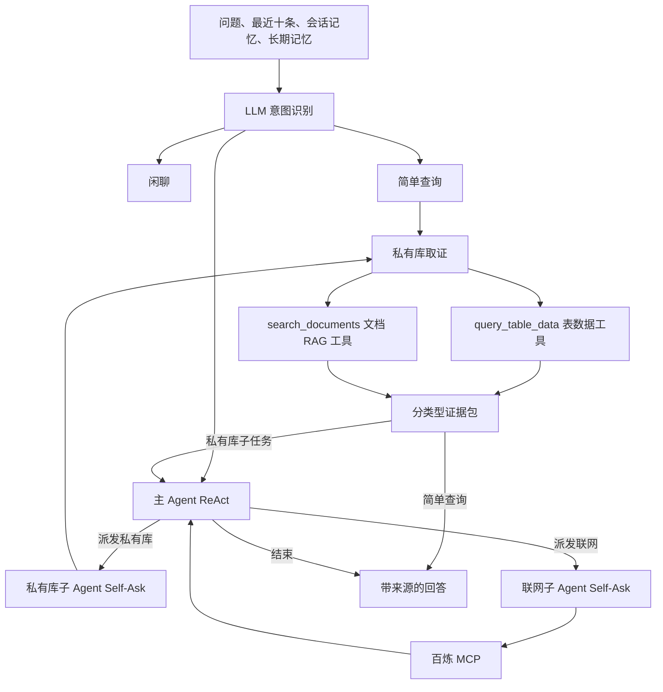
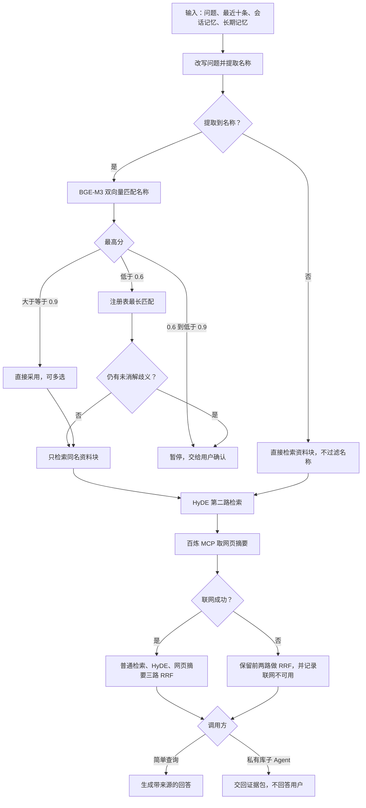
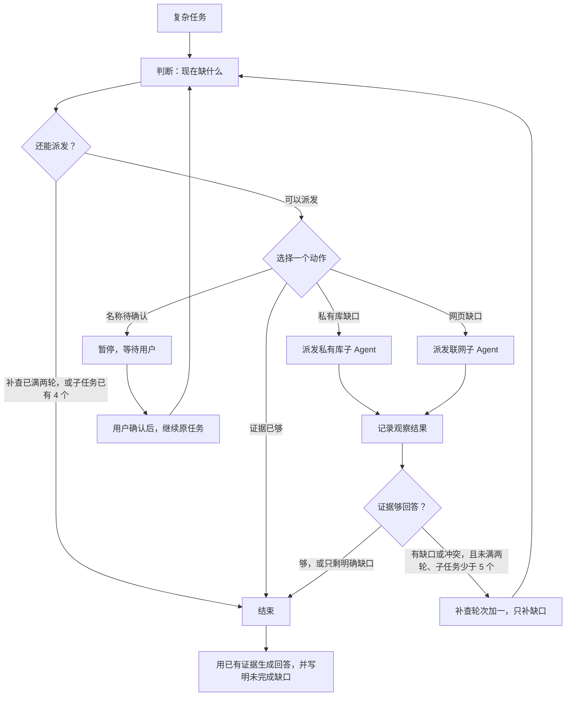
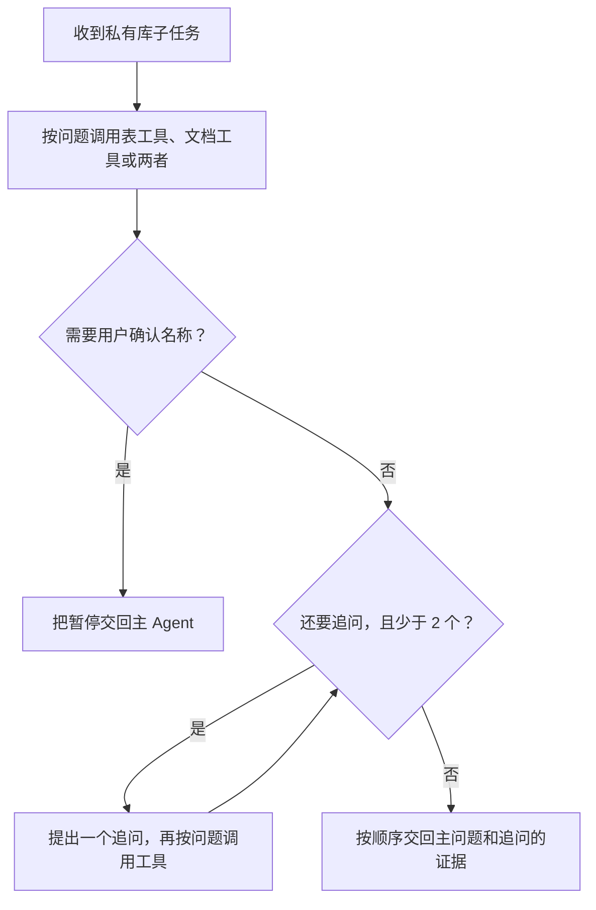
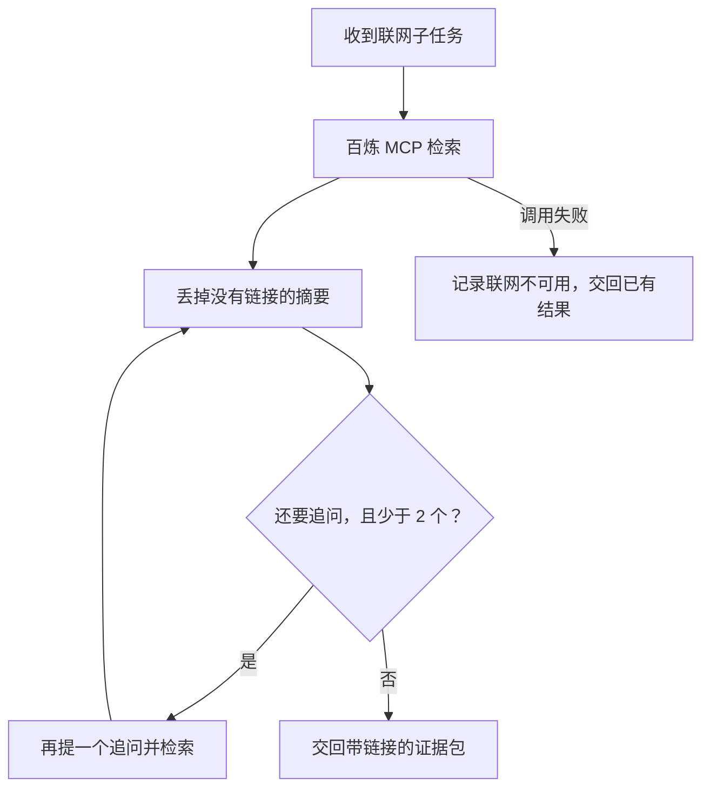

# 查询与双智能体设计

状态：草案。对应 [requirements.md](requirements.md)。本文写主 Agent、两个子 Agent、文档 RAG 与表数据两个私有库工具，以及 PostgreSQL 元数据、文件表数据和左侧每日更新怎么落地。结构化入库、只读查询和每日任务代码已按本文落地，并在本机 PostgreSQL 上跑过相关测试。

## 1. 目标与已确认约束

| 目标 | 需求 |
|---|---|
| LLM 把问题分成闲聊、简单查询、复杂任务 | REQ-002 |
| 简单查询和私有库子 Agent 共用文档 RAG；表数据走独立工具 | REQ-004、REQ-008、REQ-016 |
| 主 Agent 用 ReAct，补查最多两轮，子任务少于 5 个 | REQ-007、REQ-009 |
| 两个子 Agent 用 Self-Ask，每个子任务最多两个追问 | REQ-008 |
| 普通检索、HyDE、百炼摘要三路 RRF | REQ-004 |
| 回答必须带来源，网页必须带链接 | REQ-010 |
| 长期记忆只接受用户明确写入 | REQ-014 |
| PostgreSQL 保存文件元数据和表数据，模型据此查找或完成需求 | REQ-015、REQ-016 |
| 左侧每日任务按 SOP 运行已指定代码并更新表数据 | REQ-017 |

约束：沿用现有 Milvus 实例，文档切片和元数据使用不同集合；不把示例公司或文件写进流程分支，子 Agent 不向用户发布最终回答。分数阈值与现有代码一致：`DIRECT_MATCH_THRESHOLD = 0.9` 且大于等于该值直接采用，大于等于 0.6 且小于 0.9 才确认。结构化路径需要 PostgreSQL、MinIO、Elasticsearch 和 Excel 解析能力；本轮只更新设计，不安装依赖。MongoDB、Milvus 和 Neo4j 不改为关系库。

## 2. 现有代码里可以复用的部分

技术栈继续用现有 Python、FastAPI、MongoDB、Milvus、BGE-M3、BGE-reranker-large、LangGraph 和百炼 MCP。不为本设计新增智能体框架包。ReAct 和 Self-Ask 都用现有 LLM 接口加明确的状态循环实现。

| 能力 | 现有位置 | 本设计中的用法 |
|---|---|---|
| 对话入口、待确认暂停、`session_memory` | `chat_service.py` 的 `ChatService.send` / `iter_events` | 主入口保留。名称确认继续写入 `pending_search` |
| 问答状态 | `state.py` 的 `ImportGraphState` | 简单查询继续用。每个子任务复制一份，并使用自己的 `task_id` 和 `local_dir` |
| 意图候选 | `search/query_plan.py` 的 `plan_question` | 只复用其中已经能确定的主体、期间和会话继承。三类意图改由 REQ-002 的 LLM 调用决定，不用这里的关键词分支代替 |
| 最长匹配、简称歧义 | `knowledge/registry.py` 的 `find_in_text`、`ambiguous_aliases` | REQ-006 直接调用 |
| 改写、抽名称、双向量名称检索、分档、多选 | `search/node_item_name_confirm.py` | 共用查询在提取到名称时调用。等于 0.9 走现有 `score >= 0.9` 的直接采用 |
| 按已确认名称检索同名资料块 | `search/node_search_embedding.py` 的 `retrieve_top5` | 有名称时的普通检索 |
| 无名称时的资料块检索 | `search/financial_retrieve.py` 里的混合检索调用方式 | 只复用“按问题检索资料块”的能力。无名称问题不先按 `item_name` 过滤。不复用它后面的整段金融入口 |
| HyDE 与第二路检索 | `search/node_search_embedding_hyde.py` | 原样复用。假设文本只进检索查询，不进事实 |
| 两路 RRF | `search/node_rrf.py` 的 `fuse_chunks` | 排序公式不变。扩展为第三路网页摘要，见第 4.4 节 |
| 百炼联网 | `search/node_web_search_mcp.py` | 共用查询和联网子 Agent 都调用。结果保留 `title`、`url`、`content` |
| 重排候选的组装方式 | `search/node_rerank.py` 的 `_candidates` | 三路 RRF 之后，如仍要做 BGE 重排，输入用已经融合的列表，不再把网页摘要额外拼一次 |
| 最终回答与归档 | `search/node_answer_output.py` | 只由简单查询的最后一步或主 Agent 的结束动作调用 |
| 证据状态与引用 | `search/evidence.py` | 复用支持、不支持、冲突、检索失败四类状态。其中写死示例机构名的数值正则不作为通用规则 |
| 子任务形状、依赖校验 | `research/planner.py` 的 `ResearchTask`、`validate_tasks` | 复用结构和循环依赖检查。数量上限改为小于 5。不复用 `build_tasks` 的财报槽位拆法 |
| 预算与租约 | `research/budget.py`、`research/runtime.py` | 主 Agent 每次动作前预留额度 |
| 并行分发 | `research/graph.py` 里的 LangGraph `Send` | 只复用“按任务分发、再汇合”。worker 本体改为第 6 节的 Self-Ask |
| 对话页左侧栏 | `web/chat.html` 的 `sidebar`，`web/chat.js` 的 `api()` | REQ-017 的入口放在这里，与「个性化」「文档入库」分开 |
| 上传任务接口 | `api.py` 的 `/api/tasks` | 这是文档上传，不复用为定时任务或表数据查询 |
| 表格文件入口与原件 | `api.py`、`upload/node_entry.py`、`upload/main_graph.py` 当前接受 PDF、Markdown、Word；`node_upload_minio.py` 有原件上传函数，尚未接入导入图 | 表格文件在入口分流，原件复用已有 MinIO 函数。这些路径当前都还没有四表和 ES |
| 两个私有库工具 | `search/shared_query.py`、`search/self_ask.py` 现在走文档检索 | 文档路径封装为 `search_documents`，另建 `query_table_data`。主 Agent 不新增动作 |

下面这些不当作查询过程继续扩展：

| 位置 | 原因 |
|---|---|
| `research/graph.py` 的 `worker` | 只在父级已经检索好的资料块里按名称子串过滤 |
| `research/facts.py` 的 `_FACT` | 正则写死了示例机构、年份和三个指标 |
| `research/memory.py` 的 `PreferenceBook.learn_from_messages` | 会从对话自动归纳偏好，与 REQ-014 冲突 |
| `node_rerank` 里“RRF 块和网页摘要到了重排才相遇” | 现在的网页摘要不进 `fuse_chunks`。目标是三路先做 RRF |

`search/workflow.py` 今天会把一部分金融问题送进 `_run_financial`，产品链则是普通检索、HyDE、联网、BGE 重排。目标是改成第 4 节这一个入口。

## 3. 总流程



| 模块 | 输入 | 输出 | 失败时 |
|---|---|---|---|
| 意图识别 | 问题、最近十条、两种记忆 | `chat` / `simple` / `complex` | 第二次仍无法解析则返回分类失败 |
| 私有库取证 | 一个问题、记忆、独立 state | 按需调用表工具和文档工具，交回分类型证据、来源、名称决策和状态 | 区分无记录、指标未确认与检索失败 |
| 私有库子 Agent | 一个子任务 | 证据包，含最多两个追问 | 等待名称确认时暂停 |
| 联网子 Agent | 一个子任务 | 带链接的网页证据包 | MCP 失败写入 `web_search_error` |
| 主 Agent | 用户目标、证据包 | 下一个动作，或最终回答 | 满两轮补查或已有 4 个子任务时停止派发 |

闲聊继续走 `ChatService` 里现有的直接回答。

## 4. 共用文档 RAG 查询

把现有资料块查询封装为 `search_documents`，供简单查询和私有库子 Agent 调用；两者共用问题准备和名称确认。表数据另由第 10 节的 `query_table_data` 工具提供。下图只描述文档 RAG 工具的内部步骤，不复制一套检索。



无链接的网页摘要在进入 RRF 前丢弃。等于 0.9 走“直接采用”。用户尚未确认时，流程停在“暂停”节点，不检索正文。

### 4.1 步骤

1. 组装上下文：最近十条消息、`session_memory`、REQ-014 的长期记忆。现有确认节点默认 `MONGO_HISTORY_LIMIT=50`，闲聊截取最近 30 条。这个入口改为十条，完整历史仍留在 MongoDB。
2. 调用 `node_item_name_confirm` 里的改写和名称提取。没有名称时不调用名称集合的 `hybrid_search_item_name`，把状态标为直接匹配资料块。
3. 有名称时走现有分档。大于等于 0.9 的名称写入已确认列表。待确认则返回 `awaiting_user`，函数在这里结束。低于 0.6 时调用 `find_in_text` 和 `ambiguous_aliases`。长名优先；剩余歧义同样返回 `awaiting_user`。
4. 普通检索：有名称时调用 `retrieve_top5`，过滤条件是已确认名称。无名称时按改写后的问题检索资料块，不过滤 `item_name`。
5. 调用 `node_search_embedding_hyde`。有名称时继续使用同一批名称。
6. 调用 `node_web_search_mcp`。异常时保留前两路结果，并写入现有的 `web_search_error` 文案。
7. 三路 RRF，见第 4.4 节。
8. 调用方决定下一步。简单查询进入第 4.5 节。子 Agent 把结果放进证据包后返回。

名称确认的暂停字段继续用 `awaiting_user_confirmation`、`item_name_candidates` 和 `item_name_confirmation_message`。复杂任务把这些字段、ReAct 已完成的动作和未完成的子任务编号放进 `pending_search`。用户沿用现有选择或否认接口后，只继续该子任务。

子任务输出目录沿用 `output/search/<conversation_id>/<request_id>/<task_id>`。现有节点要写 JSON 时，路径都指到这个目录。

### 4.2 无名称直接匹配

触发条件是名称提取结果为空，不是“向量分数低”。分数低仍走注册表。

这一支的检索文本是改写后的问题。HyDE 仍生成第二路文本。两路都不加 `item_name in ...` 过滤。用户打开联网搜索时，百炼摘要再和这两路一起 RRF；关闭时不调用百炼。

### 4.3 有名称的同名检索

已确认名称可以有多个。每个名称各自检索同名资料块，结果进入普通检索这一路。用户多选的每个名称都要保留，不能只留分数最高的一个。

### 4.4 三路 RRF

复用 `fuse_chunks` 的规则：每一路先按自己的顺序去重，同一条结果在同一路只贡献一次 `1/(60+名次)`。`RRF_K` 仍是 60。

第三路是网页摘要。身份优先用 `url`；没有链接的摘要直接丢弃，不参与排序，也不能进入回答。`title` 和 `content` 原样保留，供 REQ-010 输出链接。

```text
普通检索名次 + HyDE 名次 + 网页摘要名次
    → 同一条的 rrf_score 相加
    → 按 rrf_score 从高到低
```

现有 `node_rrf` 只读普通检索和 HyDE 两份 JSON。落地时给融合函数增加可选的第三路列表；两路调用保持原来的结果。不要把网页摘要留到 `node_rerank` 才第一次和私有库结果放在一起。

BGE 重排如果继续使用，输入是这份三路融合结果，避免网页摘要被计算两次。重排不改变来源字段和链接。

### 4.5 简单查询的回答

三路结果交给 `node_answer_output`。提示要求每个事实后面都能找到私有库字段或网页链接。缺少链接的网页句子不送进提示。HyDE 原文不送进提示。

### 4.6 结构化表与文档工具

上述普通检索、HyDE、三路 RRF 是 `search_documents` 文档 RAG 工具的内部步骤。问题依赖已登记文件表时，私有库子 Agent 或简单查询调用第 10 节的 `query_table_data`；混合问题可分别调用两个工具。主 Agent 的 `private_kb` 仍只负责派发，联网子 Agent 保持原职责。表工具找不到可信表时返回缺口；若问题也涉及文档，再独立调用文档工具。表中的行不进入 RRF，也不改写成文档切片。Q-009 确认前，对话路径只读。

## 5. 主 Agent：ReAct



初始拆分的轮次记为 0，不计入两轮补查。一次可以并行派发互不依赖的动作，每个动作一份独立 state。

主 Agent 是一个有界循环，不是新的模型产品。每一步的记录为：

| 字段 | 内容 |
|---|---|
| `thought` | 现在缺什么，为什么选下一个动作 |
| `action` | 下表四种之一 |
| `observation` | 子 Agent 证据包、用户确认结果，或空 |

| 动作 | 何时使用 | 结果 |
|---|---|---|
| `private_kb` | 缺口在已导入资料 | 启动一个私有库 Self-Ask |
| `web_search` | 缺口在外部网页，或需要链接核验 | 启动一个联网 Self-Ask |
| `ask_user` | 名称落在确认区间或注册表仍有歧义 | 暂停整次任务 |
| `finish` | 证据够用，或不能再派发 | 生成最终回答 |

循环规则：

1. 初始拆分从 `thought` 开始，可以一次派发多个互不依赖的动作。并行仍用 `Send`，每个动作一份 state。
2. 全部观察返回后做一次检查，区分 `supported`、`unsupported`、`retrieval_error`。冲突保留两侧，不覆盖。
3. 只有缺口或冲突才进入补查。补查轮次从 1 计到 2。初始拆分的轮次是 0。
4. `private_kb` 和 `web_search` 的累计次数小于 5。第 5 次动作不再执行，直接 `finish`。
5. 汇合键是 `(plan_revision, task_id)`。同一键两份不同内容视为冲突。
6. `finish` 只读取证据包和计算所需的已登记工具。资料正文里的指令不能增加动作种类。

现有 `validate_tasks` 的“超过 6 个即报错”在这个入口改为“大于等于 5 个即拒绝”。循环依赖检查保留。`build_tasks` 的公司槽位模板不作为通用拆法。

依赖沿用 `depends_on`、`required_slots`、`allow_partial`。上游是检索失败、无资料或冲突，且下游不允许部分完成时，下游标为 `blocked_by_dependency`，不能自己补数字。

## 6. 两个子 Agent：Self-Ask

私有库子 Agent 的主问题和追问按第 4.6 节调用 `query_table_data`、`search_documents` 或两者。文档工具才进入第 4 节的名称确认和 RRF。表工具不把行放进 RRF。



联网子 Agent 不提取名称，也不读私有库。



子 Agent 不调用主 Agent，也不能再 `Send` 出新的子 Agent。一个子任务内部的循环是：

1. 收到主问题。
2. 判断要不要一个追问。不需要则进入第 4 步。
3. 提出一个追问并检索。私有库子 Agent 对这个追问调用第 4 节。联网子 Agent 对这个追问调用 `node_web_search_mcp`。最多重复到两个追问。
4. 返回证据包。证据包里按顺序放下主问题的检索结果和每个追问的中间结果。

追问只在这个子任务内部可见。主 Agent 看到的是完整证据包，不是子 Agent 写给用户的文章。

联网子 Agent 不提取产品名，也不读 Milvus。它的每条结果必须带 `url`，否则该条丢弃。

名称确认发生在私有库共用查询内部。子 Agent 把 `awaiting_user` 交回主 Agent，由主 Agent 执行 `ask_user`。确认完成后，主 Agent 用原 state 继续该 Self-Ask，不重新提出已经检索过的追问。

## 7. 数据契约

### 7.1 证据包

| 字段 | 类型 | 说明 |
|---|---|---|
| `task_id` | 字符串 | 子任务编号 |
| `task_type` | `private_kb` 或 `web_search` | 来源 |
| `question_rewritten` | 字符串 | 主问题的改写结果 |
| `followups` | 最多两条 | 追问、中间检索状态、来源 |
| `confirmed_names` | 字符串列表 | 未经确认的候选不放这里 |
| `chunks` | 对象列表 | 文档工具三路 RRF 之后的结果，网页项含 `url`；表格行不放入这里 |
| `table_results` | 对象列表 | 表工具返回的真实记录或汇总，含文件、表、字段、数据版本和口径 |
| `table_reason` | 字符串 | 区分 `no_records`、`metric_unconfirmed`、`metadata_missing`、`query_failed` 等表格缺口；不把失败写成无记录 |
| `status` | 枚举 | `supported`、`unsupported`、`retrieval_error`、`awaiting_user` |
| `gaps` | 字符串列表 | 缺项 |

### 7.2 最终回答的来源

私有库项输出已有的 `file_name`、`item_name`，以及资料上的内容类型、产品代码和发布时间。没有这些字段时不补造。

网页项输出 `title` 和 `url`。表格项输出来源文件名、表名、所用字段、版本和计算口径；同一事实的表结果以当前可查询版本为准，文档数字不能补造表中不存在的记录。`node_answer_output` 在归档前检查：除闲聊、无资料说明和检索失败说明外，回答中的每条事实都能对应到证据包里的一项。检查失败则去掉无来源句子；若因此没有事实，改用 REQ-010 的无资料说明。

### 7.3 长期记忆

新增用户级记录，和对话上的 `session_memory` 分开。字段只保留：用户编号、正文、来源、更新时间。来源只能是 `user_explicit` 或 `settings`。

写入入口有两个：对话里用户明确要求记住；个性化设置的保存。不调用 `PreferenceBook.learn_from_messages`。删除是物理删除或把该条标为删除后不再读出，后续查询两种结果相同。

查询时把尚未删除的正文附在改写上下文里。正文不参与工具白名单，也不能改意图标准。

## 8. 权衡与风险

- 共用查询包含一次百炼调用，简单问题会比纯私有库慢。这是为了让网页摘要和两路私有检索使用同一次排序。
- 私有库子 Agent 的共用查询已经会联网。主 Agent 仍可另派联网子 Agent，用来处理独立的网页追问。汇合时按 `url` 去掉重复网页。
- 子任务少于 5 个、补查两轮、追问两个，都会在证据还不全时停止。停止后的回答必须写出缺口，不能用模型补数。
- 旧稿 `docs/superpowers/specs/2026-11-04-multi-agent-financial-research-design.md` 里的公司研究 Agent 和行业 Agent 不作为本轮角色。预算、租约和按任务分发仍可复用。
- 回滚时把意图暂时固定为简单查询，只走第 4 节。回滚后的回答要说明没有执行 ReAct 补查。
- PostgreSQL 不可用时，文档检索仍可回答。涉及已登记文件表的需求返回查询失败，不改口为“没有文档”或“没有记录”。
- 定时任务随现有 API 进程运行。进程停机期间不会执行；Q-004 确认补跑之前，错过的那次不补跑。
- 回滚结构化能力时，停用第 10 节和第 11 节，保留原有文档查询。已写入的 PostgreSQL 表不在回滚时删除。

## 9. 测试映射

不把现有测试结果写成已经满足本文。落地时按下面补测：

| 需求 | 测试 |
|---|---|
| REQ-002 | 替换 LLM 返回三类结果，断言路由；不调用 LLM 时分流失败 |
| REQ-004、REQ-008 | 同一输入走简单查询和私有库子 Agent，断言名称过滤、HyDE、百炼和三路 RRF 一致，子 Agent 没有最终回答 |
| REQ-004 | 无名称问题不调用名称集合检索 |
| REQ-005 | 0.6、等于 0.9、大于 0.9、低于 0.6；等于 0.9 不询问 |
| REQ-006 | 长名覆盖短名；示例以外的双主体简称必须追问 |
| REQ-007 | 第 5 个子任务被拒绝；第三轮补查不会开始；动作只有四种 |
| REQ-008 | 第 3 个 Self-Ask 追问不会执行；联网结果没有 `url` 时被丢弃 |
| REQ-010 | 最终回答的网页事实都有链接；无来源句子不会留下 |
| REQ-014 | 明确“记住”会保存；普通提问不会保存；删除后不再进入改写上下文 |
| REQ-015、REQ-016 | 四表字段以第 10.1 节为准；导入须人工确认；受限同表公式含 `COUNT(DISTINCT ...)`，分组和过滤不进公式，属性字段不能 `SUM`；不同版本保留、完全重复上传去重；值索引按确认开关建立；字段说明不充当记录；未登记关联不自动连接；连接失败、无记录、指标未确认分开说明 |
| REQ-016、REQ-004 | 对不上文件表的文档问题仍走第 4 节；表数据不进入 RRF |
| REQ-017 | 任务运行自己指定的代码；无代码、代码不存在或运行失败时不改表；已索引字段值变化时先建新版本 ES 索引再切换可查询版本；当天成功后不重复运行；对话不触发更新 |

样本使用需求说明和 `input/` 示例文件以外的机构、产品或文件。`research/facts.py` 能匹配示例公司，不能当作这组测试通过。上表是落地时要补的测试，不是已经获得的测试结果。

## 10. PostgreSQL 元数据与文件表数据

对应 REQ-015、REQ-016。PostgreSQL 的四张元数据表是权威定义；表格文件的业务行也在 PostgreSQL。原件在 MinIO；现有 Milvus 文档切片集合保留，另在同一 Milvus 实例建元数据集合；Elasticsearch 只索引人工选定字段的实际取值。MongoDB 继续保存对话，Neo4j 继续保存已有图数据。本节是目标设计，现有代码尚未实现表格导入、四表或 ES 路径。`demo/metadata` 只展示四张表的样子，字段以本节为准。

连接信息只从环境变量读取，不写地址、账号或库名。变量名在实现时与现有 `.env` 的写法对齐。

### 10.1 表契约

固定的元数据表是 `doc_info`、`table_info`、`column_info`、`metric_info`。第 11 节的 `data_job` 不计入这四张。每份表格文件另有一张业务数据表，也不计入。表格文件指 xlsx、xlsm、xls 和 csv；首次由人员选定一个工作表或等效表，一文件一业务表。PDF、Word、Markdown 只登记 `doc_info`，不创建业务表，也不建 ES 值索引。

标识符只允许字母开头，其余为字母、数字或下划线。物理表名在库内唯一，物理列名在同一表的同一导入版本内唯一。

`doc_info`，一个导入版本一行。主键是 `import_version_id`。

| 字段 | 要求 |
|---|---|
| `doc_id` | 同一逻辑文件保持不变。该 `doc_id` 同时最多一行 `status=ready` |
| `import_version_id` | 主键。内容、工作表、导入配置或经明确修改的元数据各用一个新值 |
| `source_file` | 原文件名，非空 |
| `format` | 非空 |
| `summary` | 简介。发布前 `review_status` 必须已确认 |
| `minio_key` | 原件对象键，非空 |
| `checksum` | 原件 SHA-256，非空 |
| `sheet_name` | 表格文件所选工作表或等效表名。非表格文件为空 |
| `upload_task_id` | 上传任务标识，可空。不是 `data_job.job_id` |
| `status` | `pending`、`indexing`、`ready`、`archived`、`failed` 之一 |
| `data_version_id` | 当前可查询的数据装载版本。非 `ready` 时可空 |
| `fields_snapshot` | 仅表格文件。同版 `column_info` 的字段名和说明，生成后不手改 |
| `generated_by` | 简介来源：`llm`、`user` 或 `program`，可空 |
| `review_status` | `pending_review` 或 `confirmed` |
| `created_at` | 带时区，非空 |

`table_info`，一个导入版本中的一张逻辑业务表一行。主键是 `(table_id, import_version_id)`。

| 字段 | 要求 |
|---|---|
| `table_id` | 同一逻辑业务表跨导入版本不变 |
| `import_version_id` | 指向 `doc_info` |
| `doc_id` | 与该导入版本的 `doc_id` 一致 |
| `table_name` | 物理表名，库内唯一 |
| `role` | `事实表` 或 `维度表`。发布前必须确认。首版不存跨表关联 |
| `summary` | 业务简介。发布前必须确认 |
| `fields_snapshot` | 同版字段名，按 `position` 从 `column_info` 生成，只供展示 |
| `generated_by` | 简介来源，取值同 `doc_info` |
| `review_status` | `pending_review` 或 `confirmed` |

`column_info`，一个导入版本中的一个物理列一行。主键是 `(column_id, import_version_id)`。这是字段定义的权威来源。

| 字段 | 要求 |
|---|---|
| `column_id` | 同一物理列在后续版本中保持不变。列被替换时使用新值 |
| `import_version_id` | 指向 `doc_info` |
| `table_id` | 指向同版 `table_info` |
| `column_name` | 物理列名。同一表版本内唯一 |
| `position` | 从 1 开始。同一表版本内唯一 |
| `data_type` | 人员确认后的 PostgreSQL 类型。程序只提交候选 |
| `role` | `维度`、`度量`、`时间`、`主键`、`属性` 之一。发布前必须确认。只有 `度量` 可以作为 `SUM` 或 `AVG` 的目标 |
| `aliases` | 别名列表，可空。别名不代替物理列名 |
| `description` | 字段说明。发布前非空且已确认，只解释含义 |
| `value_index` | 布尔，人员确认。度量、时间、主键和高基数文本默认 `false` |
| `generated_by` | 说明或别名的来源 |
| `review_status` | `pending_review` 或 `confirmed` |

`metric_info`，一个导入版本中的一个指标一行。主键是 `(metric_id, import_version_id)`。可以没有指标。

| 字段 | 要求 |
|---|---|
| `metric_id` | 同一指标跨版本保持不变 |
| `import_version_id` | 指向 `doc_info` |
| `table_id` | 只能指向同版的一张表 |
| `name` | 指标名，非空 |
| `summary` | 业务描述 |
| `aliases` | 别名列表，可空 |
| `column_ids` | 引用列，必须属于同一 `table_id` 和 `import_version_id` |
| `formula_tree` | 受限表达式。叶子是这些列或数值常量；节点只允许 `SUM`、`COUNT`、`COUNT_DISTINCT`、`AVG`、加、减、乘、除 |
| `formula_text` | 给人看的公式，不执行 |
| `status` | `draft` 或 `approved`。只有 `approved` 参与计算 |
| `review_status` | `approved` 时必须为 `confirmed` |

`fields_snapshot` 生成后不单独修改。选表、校验和生成 SQL 只读当前 `ready` 版本的 `column_info` 和实际业务表结构。模型生成的说明、别名记 `generated_by=llm`；字段说明里的示例值不是事实。

同一文件的不同内容或导入配置保留各自的 `import_version_id`。一次导入版本之后可以有多个 `data_version_id`：每日任务只增加数据版本，不重新上传原件。业务表每行另存 `import_version_id`、`data_version_id`、`source_file` 和 `loaded_at`，供过滤和引用来源；这四列不是表格里的业务列。旧原件、元数据和行不因新版本发布而删除。没有已确认的主键时不另造业务主键。未登记的表间关联按 Q-007 不查询。

`formula_tree` 不是自由 SQL。程序检查角色、类型、引用范围和除零；除数为零时返回空值和原因，不返回伪造的 0。分组和过滤写在当次查询计划里，不写进 `formula_tree`。`demo/metadata` 里带 `GROUP BY` 或 `WHERE` 的式子是一次查询的例子，不是指标的存储格式。展示用 `formula_text` 可以保存，执行只编译 `formula_tree`。跨表指标首版拒绝。客单价可以表示成 `SUM(amount) / COUNT_DISTINCT(order_id)`，其中两列属于同一张表。

### 10.2 入库

1. 上传原件到 MinIO 暂存。对同一 `doc_id`，先按原件 SHA-256 查候选，再核对原件字节、所选工作表和导入配置，确认“完全重复”才复用已有版本；仅清理本次暂存的重复对象，不新建 `doc_info` 版本，也不再次调用 LLM。非重复才创建 `doc_info` 的 `pending` 记录。明确修改已有元数据则另建版本；不同内容或配置也产生新版本，旧版保留。
2. 对非重复上传，程序解析列名、列序、样例与类型候选；LLM 草拟文件/表/字段的简介和别名、可选指标候选，写入 PostgreSQL 的 `pending` 元数据版本，标记 `generated_by=llm`。人员在导入界面检查确认表的事实表或维度表角色、字段类型与业务角色、说明、别名和逐列 `value_index`；这些定义未确认时本版不发布。指标候选可留 `draft`，不阻塞已确认字段的数据入库，但只有口径经人员确认才可用于查询。数字列不因类型为数字就自动成为度量。
3. 一个 PostgreSQL 事务内将已确认的本版元数据定稿并写入业务行，字段与 `column_info` 不一致就整体回滚并报告差异。版本行使用 `import_version_id`、`data_version_id` 过滤；候选版本不参与正常查询。Q-008 确认前不自动删旧列或给旧行填新值。
4. 从已提交的数据版本提取 `value_index=true` 列的实际去重值，写入带 `column_id`、`table_id`、版本的 ES 索引。取值使用 keyword，按整值精确匹配。金额、时间、主键和高基数字段默认不开启，人员可检查具体业务键。元数据用 BGE-M3 写入独立 Milvus 元数据集合；向量文本由表简介、字段名、别名和字段说明拼成，不单用字段名。文档切片不进入该集合，集合只召回可查询版本。索引使用可重试的确定性 ID，同一版本重建时先按版本删再写。失败时旧 `ready` 版本继续服务。
5. 核对 PostgreSQL、ES、Milvus 的对应版本后，用 PostgreSQL 事务把新版本设为唯一 `ready`、旧版设为 `archived`；旧版原件和行数据继续保留。索引旧项可在切换后清理，但不能先删当前可查询项。每日任务仅更新数据时，新建 `data_version_id`，确认值索引完成后原子更新当前数据版本；元数据文本未变化时沿用已有向量，不刷新文档切片。

### 10.3 回答和查找

简单查询和私有库子 Agent 均可调用 `query_table_data`、`search_documents` 两个工具；主 Agent 的 `private_kb` 动作不变。两个工具都只交回证据，不直接给用户回答。

1. 表工具从问题抽主体、时间、字段词、指标词和取值词。Milvus **元数据集合**召回候选表、字段与指标；ES 在当前版本可见范围内找实际字段值。按 ID 去重、按表聚合并重排候选，再从 PostgreSQL 读取完整的 `ready` 元数据；不把全库指标一次交给模型。
2. 模型给出结构化查询计划，计划里包含字段、过滤、分组、聚合和行数上限。程序验证表和字段属于同版元数据、指标已是 `approved`、`SUM` 和 `AVG` 的目标列是度量、取值属于对应字段。首版只查单表；没有登记关联时不生成连接。程序用只读账号、单条语句、标识符白名单和参数绑定编译 SQL。自由 SQL 原文不执行；计划被修改后必须再次验证。语句时限仍待 Q-001，本文不写死秒数。
3. PostgreSQL 按当前 `import_version_id` 与 `data_version_id` 查真实行或汇总。结果来源至少含原件名、表名、字段、版本和指标口径。表工具以 `no_records`、`query_failed`、`metric_unconfirmed`、`metadata_missing` 区分原因；表格事实以当前行数据为准，文档文字和字段说明不能补造缺失数字。
4. 文档工具继续第 4 节的名称确认、普通检索、HyDE、网页摘要 RRF 和重排；文档块与表结果分别引用，表行不进入 RRF。表工具无匹配时只返回缺口；问题还涉及文档时再调用文档工具。Q-009 确认前，对话只读，不写回表数据。

## 11. 左侧每日定时任务

对应 REQ-017。入口加在 `web/chat.html` 的左侧栏，状态请求走新的 `/api/data-jobs`。不使用 `/api/tasks`，也不新增 APScheduler。

任务保存在 `data_job`，一行一个每日任务。演示里要打开任务、改描述、改钟点、预览涉及文件和代码，并取消已保存的任务。这些都落在这一行上，不另建任务表。代码正文仍放在项目内的登记里，不放进这张表。

| 字段 | 要求 |
|---|---|
| `job_id` | 主键 |
| `name` | 左侧显示的任务名称，非空 |
| `sop_ref` | SOP 标识，非空。SOP 正文尚未提供，不把未给出的步骤写进任务 |
| `description` | 任务描述，可空。人员可以修改。这是给左侧和详情看的说明，不是 SOP 正文 |
| `code_id` | 已指定更新代码的标识，可空。空着表示未指定，任务可以保存，但不会运行 |
| `run_at` | 每天的钟点，不含时区，非空。人员可以修改。修改只保存，不因此运行 |
| `doc_ids` | 涉及的逻辑文件，元素必须是已有的 `doc_id`，同一任务内不重复。详情页按各文件当前版本预览文件和样例行 |
| `enabled` | 是否参与每日运行 |
| `last_run_at` | 最近一次运行时间，可空。失败也会更新 |
| `last_status` | `never`、`running`、`succeeded` 或 `failed`。`running` 只表示这次调用尚未结束 |
| `last_error` | 失败说明。成功时为空。`failed` 时必须有说明 |
| `last_success_on` | 最近一次成功的日期，可空。之后的失败不清除它，用来判断当天是否已经成功 |

`code_id` 有值时必须指向项目内的登记，登记再指向一个更新函数。登记没有该标识时不运行。Q-006 确认前，界面不提交代码正文、命令或脚本路径。点开代码时，预览读取登记中的函数正文。

`doc_ids` 里有多份文件，只说明详情页可以分别预览。这不构成文件之间的关联。写入哪张表仍由更新函数声明的 `doc_id` 或 `table_id` 决定；任务引用稳定 ID，不绑定某个导入版本。

运行时刻的时区，以及错过时刻后是否补跑，仍以 Q-004 为准。钟点可以先保存和展示，调度不启动。确认后，由现有 API 进程每分钟检查一次到期任务；这一分钟是实现间隔，不是业务时限。

取消已保存的任务时删除这一行，文件表保持原样。创建对话框里的取消只丢掉还没保存的输入，不删除已有任务。

一次运行：

1. 只调用该任务的 `code_id` 所登记的函数。`code_id` 为空或登记里没有时不调用，表数据不变。
2. 函数声明自己负责的 `doc_id` 或 `table_id`，并按第 10.2 节写入。只改行数据时生成新的 `data_version_id`；若已索引字段的取值变化，先重建该版本 ES 值索引并核对，再切换当前数据版本。
3. 调用开始时把 `last_status` 写成 `running`。数据和必需索引均成功、当前版本切换完成时才写入 `succeeded`、`last_run_at` 和 `last_success_on`，并清空 `last_error`。`last_success_on` 已是当天则不再执行。
4. 函数缺失、抛错、入库回滚或 ES 索引失败时写入 `failed`、`last_run_at` 和错误说明。未发布的候选版本可以留下供重试，但当前可查询数据与运行前一致；`last_success_on` 保持失败前的值。
5. 左侧读取 `last_status` 显示成功、失败、运行中或尚未运行，并显示任务描述、SOP 标识、每天钟点和代码标识。打开任务后可以预览 `doc_ids` 里的文件，以及登记中的代码。

更新函数不调用文档入库；值变化时刷新对应 ES 值索引，元数据未变化时不重算 Milvus 元数据向量。是否刷新文档切片向量、Neo4j 或会话数据仍属 Q-010 的剩余待确认项。
