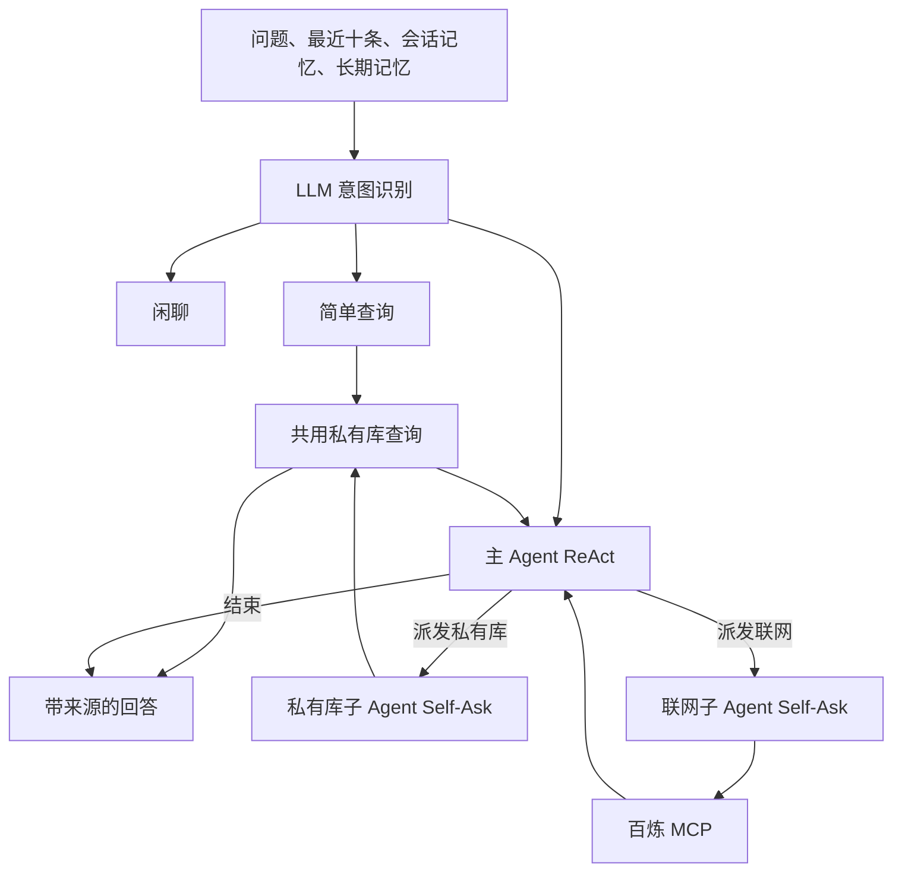
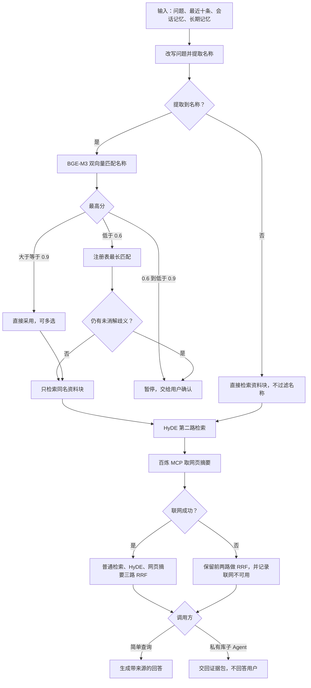
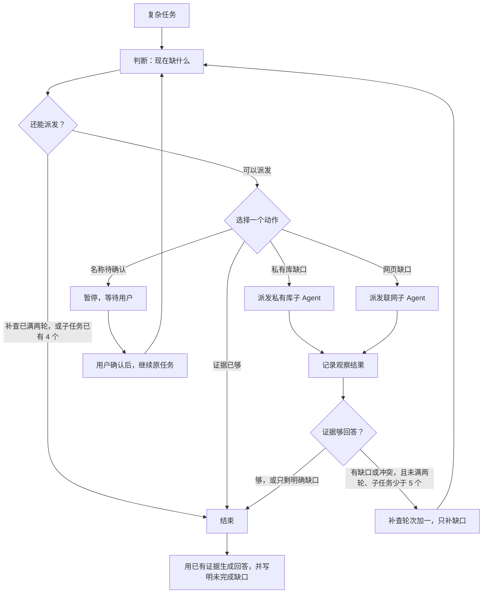
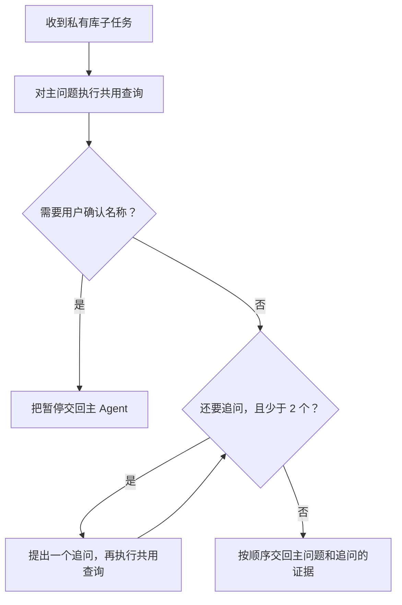
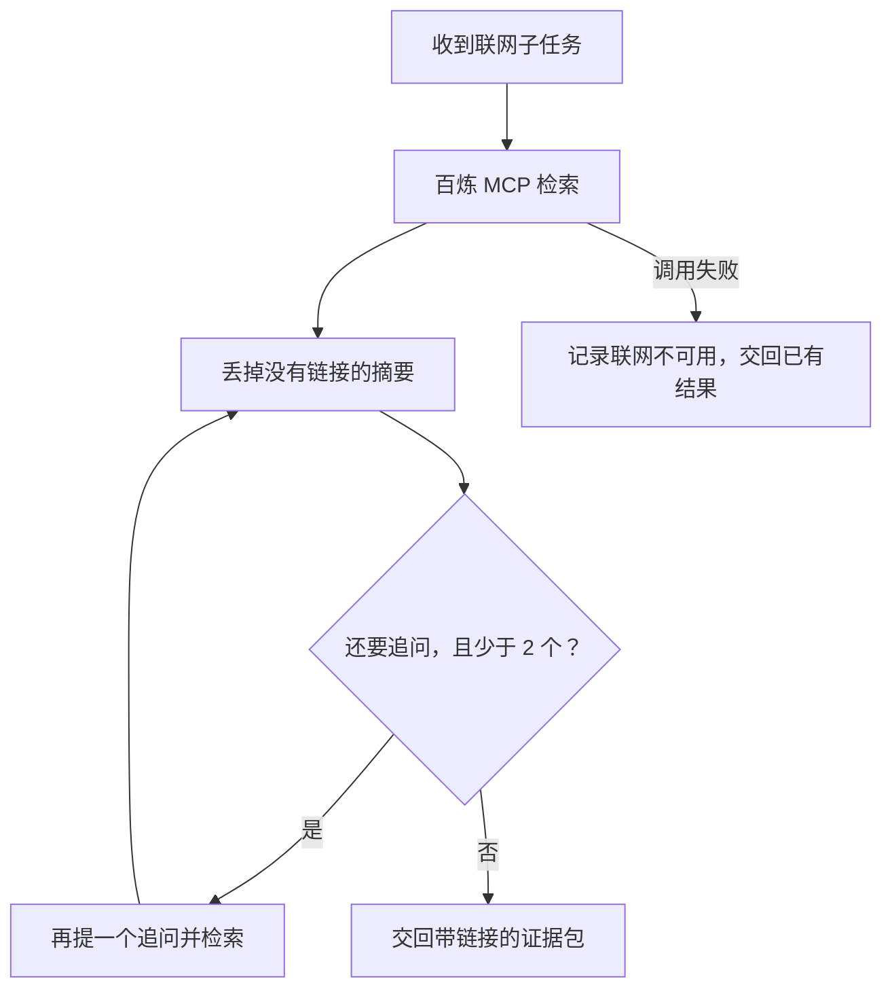

# 查询与双智能体设计

状态：草案。对应 [requirements.md](requirements.md)。本文写主 Agent、两个子 Agent 和共用私有库查询怎么落地。未改业务代码，也未运行测试。

## 1. 目标与已确认约束

| 目标 | 需求 |
|---|---|
| LLM 把问题分成闲聊、简单查询、复杂任务 | REQ-002 |
| 简单查询和私有库子 Agent 共用一条查询 | REQ-004、REQ-008 |
| 主 Agent 用 ReAct，补查最多两轮，子任务少于 5 个 | REQ-007、REQ-009 |
| 两个子 Agent 用 Self-Ask，每个子任务最多两个追问 | REQ-008 |
| 普通检索、HyDE、百炼摘要三路 RRF | REQ-004 |
| 回答必须带来源，网页必须带链接 | REQ-010 |
| 长期记忆只接受用户明确写入 | REQ-014 |

约束：不新增向量库，不把示例公司写进流程分支，子 Agent 不向用户发布最终回答。分数阈值与现有代码一致：`DIRECT_MATCH_THRESHOLD = 0.9` 且大于等于该值直接采用，大于等于 0.6 且小于 0.9 才确认。

## 2. 现有代码里可以复用的部分

技术栈继续用现有 Python、FastAPI、MongoDB、Milvus、BGE-M3、BGE-reranker-large、LangGraph 和百炼 MCP。不为本设计新增智能体框架包。ReAct 和 Self-Ask 都用现有 LLM 接口加明确的状态循环实现。

| 能力 | 现有位置 | 本设计中的用法 |
|---|---|---|
| 对话入口、待确认暂停、`session_memory` | `chat_service.py` 的 `ChatService.send` / `iter_events` | 主入口保留。名称确认继续写入 `pending_search` |
| 问答状态 | `state.py` 的 `ImportGraphState` | 简单查询继续用。每个子任务复制一份，并使用自己的 `task_id` 和 `local_dir` |
| 意图候选 | `search/query_plan.py` 的 `plan_question` | 只复用其中已经能确定的主体、期间和会话继承。三类意图改由 REQ-002 的 LLM 调用决定，不用这里的关键词分支代替 |
| 最长匹配、简称歧义 | `knowledge/registry.py` 的 `find_in_text`、`ambiguous_aliases` | REQ-006 直接调用 |
| 改写、抽名称、双向量名称检索、分档、多选 | `search/node_item_name_confirm.py` | 共用查询在提取到名称时调用。等于 0.9 走现有 `score >= 0.9` 的直接采用 |
| 按已确认名称检索同名资料块 | `search/node_search_embedding.py` 的 `retrieve_top5` | 有名称时的普通检索 |
| 无名称时的资料块检索 | `search/financial_retrieve.py` 里的混合检索调用方式 | 只复用“按问题检索资料块”的能力。无名称问题不先按 `item_name` 过滤。不复用它后面的整段金融入口 |
| HyDE 与第二路检索 | `search/node_search_embedding_hyde.py` | 原样复用。假设文本只进检索查询，不进事实 |
| 两路 RRF | `search/node_rrf.py` 的 `fuse_chunks` | 排序公式不变。扩展为第三路网页摘要，见第 4.4 节 |
| 百炼联网 | `search/node_web_search_mcp.py` | 共用查询和联网子 Agent 都调用。结果保留 `title`、`url`、`content` |
| 重排候选的组装方式 | `search/node_rerank.py` 的 `_candidates` | 三路 RRF 之后，如仍要做 BGE 重排，输入用已经融合的列表，不再把网页摘要额外拼一次 |
| 最终回答与归档 | `search/node_answer_output.py` | 只由简单查询的最后一步或主 Agent 的结束动作调用 |
| 证据状态与引用 | `search/evidence.py` | 复用支持、不支持、冲突、检索失败四类状态。其中写死示例机构名的数值正则不作为通用规则 |
| 子任务形状、依赖校验 | `research/planner.py` 的 `ResearchTask`、`validate_tasks` | 复用结构和循环依赖检查。数量上限改为小于 5。不复用 `build_tasks` 的财报槽位拆法 |
| 预算与租约 | `research/budget.py`、`research/runtime.py` | 主 Agent 每次动作前预留额度 |
| 并行分发 | `research/graph.py` 里的 LangGraph `Send` | 只复用“按任务分发、再汇合”。worker 本体改为第 6 节的 Self-Ask |

下面这些不当作查询过程继续扩展：

| 位置 | 原因 |
|---|---|
| `research/graph.py` 的 `worker` | 只在父级已经检索好的资料块里按名称子串过滤 |
| `research/facts.py` 的 `_FACT` | 正则写死了示例机构、年份和三个指标 |
| `research/memory.py` 的 `PreferenceBook.learn_from_messages` | 会从对话自动归纳偏好，与 REQ-014 冲突 |
| `node_rerank` 里“RRF 块和网页摘要到了重排才相遇” | 现在的网页摘要不进 `fuse_chunks`。目标是三路先做 RRF |

`search/workflow.py` 今天会把一部分金融问题送进 `_run_financial`，产品链则是普通检索、HyDE、联网、BGE 重排。目标是改成第 4 节这一个入口。

## 3. 总流程



| 模块 | 输入 | 输出 | 失败时 |
|---|---|---|---|
| 意图识别 | 问题、最近十条、两种记忆 | `chat` / `simple` / `complex` | 第二次仍无法解析则返回分类失败 |
| 共用私有库查询 | 一个问题、记忆、独立 state | 三路 RRF 结果、链接、名称决策、状态 | 连接失败返回 `retrieval_error` |
| 私有库子 Agent | 一个子任务 | 证据包，含最多两个追问 | 等待名称确认时暂停 |
| 联网子 Agent | 一个子任务 | 带链接的网页证据包 | MCP 失败写入 `web_search_error` |
| 主 Agent | 用户目标、证据包 | 下一个动作，或最终回答 | 满两轮补查或已有 4 个子任务时停止派发 |

闲聊继续走 `ChatService` 里现有的直接回答。

## 4. 共用私有库查询

新增一个函数作为唯一入口，供简单查询和私有库子 Agent 调用。内部只串联现有节点，不复制一套检索。



无链接的网页摘要在进入 RRF 前丢弃。等于 0.9 走“直接采用”。用户尚未确认时，流程停在“暂停”节点，不检索正文。

### 4.1 步骤

1. 组装上下文：最近十条消息、`session_memory`、REQ-014 的长期记忆。现有确认节点默认 `MONGO_HISTORY_LIMIT=50`，闲聊截取最近 30 条。这个入口改为十条，完整历史仍留在 MongoDB。
2. 调用 `node_item_name_confirm` 里的改写和名称提取。没有名称时不调用名称集合的 `hybrid_search_item_name`，把状态标为直接匹配资料块。
3. 有名称时走现有分档。大于等于 0.9 的名称写入已确认列表。待确认则返回 `awaiting_user`，函数在这里结束。低于 0.6 时调用 `find_in_text` 和 `ambiguous_aliases`。长名优先；剩余歧义同样返回 `awaiting_user`。
4. 普通检索：有名称时调用 `retrieve_top5`，过滤条件是已确认名称。无名称时按改写后的问题检索资料块，不过滤 `item_name`。
5. 调用 `node_search_embedding_hyde`。有名称时继续使用同一批名称。
6. 调用 `node_web_search_mcp`。异常时保留前两路结果，并写入现有的 `web_search_error` 文案。
7. 三路 RRF，见第 4.4 节。
8. 调用方决定下一步。简单查询进入第 4.5 节。子 Agent 把结果放进证据包后返回。

名称确认的暂停字段继续用 `awaiting_user_confirmation`、`item_name_candidates` 和 `item_name_confirmation_message`。复杂任务把这些字段、ReAct 已完成的动作和未完成的子任务编号放进 `pending_search`。用户沿用现有选择或否认接口后，只继续该子任务。

子任务输出目录沿用 `output/search/<conversation_id>/<request_id>/<task_id>`。现有节点要写 JSON 时，路径都指到这个目录。

### 4.2 无名称直接匹配

触发条件是名称提取结果为空，不是“向量分数低”。分数低仍走注册表。

这一支的检索文本是改写后的问题。HyDE 仍生成第二路文本。两路都不加 `item_name in ...` 过滤。用户打开联网搜索时，百炼摘要再和这两路一起 RRF；关闭时不调用百炼。

### 4.3 有名称的同名检索

已确认名称可以有多个。每个名称各自检索同名资料块，结果进入普通检索这一路。用户多选的每个名称都要保留，不能只留分数最高的一个。

### 4.4 三路 RRF

复用 `fuse_chunks` 的规则：每一路先按自己的顺序去重，同一条结果在同一路只贡献一次 `1/(60+名次)`。`RRF_K` 仍是 60。

第三路是网页摘要。身份优先用 `url`；没有链接的摘要直接丢弃，不参与排序，也不能进入回答。`title` 和 `content` 原样保留，供 REQ-010 输出链接。

```text
普通检索名次 + HyDE 名次 + 网页摘要名次
    → 同一条的 rrf_score 相加
    → 按 rrf_score 从高到低
```

现有 `node_rrf` 只读普通检索和 HyDE 两份 JSON。落地时给融合函数增加可选的第三路列表；两路调用保持原来的结果。不要把网页摘要留到 `node_rerank` 才第一次和私有库结果放在一起。

BGE 重排如果继续使用，输入是这份三路融合结果，避免网页摘要被计算两次。重排不改变来源字段和链接。

### 4.5 简单查询的回答

三路结果交给 `node_answer_output`。提示要求每个事实后面都能找到私有库字段或网页链接。缺少链接的网页句子不送进提示。HyDE 原文不送进提示。

## 5. 主 Agent：ReAct



初始拆分的轮次记为 0，不计入两轮补查。一次可以并行派发互不依赖的动作，每个动作一份独立 state。

主 Agent 是一个有界循环，不是新的模型产品。每一步的记录为：

| 字段 | 内容 |
|---|---|
| `thought` | 现在缺什么，为什么选下一个动作 |
| `action` | 下表四种之一 |
| `observation` | 子 Agent 证据包、用户确认结果，或空 |

| 动作 | 何时使用 | 结果 |
|---|---|---|
| `private_kb` | 缺口在已导入资料 | 启动一个私有库 Self-Ask |
| `web_search` | 缺口在外部网页，或需要链接核验 | 启动一个联网 Self-Ask |
| `ask_user` | 名称落在确认区间或注册表仍有歧义 | 暂停整次任务 |
| `finish` | 证据够用，或不能再派发 | 生成最终回答 |

循环规则：

1. 初始拆分从 `thought` 开始，可以一次派发多个互不依赖的动作。并行仍用 `Send`，每个动作一份 state。
2. 全部观察返回后做一次检查，区分 `supported`、`unsupported`、`retrieval_error`。冲突保留两侧，不覆盖。
3. 只有缺口或冲突才进入补查。补查轮次从 1 计到 2。初始拆分的轮次是 0。
4. `private_kb` 和 `web_search` 的累计次数小于 5。第 5 次动作不再执行，直接 `finish`。
5. 汇合键是 `(plan_revision, task_id)`。同一键两份不同内容视为冲突。
6. `finish` 只读取证据包和计算所需的已登记工具。资料正文里的指令不能增加动作种类。

现有 `validate_tasks` 的“超过 6 个即报错”在这个入口改为“大于等于 5 个即拒绝”。循环依赖检查保留。`build_tasks` 的公司槽位模板不作为通用拆法。

依赖沿用 `depends_on`、`required_slots`、`allow_partial`。上游是检索失败、无资料或冲突，且下游不允许部分完成时，下游标为 `blocked_by_dependency`，不能自己补数字。

## 6. 两个子 Agent：Self-Ask

私有库子 Agent 的主问题和追问都进入第 4 节的共用查询。



联网子 Agent 不提取名称，也不读私有库。



子 Agent 不调用主 Agent，也不能再 `Send` 出新的子 Agent。一个子任务内部的循环是：

1. 收到主问题。
2. 判断要不要一个追问。不需要则进入第 4 步。
3. 提出一个追问并检索。私有库子 Agent 对这个追问调用第 4 节。联网子 Agent 对这个追问调用 `node_web_search_mcp`。最多重复到两个追问。
4. 返回证据包。证据包里按顺序放下主问题的检索结果和每个追问的中间结果。

追问只在这个子任务内部可见。主 Agent 看到的是完整证据包，不是子 Agent 写给用户的文章。

联网子 Agent 不提取产品名，也不读 Milvus。它的每条结果必须带 `url`，否则该条丢弃。

名称确认发生在私有库共用查询内部。子 Agent 把 `awaiting_user` 交回主 Agent，由主 Agent 执行 `ask_user`。确认完成后，主 Agent 用原 state 继续该 Self-Ask，不重新提出已经检索过的追问。

## 7. 数据契约

### 7.1 证据包

| 字段 | 类型 | 说明 |
|---|---|---|
| `task_id` | 字符串 | 子任务编号 |
| `task_type` | `private_kb` 或 `web_search` | 来源 |
| `question_rewritten` | 字符串 | 主问题的改写结果 |
| `followups` | 最多两条 | 追问、中间检索状态、来源 |
| `confirmed_names` | 字符串列表 | 未经确认的候选不放这里 |
| `chunks` | 对象列表 | 三路 RRF 之后的结果，网页项含 `url` |
| `status` | 枚举 | `supported`、`unsupported`、`retrieval_error`、`awaiting_user` |
| `gaps` | 字符串列表 | 缺项 |

### 7.2 最终回答的来源

私有库项输出已有的 `file_name`、`item_name`，以及资料上的内容类型、产品代码和发布时间。没有这些字段时不补造。

网页项输出 `title` 和 `url`。`node_answer_output` 在归档前检查：除闲聊、无资料说明和检索失败说明外，回答中的每条事实都能对应到证据包里的一项。检查失败则去掉无来源句子；若因此没有事实，改用 REQ-010 的无资料说明。

### 7.3 长期记忆

新增用户级记录，和对话上的 `session_memory` 分开。字段只保留：用户编号、正文、来源、更新时间。来源只能是 `user_explicit` 或 `settings`。

写入入口有两个：对话里用户明确要求记住；个性化设置的保存。不调用 `PreferenceBook.learn_from_messages`。删除是物理删除或把该条标为删除后不再读出，后续查询两种结果相同。

查询时把尚未删除的正文附在改写上下文里。正文不参与工具白名单，也不能改意图标准。

## 8. 权衡与风险

- 共用查询包含一次百炼调用，简单问题会比纯私有库慢。这是为了让网页摘要和两路私有检索使用同一次排序。
- 私有库子 Agent 的共用查询已经会联网。主 Agent 仍可另派联网子 Agent，用来处理独立的网页追问。汇合时按 `url` 去掉重复网页。
- 子任务少于 5 个、补查两轮、追问两个，都会在证据还不全时停止。停止后的回答必须写出缺口，不能用模型补数。
- 旧稿 `docs/superpowers/specs/2026-11-04-multi-agent-financial-research-design.md` 里的公司研究 Agent 和行业 Agent 不作为本轮角色。预算、租约和按任务分发仍可复用。
- 回滚时把意图暂时固定为简单查询，只走第 4 节。回滚后的回答要说明没有执行 ReAct 补查。

## 9. 测试映射

不把现有测试结果写成已经满足本文。落地时按下面补测：

| 需求 | 测试 |
|---|---|
| REQ-002 | 替换 LLM 返回三类结果，断言路由；不调用 LLM 时分流失败 |
| REQ-004、REQ-008 | 同一输入走简单查询和私有库子 Agent，断言名称过滤、HyDE、百炼和三路 RRF 一致，子 Agent 没有最终回答 |
| REQ-004 | 无名称问题不调用名称集合检索 |
| REQ-005 | 0.6、等于 0.9、大于 0.9、低于 0.6；等于 0.9 不询问 |
| REQ-006 | 长名覆盖短名；示例以外的双主体简称必须追问 |
| REQ-007 | 第 5 个子任务被拒绝；第三轮补查不会开始；动作只有四种 |
| REQ-008 | 第 3 个 Self-Ask 追问不会执行；联网结果没有 `url` 时被丢弃 |
| REQ-010 | 最终回答的网页事实都有链接；无来源句子不会留下 |
| REQ-014 | 明确“记住”会保存；普通提问不会保存；删除后不再进入改写上下文 |

样本使用需求说明之外的机构或产品名称。`research/facts.py` 能匹配示例公司，不能当作这组测试通过。
