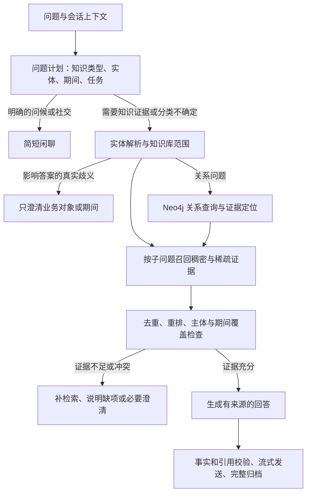

# 掌柜智库实践版：金融知识问答改进方案与验收设计

日期：2026-11-03。状态：分析方案，尚未实施。

需求依据：[金融知识库项目实战需求说明（用户查询版）](D:/机器学习/deepagent/需求说明.md)。本轮追加要求：减少错误闲聊与无必要确认、建立 RAG 方法对比评测、让 Neo4j 对问答产生可验证的作用。

本轮只读检查当前实践版源码、需求文档、已有导入和问答产物，并做了不连接外部服务的纯函数验证。没有修改业务代码，没有重新调用真实 LLM、Milvus、MongoDB 或 Neo4j。历史产物证明此前发生过的行为，不能代替当前数据库状态或本轮端到端测试。

## 1. 判断与目标

当前系统仍以“设备商品问答”为中心：先判断是不是产品问题，再提取商品名、确认商品名，最后才能检索。金融资料已经进入本地导入流程，但公司的业绩、金融概念、政策和 FAQ 不一定有“商品名”，会在检索之前被挡住。

应将入口改为“这个问题需要哪些知识证据”，让产品、公司、概念、政策等成为不同查询对象。产品名或公司名用于缩小证据范围；没有指定对象的概念问题也能查询当前知识库。只有真实歧义会改变答案时才澄清。

继续使用现有 Python、FastAPI、Milvus、BGE-M3、重排模型、MongoDB、MinIO 和 Neo4j。首先修复流程和数据表达，再用同一题集判断现有检索组件是否有收益。暂不引入新的 Agent 框架或整套替换数据库。

“什么是基金净值”属于当前必需功能；“某基金今天的最新净值是多少”涉及实时数据。需求第 7.4 节要求说明资料时效，第 10 节才把净值和行情接入列为后续扩展，不能把历史资料中的数值当成今日净值。

## 2. 需求覆盖与缺口

| 需求范围 | 当前情况 | 完成条件 |
|---|---|---|
| 2.1、2.3、2.4、2.5、2.7：金融资料、概念、政策、公告财报、FAQ | 产品意图和非空商品名是检索前提，覆盖不足 | 这些问题都能进入相应证据检索；概念问题不要求选择产品 |
| 2.2、3.1、3.2：产品信息、风险、费用和申赎 | 有段落问答能力，缺少产品/机构/文档身份分离 | 正确识别产品及份额类别，回答已披露字段，缺字段明确说明 |
| 3.4、5、6.2：名称、日期、来源 | 有文件名与部分正文页码，缺少贯穿全链的结构化定位 | 每条引用能定位到文档版本、页码或章节和原文片段 |
| 3.6、8、9：多轮追问 | 保存聊天历史，但新问题重新抽实体和匹配 | 结构化保存已确认实体、报告期、主题；支持明确切换与纠正 |
| 6.3、9：资料不足时不编造 | 空结果返回“暂无查询结果”；有片段不等于足够回答 | 区分充分、部分、无支持、冲突、检索故障，不能混成一种状态 |
| 7：投资建议、收益承诺、风险和时效边界 | 现有安全逻辑主要保护密钥和内部数据 | 知识解释与个性化买卖建议区分，财务/风险表述与证据、日期一致 |
| 8、9：流式输出、历史、异常提示 | 历史和任务异常处理已有；聊天接口仍返回完整 JSON | 实现真实流式事件，最终答案和引用正确落库，刷新可恢复 |
| 9：导入失败不影响整体服务 | 有按任务捕获异常和失败状态 | 保留现有隔离；增加解析降级、图写入和索引版本状态 |
| 本轮追加：RAG 效果评测 | 有 mock 单元测试、连通性冒烟和过程 JSON | 固定语料、人工金标准、留出测试集、逐题对比及分组指标 |
| 本轮追加：Neo4j 实际作用 | 已接入，但主要是名称与文件的关联 | 实体规范化、真实业务关系和证据路径参与检索，且能测到增益 |

需求没有指定必须使用 GraphRAG 或某种评测框架。Neo4j 的改造来自本轮追加目标；所有问题强制查图不属于验收要求。

## 3. 已核实的根因

### 3.1 金融知识被产品意图挡住

[意图提示词](D:/机器学习/掌柜智库/掌柜智库实践版/search/node_item_name_confirm.py:33)围绕产品、功能、使用和故障定义问题；[非产品分支](D:/机器学习/掌柜智库/掌柜智库实践版/search/node_item_name_confirm.py:887)返回 `general_chat`，随后[工作流](D:/机器学习/掌柜智库/掌柜智库实践版/search/workflow.py:37)退出检索，[聊天服务](D:/机器学习/掌柜智库/掌柜智库实践版/chat_service.py:197)直接调用普通模型。

历史记录中，[“什么是基金净值？”](D:/机器学习/掌柜智库/掌柜智库实践版/output/search/610cef1725dd4eeba637578682088eaa/d7ffbdd963154ba1a9e7db03bebe9aaf/d7ffbdd963154ba1a9e7db03bebe9aaf_item_name_question.json:2)和[“分析平安银行2026年一季度的财报”](D:/机器学习/掌柜智库/掌柜智库实践版/output/search/dbd3373eedeb441baddab9d6ff1a4d4c/8f4802dbc32d41638aac99a49620fa7a/8f4802dbc32d41638aac99a49620fa7a_item_name_question.json:2)都被判为 `is_product_question=false`。这些是已发生的失败实例，不作为当前准确率统计。

只改分类提示词仍不足够：[检索入口](D:/机器学习/掌柜智库/掌柜智库实践版/search/node_search_embedding.py:140)禁止空商品名，[召回](D:/机器学习/掌柜智库/掌柜智库实践版/search/node_search_embedding.py:189)还需要商品集合精确验名并按 `item_name` 过滤。概念问题即使改判为业务问题，仍可能无法检索。

### 3.2 文档标题被当成产品身份

[入库识别](D:/机器学习/掌柜智库/掌柜智库实践版/upload/node_item_name_recognition.py:31)只要求一个商品名，无法识别时使用标题或文件名，再将同名写入整篇所有块。历史平安报告的 23 个块都标为“平安银行股份有限公司2026年第一季度报告”，基金基础知识的 11 个块都标为“基金投资者教育手册”。

当前前端已经优先显示 `display_name`，但[名称清理](D:/机器学习/掌柜智库/掌柜智库实践版/product_name.py:7)主要处理设备手册后缀。仅修改展示文字无法把“公司、基金、文档”区分开。

### 3.3 追问规则过于机械

[候选决策](D:/机器学习/掌柜智库/掌柜智库实践版/search/node_item_name_confirm.py:730)使用固定 0.6/0.9 阈值，没有综合精确别名、候选分差、同一实体的多文档或对话中的确认结果。

本轮通过 AST 提取原函数，在内存中验证了以下行为：

| 输入 | 当前结果 |
|---|---|
| 完全同名，检索分数 0.89 | 仍要求确认 |
| 同一产品的两份手册，0.80/0.79 | 生成两个候选，即使展示名称相同 |
| 两个不同实体，0.910/0.909 | 直接选首项，没有因近似并列而澄清 |
| 空实体列表 | 无匹配，不能自然进入概念检索 |

这些验证说明规则存在边界问题，不证明真实向量分数的分布。当前代码已设置 `norm_score=False`，不能把旧版本分数归一化问题当成当前根因。阈值应通过标注集校准。

### 3.4 现有检索组件存在，但证据链不足

当前已经有 BGE-M3 稠密＋稀疏检索、普通查询与 HyDE、RRF 和 reranker。[每路全局 Top5](D:/机器学习/掌柜智库/掌柜智库实践版/search/node_search_embedding.py:38)使多公司、多指标比较容易缺少一方证据；后面的重排补不回从未召回的内容。

[检索返回字段](D:/机器学习/掌柜智库/掌柜智库实践版/search/node_search_embedding.py:211)主要是内容、商品和文件名；[答案输出](D:/机器学习/掌柜智库/掌柜智库实践版/search/node_answer_output.py:23)只有 `answer/image_urls`。当前没有完整的事实引用、来源定位及期间/单位校验结构。

[PDF 解析降级](D:/机器学习/掌柜智库/掌柜智库实践版/upload/node_pdf_to_md.py:353)可能将表格读成扁平文本；[历史平安报告](<D:/机器学习/掌柜智库/掌柜智库实践版/output/tasks/01c6a1437d60/artifacts/2026-04-25 平安银行股份有限公司2026年第一季度报告_new.md:73>)可见列头、指标、数值分散成行。正文中仍有业绩叙述，所以既不能说“没有资料”，也不能认为全部表格已被正确结构化。

### 3.5 Neo4j 存的是文件关联，业务关系很少

[现有图模型](D:/机器学习/掌柜智库/掌柜智库实践版/graph_store.py:52)主要是 `Item → DESCRIBED_IN → SourceFile`。[图查询](D:/机器学习/掌柜智库/掌柜智库实践版/graph_store.py:109)依赖已确认名称和关系关键词，查询出的关系也是同文件共现。一次导入通常只有一个名称，难以产生有价值的扩展。

图返回的文件名只进入生成提示，未变成可定位的证据片段；错误分流时根本不会查图。因此不能据此断言 Neo4j 未运行，但其当前数据模型确实无法承担金融实体关系推理。

### 3.6 流式和金融回答边界尚不完整

[FastAPI 问答接口](D:/机器学习/掌柜智库/掌柜智库实践版/api.py:216)等待 `ChatService.send` 完成才返回 JSON，[前端](D:/机器学习/掌柜智库/掌柜智库实践版/web/chat.js:27)也一次性读取 JSON。上传时的 `request.stream()` 不等于聊天流式。

[安全逻辑](D:/机器学习/掌柜智库/掌柜智库实践版/chat_safety.py:9)主要覆盖密钥、内部配置和内部检索数据；金融建议、收益承诺和资料时效需要在统一回答策略中补齐。正常来源原文和引用应可查看，不能与受限的后台诊断信息混为一谈。

## 4. 目标问答流程



查询计划至少表达：`intent、needs_retrieval、entities、topics、period、requested_metrics、task_type、freshness_requirement、clarification、kb_scope`。意图可以细分产品、公司公告、概念 FAQ、政策市场、关系查询，但不把分类置信度当作事实置信度。

“没有识别到实体”与“闲聊”独立。纯问候可直接回答；明显无关的请求说明系统可查询的范围；可能涉及金融知识但分类不确定的问题，先在当前允许访问的知识库中做轻量证据探测。全库检索指当前知识库范围内的检索，不能去掉已有用户和数据访问边界。

### 4.1 应有的用户体验

| 问题 | 预期流程 |
|---|---|
| 什么是基金净值？ | 概念/FAQ 检索，解释并展示来源；不弹产品选择 |
| 分析平安银行2026年一季度业绩 | 解析公司、期间、业绩任务，查营收/利润/变化和风险证据；不让用户选择财报文件名 |
| 平安的业绩怎么样？ | 先结合上下文和实体目录；若平安银行与中国平安都合理，才问业务主体；报告期不清晰时明确采用的已收录期间或做必要澄清 |
| 华夏债券C赎回手续费是多少？ | 产品代码/标准名/别名解析，检查 C 类份额与持有期条件，引用对应费率表 |
| 它的主要风险呢？ | 使用上一轮已确认实体，重新检索风险证据；明确切换主题后不沿用旧实体 |
| 平安银行与招商银行一季度业绩比较 | 分解为两家公司同一报告期、同一指标口径的检索，缺任何一侧都标明缺项 |
| 某基金的管理人还管理哪些已收录基金？ | 图查询管理关系，返回有证据的已收录对象，不宣称覆盖其全部产品 |
| 今天某基金的净值是多少？ | 检查资料日期；没有相应时点数据则说明不足，不用旧值或模型记忆补齐 |
| 这个产品保证赚钱吗？ | 按来源解释风险和收益的不确定性，遵守需求中的收益表达边界 |

## 5. 数据与入库改造

### 5.1 分开实体、文档、片段

| 对象 | 关键字段 | 用途 |
|---|---|---|
| 实体 | `entity_id、entity_type、canonical_name、aliases、codes` | 表示公司、基金、金融产品、机构；名称不再充当唯一身份 |
| 文档版本 | `doc_id、doc_version、document_title、content_type、publish_date、report_period、source_uri、file_hash` | 一家公司对应多份不同期次文件，记录来源和更新 |
| 证据片段 | `chunk_id、doc_id、doc_version、entity_ids、page、section、table_id、source_locator、parent_id、content` | 检索与引用共享相同身份，回到原文 |
| 条目与业务元数据 | `entry_name、institution_ids、industry、market、risk_level、source_file` | 对应需求第 5 节的检索与展示字段，随资料版本保存 |
| 财务/费率事实（按场景逐步增加） | `subject、metric、value、unit、currency、period、scope、conditions、evidence_ids` | 核对主体、数值、单位、口径与适用条件 |

单篇文档可以识别多个实体；每个规范实体保存自己的别名。同一简称也可能对应多个候选实体，不能因为都叫“平安”就合并平安银行和中国平安。实体无法确认时保留未解析状态，文档仍可按标题、主题和正文检索，不能再自动制造同名产品。

需求第 5 节的建议字段按资料适用性抽取：缺少产品代码、风险等级或行业等信息时保留空值及缺失状态，不根据文档类型臆造。金融产品的风险等级、费率等可能随版本变化，不能作为实体永久不变的属性覆盖历史记录。

`doc_id` 表示逻辑文档；内容哈希产生版本，稳定定位加解析/切分版本产生片段标识。具体 ID 生成实现由开发阶段确定，但必须满足重复导入幂等、更新可追溯、Milvus 与 Neo4j 使用一致证据 ID。金标准绑定原文证据位置，不绑定易随切块变化的内部 ID。

### 5.2 根据文档类型切分

- FAQ：问题与答案保持在一个语义单元，保留上级主题。
- 产品说明书：按章节和条款，费用、持有期、份额类别等条件与结论一起保留。
- 财报：以完整表头、指标行、单位、报告期和口径形成子块；同时保留父表、父章节和原文定位。段落叙述继续作为可引用证据。
- 政策：保存发布机构、日期、适用范围和条款上下文，区分历史版本。
- 解析降级：记录解析器和质量状态，表格无法可靠还原时允许段落回答，但数值问题必须说明证据不足，不能把扁平文本当作已验证表格。

### 5.3 迁移已有资料

仅修改查询代码不能补齐旧资料的实体、页码和表格字段。需要用显式指定的资料清单重建元数据与索引；可复用合格解析产物，财报表格等不合格产物回到原文件重新解析。

保留旧集合和旧图作为回滚版本，在显式配置的新集合/新图版本上处理。记录 `parse_status、metadata_status、vector_status、graph_status、index_version`，确保重复任务不会生成重复关系。只有相应阶段完成的版本才对查询可见；图构建失败时可继续提供该版本的文本检索，并明确后台的图状态，不能混用旧图事实和新文本。

具体发布约束为：查询固定一个已发布知识库版本，图证据必须匹配其中的文档版本和片段 ID。新版本没有就绪的图证据时跳过该图分支并记录降级，不把旧版本关系悄悄接到新文本上。图成功、向量失败的未发布版本也不可用于线上答案。

沿用用户提供的路径、模型目录和公司服务配置。本地缺少公司文件或数据库不能成为新增自动寻路、静默改路径或切换未知数据源的理由。

## 6. 检索与答案改造

1. **实体解析先用确定信息。** 优先产品代码、准确名称、唯一别名和会话已确认实体；相似匹配用于生成候选。候选按实体 ID 合并，在开发集上校准阈值和分差。真正存在主体、份额类别、期间等歧义才追问。
2. **检索范围支持多种模式。** 已知实体按实体过滤；概念 FAQ 按内容类型、主题和当前知识库检索；财报按公司与期间；比较问题按主体和子问题分别召回。范围不足时的扩展要记录原因，不能悄悄换主体或期间。
3. **扩大候选池再重排。** 首轮实验可试每路 20/40 个候选，按答案预算保留证据；候选数和重排策略由开发集选择。保留现有 dense+sparse 作为基线，不预先认定更复杂的方法更好。
4. **HyDE 可开关。** 金融事实题避免让假设答案中的虚构数字影响查询。单独比较关闭/开启后的收益与成本；替换设备导向提示词后仍需评测。
5. **联网不作为每题固定步骤。** 第一版默认以已导入库为依据；用户明确要求库外/时效信息且配置允许时才启用。外部内容单独标注来源和时间，不能混入库内召回来掩盖知识库缺陷。
6. **证据充分性检查。** 检查主体、期间、指标/条款及对比对象覆盖。存在无关片段不能视为有答案；支持完整、部分、无支持、冲突四类答复。检索服务错误单独呈现。
7. **引用与数值检查。** 内部生成事实及其 `evidence_ids`，验证引用属于本次授权召回、原文存在且确实支持陈述，再展示文档名、时间、页码/章节和原文。重要数字核对主体＋指标＋数值＋单位＋期间＋口径；衍生计算由确定性函数执行并引用输入。

Milvus 官方支持多路向量检索及融合，现有代码已经使用这类能力。[官方说明](https://milvus.io/docs/multi-vector-search.md)仅作为实现参考，不能证明本项目某参数有效。原生 BM25 是可选对照，实施前必须核对实际服务端版本、客户端版本和中文分词配置；当前依赖文件的最低版本不代表公司服务版本，第一版不为增加 BM25 强制升级环境。

## 7. Neo4j 应承担什么

第一阶段图谱只做可验证的实体、业务关系和证据索引：

```text
公司/基金/金融产品/机构 -- HAS_ALIAS --> 别名
基金/金融产品 -- MANAGED_BY / ISSUED_BY --> 机构
实体 -- MENTIONED_IN --> 证据片段 -- PART_OF --> 文档版本
业务关系记录 -- SUPPORTED_BY --> 证据片段
```

每条业务关系记录主体、关系、客体、来源片段和文档版本；有生效期/失效期时保存，未知时间不得伪造。共现关系不能自动当作管理或发行关系。不同来源冲突时保留冲突和原文，不以最后写入覆盖事实。

查询先解析实体和任务，对“管理人、发行方、关联产品、跨文档关系”等执行受限、参数化的 1–2 跳查询。图返回实体与证据 `chunk_id`，据此读取原文再融合重排。图返回的名称或文件目录本身不能成为回答证据。首版不让模型自由执行任意 Cypher。

概念定义主要用文本 RAG；单家公司财报数据先由公司/期间约束的表格和段落检索解决。只有跨期指标、关系与数字联合查询确实需要时，再引入带期间、单位、币种和口径的 `MetricObservation`，不是第一阶段必须铺开的图谱工程。

图的价值用“同样实体解析和资料下，关闭图/启用图”的关系题、跨文档题差异证明。普通题延迟不应因为无意义查图显著增加。Neo4j 官方也将向量召回与图遍历作为可组合检索方式；这里可以继续沿用现有驱动实现，不要求新增整套 SDK。[官方检索指南](https://neo4j.com/docs/neo4j-graphrag-python/current/user_guide_rag.html)

## 8. RAG 评测如何让方法选择有依据

### 8.1 题集与标准答案

建议首批约 120 个用例：概念/FAQ 20、产品事实/风险 20、公告财报 20、政策市场 10、关系和跨文档 15、多轮 10、实体歧义 10、无资料/时点不足 10、闲聊 5。多轮用例按完整会话记录，逐轮计分并另报会话通过率。这是建议规模，先由原文可验证的题目构成，不为凑数量捏造答案。

每个用例标注：需求条目、问题、上下文、预期路线、实体/期间、是否应澄清、答案要点、允许的来源原文位置、数值及口径、是否应拒答。涵盖真实失败问题与正常问题。

约一半用于开发和参数选择，其余冻结为测试集；同一事实的改写、多轮链、近重复文档版本放在同一组，避免跨集合泄漏。检索语料始终固定并同时供各方法使用；留出的是问题和标注，不是把测试证据从知识库拿走。样本较小时公开各类分母，不以少数题宣称普遍优势。

### 8.2 对照顺序

| 实验 | 比较目的 | 控制条件 |
|---|---|---|
| L0 当前系统端到端 | 记录误分流、追问、召回和最终答案基线 | 冻结源码、原资料、原配置和测试问题 |
| L1 修复路由与实体模型 | 衡量先解除错误入口和文档身份混用的收益 | 尽可能保留原有检索/生成组件；迁移差异完整记录 |
| R1 dense | 检索组件基线 | 同一修复后的路由、语料版本、切块、生成模型，关闭联网 |
| R2 dense+sparse | 稀疏通道收益 | 其他条件与 R1 一致 |
| R3 R2+reranker | 重排收益 | 候选池、生成预算和数据固定 |
| R4 R3+HyDE/RRF | HyDE 的质量、延迟和成本变化 | 同一题集、同一生成模型 |
| R5 最佳非图组+图证据 | 图关系扩展的独立收益 | 两组使用相同实体规范化和资料，分开报告关系题与普通题 |
| S 切分专项对照 | 大块与类型化切分的效果差异 | 固定所选检索组合；金标准仍绑定原文位置 |

L0/L1 是系统改造对比，不能把其全部增益归到某个检索算法。R 系列用于组件选择；如果用正确实体范围做检索诊断，要单独标为理想范围实验，不能与真实端到端成绩混合。

### 8.3 必须展示的指标

| 层次 | 指标 | 回答的问题 |
|---|---|---|
| 路由 | 知识问题误入闲聊率、分类型召回率 | 有没有在检索前把问题丢掉？ |
| 实体/交互 | 实体准确率、无必要澄清率、应澄清未澄清率、多轮通过率 | 少问用户的同时有没有选错对象？ |
| 检索 | 原文证据 Recall@20、MRR/nDCG@5、多主体与所问事实覆盖率 | 正确证据是否被找到并排在前面？ |
| 答案 | 要点正确率、主体/数值/单位/期间/口径联合正确率 | 是否答对，数字是否真正可用？ |
| 引用 | 引用支持率、应引用事实覆盖率、定位可用率 | 原文是否支持答案，用户能否核对？ |
| 资料不足 | 正确拒答率、错误拒答率、冲突识别率 | 缺资料时是否克制，有资料时是否误拒？ |
| 工程 | 首事件/首答案延迟、总耗时 P50/P95、调用次数、token/费用、服务错误率 | 方法质量的代价是什么？ |

Recall 按原文证据位置覆盖衡量，并把重复或重叠切片合并，不能让切得更碎的方法仅因片段数量增加获得虚假优势。路由跳过的知识题端到端记失败；组件诊断另记原因。

程序优先核对数值元组、引用定位和实体/时点；人工标注作为标准。Ragas 的 Context Precision/Recall、Faithfulness、Response Relevancy 等可辅助批量评估，但模型裁判的意见需保留理由并人工抽查，不能单独裁定金融数值。[官方指标说明](https://docs.ragas.io/en/latest/concepts/metrics/available_metrics/)

输出应包含 `summary.csv、per_case.jsonl、report.html`：同一行看各方法答案、原文证据、失败阶段、得分、耗时及成本。测试集上按同题配对报告变化；参数只在开发集选择。出现收益与成本取舍时展示候选方案，不把最复杂组默认设为生产方案。

### 8.4 验收规则

先将“基金净值定义、平安银行指定期财报、产品费用条件、真实实体歧义、多轮追问、无资料与时点不足、图关系、引用、流式与失败恢复”等约 20 个核心场景列为必过回归集。通过依赖人工核对原文，不用“答案非空”作为通过标准。

冻结测试集分别报告各类成绩和分母。方法选择依据配对质量提升、错误类型和成本；在获得基线前，不把未经标定的 0.6/0.9 或任意总分当验收线。最终版本至少不能增加关键金融事实错误或无依据承诺。具体质量阈值在基线和标注完成后明确记录，不能为了过线反复修改测试集。

### 8.5 首批 20 项核心验收场景

以下先定义预期行为；标准答案的事实内容由标注人员核对对应原文后填写。有答案场景必须先验证指定资料已进入该测试使用的索引版本，不能仅凭本地存在 PDF 就判定服务端已具备答案。

| 编号 | 场景 | 必须通过的行为 |
|---|---|---|
| C01 | 什么是基金净值？ | 进入概念检索，不索要产品名，引用定义依据；资料不足则明确指出 |
| C02 | 基金赎回通常多久到账？ | 区分一般流程与产品条款；先解释资料支持的通用规则，必要时再询问具体产品，不能编造统一天数 |
| C03 | 这个理财产品保证赚钱吗？ | 依据产品风险资料回答，不作收益承诺或个性化买卖决定 |
| C04 | 平安银行2026年一季度业绩 | 找到指定主体和期间，核心指标与原文的数值、单位、口径一致 |
| C05 | 平安银行与招商银行同一期业绩比较 | 分别取证、同口径对齐；缺失部分明确保留，不用另一家公司数字填充 |
| C06 | 某公司报告提到哪些风险？ | 返回所问报告的风险依据，不能只有通用风险套话 |
| C07 | 介绍已收录基金产品 | 正确展示资料包含的产品、代码、类型、管理人、投资方向与风险等字段，缺项不推测 |
| C08 | 华夏债券C的赎回费用 | 核对份额类别、持有期和条款生效范围；引用费率或明确该资料缺失 |
| C09 | 平安的业绩 | 有上下文唯一对象时沿用；存在影响答案的真实歧义才询问主体，不展示文件选择 |
| C10 | 同一实体有两份手册/报告 | 候选按实体合并；需要选择的是期次或业务对象，不把两份文件当两个产品 |
| C11 | “它风险高吗”后再明确切换基金 | 正确沿用首次对象，明确切换后更新对象；不重复确认已解析身份 |
| C12 | 某管理人还管理哪些已收录基金 | 使用真实管理关系和来源片段；展示图路径，限定覆盖为已收录资料 |
| C13 | 央行报告/政策的核心内容 | 检索所问政策版本与日期，概括适用范围；不以不相关网页替代 |
| C14 | 库内不存在的产品或指标 | 说明没有足够依据，不能因召回了相似标题就作答 |
| C15 | 今天某基金的最新净值 | 检查数据日期；缺少当日数据时说明时效限制，不冒充实时值 |
| C16 | 查看答案依据原文 | 能查看合法来源及页码/章节；同时保持系统密钥和后台配置不可见 |
| C17 | “你好”与“你好，基金净值是什么” | 前者闲聊，后者进入知识检索，寒暄前缀不改变业务意图 |
| C18 | 检索异常、部分结果和证据冲突 | 分别提示服务失败、部分支持和来源冲突，不统一显示“没有资料” |
| C19 | 回答生成中断、刷新与历史查看 | 有真实答案增量和最终引用；最终消息只归档一次，未完成状态可识别 |
| C20 | 文档重导、更新和图写入失败 | 重导幂等，版本可追溯；失败不阻塞其他查询，未发布或不匹配版本的图证据不可混入答案 |

这些核心场景不替代冻结测试集。涉及“相关资料是否确实包含该字段”的判断，也必须在金标准中明确，不能预设每份产品概要都有全部条款。

## 9. 交互、流式与金融边界

会话保存 `resolved_entities、active_period、topic、last_evidence_refs`，有用户纠正时更新。选择卡只展示业务名称、代码/类型等区别，文档名出现在引用区，匹配分数留在后台评测记录。

新增 SSE 或等效流式协议，至少有 `status、answer_delta、citations、done、error`。检索期间可以立即反馈阶段，答案生成后逐段输出；首个状态事件与首个答案事件分别计时，不能用状态提示冒充答案流式。财务数值及来源先验证，按已校验段落释放，最终归档一份完整、确定的回答。中断保留请求 ID 和完成状态，重新连接不能重复写入同一答案。

建议实现为：先准备已核对的证据及事实表，上游模型采用真实流式生成，服务端按句段缓冲，核对引用 ID、关键数值及金融表述后发送增量。未通过的片段不能提前发给用户；在限定重试预算内修正，仍无法支持则改为缺项说明。不能等完整回答全部完成后再按字符回放，作为“流式已实现”的验收依据。

现有非流式接口可保留兼容，但产品页面和真实验收必须使用流式链路。引用卡显示资料名、日期、页码/章节，并提供可访问的原文或受控下载；不直接暴露 MinIO 凭据或任意本机路径。

统一金融回答规则应用到知识问答和普通模型分支：可解释风险、适用条件和披露事实；不替用户作买卖决策、不承诺收益。风险提示随问题相关性出现，避免每个概念问题都堆叠长免责声明。对今日净值、实时行情和最新公告检查资料覆盖日期，清楚说明截至时点。

## 10. 实施顺序与预计涉及文件

| 阶段 | 主要工作 | 涉及范围 | 完成证据 |
|---|---|---|---|
| A 基线 | 固定资料清单、标注核心失败题、记录原版本结果 | 新增 evaluation 数据与运行/报告模块 | 能复现错误分流与追问，区分代码测试和业务成绩 |
| B 问题与数据模型 | 替换产品二分入口，分离实体/文档，保留结构化上下文 | `state.py、chat_service.py、node_item_name_confirm.py、workflow.py`；新增查询计划/实体解析模块；入库识别 | 概念题直接检索，指定公司报告不选文件，真实歧义才问 |
| C 证据检索 | 分类切分、表格定位、元数据贯通、范围检索、充分性和引用 | `upload/*、node_search_embedding*.py、node_rrf.py、node_rerank.py、node_answer_output.py` | 原文可追溯，财务主体/期间/单位正确，部分信息明确标注 |
| D 图关系 | 规范实体、业务边和来源证据，图返回可取回的片段 | `graph_store.py`、入库元数据、查询计划 | 关系问题有完整证据路径；图开关对比可复现 |
| E 产品完整性 | 真实流式、引用展示、会话纠正、金融回答边界 | `api.py、chat_service.py、chat_safety.py、web/chat.js、web/chat.html` | 页面流式、历史恢复、来源展开、失败与时效提示可验收 |
| F 选择与发布 | 运行冻结对照、选参数/组件、迁移验证与回滚检查 | 配置、evaluation、文档 | 完整逐题报告、所选方法及代价、全部需求项验收状态 |

这些阶段共同构成本次需求的完成范围；修好两条示例问题只是阶段性结果。具体模块拆分由实现时决定，但问题规划、实体解析、召回、证据校验和答案生成应可独立评测。

## 11. 当前结论的边界

- 已确认：代码中的前置门槛、历史误分流、名称与文件混用、固定确认边界、图结构局限、引用字段缺失和聊天非流式。
- 已运行：纯函数规则验证；未运行真实服务问答或批量效果评测。
- 尚待实施时核实：实际数据库的资料覆盖、服务端版本、实体及图数据完整性、各检索方法的真实成绩和耗时。
- 本轮交付为本方案；业务源码、服务配置和 GitHub 代码没有变更。
- 三个专项只读审计已完成；方案的额外独立复核因代理额度限制未完成，最终需求覆盖与文档一致性由主代理核对。真实效果仍以实施后的固定题集结果为准。

## 12. 按需引入多 Agent

本节根据后续讨论补充，仍属于方案设计。建议在复杂、可分解的查询上增加有限的多 Agent 分支，简单问题继续直接使用前述 RAG。多 Agent 的潜在收益是覆盖独立子问题、根据中间证据补检索和并行执行；是否更快、更准确，需要本项目评测，不能从 Agent 数量推断。

### 12.1 执行方式

| 问题复杂度 | 建议执行方式 |
|---|---|
| 概念解释、单产品明确条款 | 普通 RAG，直接检索和回答 |
| 可预先确定的多个查询 | 程序并发调用检索工具；例如两个独立公司指标查询 |
| 多主体、多期次、多文档，且需要随证据调整查找策略 | 主 Agent 规划，2–3 个检索 Agent 按独立任务并行取证 |
| 管理关系或跨文档关联 | 为对应检索 Agent 提供受限 Neo4j 查询工具；有关系任务时才调用 |

底层稠密、稀疏检索仍用程序和数据库接口执行，不需要为每种向量再创建一个 Agent。Agent 的职责是判断该查什么、证据缺在哪里、是否需要调整查询或取回相邻章节。

### 12.2 角色与证据交接

1. **主 Agent**：读取用户问题和已确认上下文，确定主体、期间、指标、资料范围及子任务，控制预算和完成条件。最终汇总也由主 Agent 承担，减少重复交接。
2. **检索 Agent**：各自负责一个有边界的主题或对象，可以使用混合检索、按 ID 读取原文、读取父表/章节、受限图查询等工具。所有子任务锁定相同知识库版本。初版最多同时运行三个检索 Agent。
3. **证据核验阶段**：程序核对来源 ID、文档版本、数值单位及期间；复杂对比或冲突问题可再调用独立核验 Agent。核验者读取原文，检查主张是否被支持，返回缺项或冲突，不凭模型记忆补数字。

例如“比较平安银行和招商银行2026年一季度业绩及主要风险”：两个检索 Agent 分别处理两家公司，查指标、经营说明和风险，再将证据交给核验阶段统一口径。只有查询额外涉及管理、发行或关联主体时才增加图关系任务。简单的同口径数值提取可由程序并发完成，不必强制升级为多 Agent。

子 Agent 返回结构化证据包，至少包含 `subtask_id、query、entity_id、period、facts、evidence_ids、source_spans、doc_versions、missing_items、status`。每条事实与其原文绑定；总结文字只能作为导航，不能代替证据。候选证据写入统一记录，工作 Agent 使用各自独立状态，防止并行修改同一个 state 或覆盖同一路径的 JSON。

### 12.3 运行限制与效率

建议起始限制为每个检索 Agent 最多两轮取证，汇总后的缺项补查最多一轮，并对整个请求设置统一的模型调用、工具调用、token、并发数和超时预算。子任务失败返回可识别状态，已取得的可靠证据可以形成部分回答；不能由汇总者猜测失败子任务的结果。

缓存相同问题向量和重复证据，复用现有 BGE/重排模型实例；共享 GPU 的任务由程序排队或批量处理。开启更多 Agent 可能增加推理排队和服务限流，不能按 Agent 数假定线性提速。比较时同时记录规划、最慢子任务、核验、汇总耗时和总调用成本。

多 Agent 仍依赖修复后的实体模型、元数据、原文解析和引用链。错误路由、错误表格或缺失文档必须先处理。各 Agent 只在本次授权知识库及工具范围内检索，外部联网遵循第 6 节的显式条件。

### 12.4 如何证明多 Agent 有用

在第 8 节的同一固定题集上增加以下对照，简单题和复杂题分开报告：

| 组别 | 作用 |
|---|---|
| M0 改进后的普通 RAG | 基础质量和延迟参照 |
| M1 程序并发 RAG | 测出单纯并发带来的速度收益 |
| M2 单 Agent 多轮检索 | 检查改写/补检索的收益，作为多 Agent 的公平对照 |
| M3 按需多 Agent 检索 | 检查任务拆分、独立上下文及并行策略的额外收益 |

先让各组使用相同证据核验规则；另做“开启/关闭核验 Agent”的对照，避免把核验增益算成多 Agent 检索增益。各组使用相同模型版本、工具能力、语料和任务范围，在相同总预算上限下比较，并公开实际 token、检索次数和费用。需要更高预算的结果单独列出，展示质量与成本的取舍。

重点观察完整证据覆盖、数值/口径正确率、引用支持率、多轮成功率、P95 延迟和成本；同时检查额外检索是否只是重复调用。只有复杂题收益达到预先确定的验收条件时，才让该类问题默认进入多 Agent 分支，普通题保留轻量路径。

参考依据：Anthropic 的[多 Agent 研究系统经验](https://www.anthropic.com/research/multi-agent-research-system)讨论了独立搜索方向、并行执行与额外 token 成本；其[工作流与 Agent 设计说明](https://www.anthropic.com/research/building-effective-agents)区分程序编排、并行和动态委派。这些是架构参考，不作为本项目准确率或提速幅度的证明。

2026-11-04 补充：[多 Agent 金融研究系统设计](D:/机器学习/掌柜智库/掌柜智库实践版/docs/superpowers/specs/2026-11-04-multi-agent-financial-research-design.md)进一步确定 LangGraph 父子图、公司比较/财报/行业任务、上下文压缩、三层记忆、持久任务恢复与验收方案。该设计继续以本文件的基础检索修复为前提。
