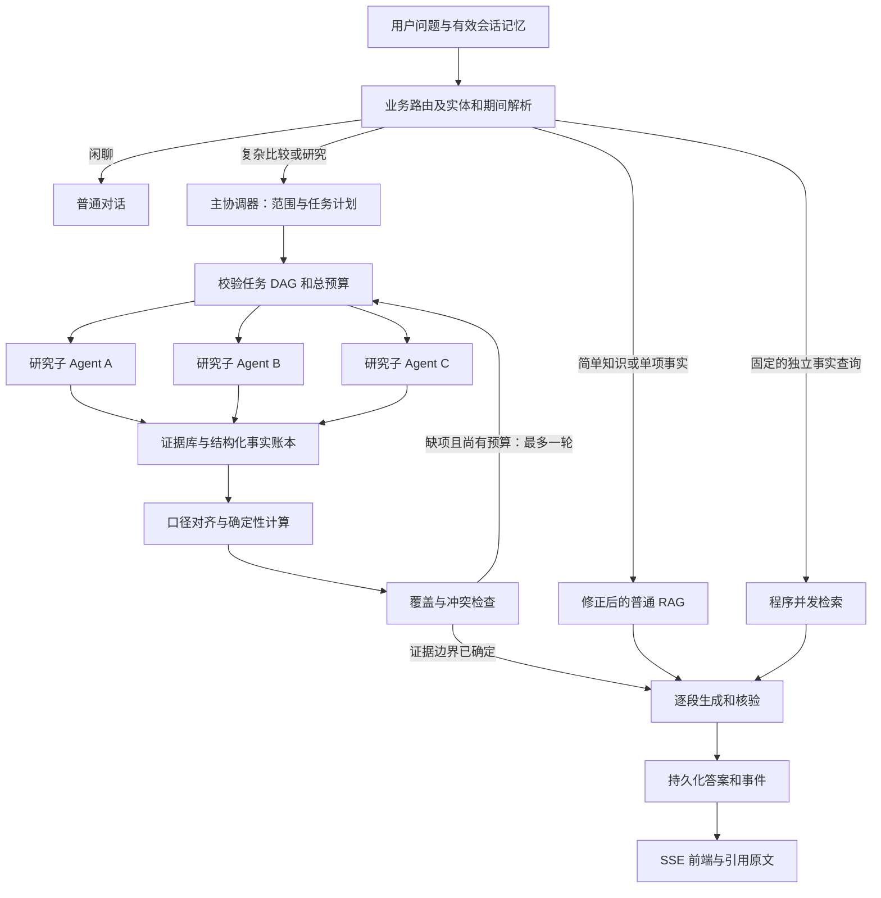
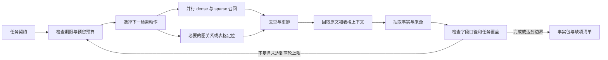

# 掌柜智库实践版：多 Agent 金融研究系统设计

日期：2026-11-04。状态：设计稿，尚未实施。

**目标：**在现有金融 RAG 之上增加复杂研究能力，支持两家公司比较、单家公司财报分析和行业分析，并保持简单问答的速度、连续对话体验和证据可追溯性。

**架构：**LangGraph 显式状态图 + 主协调器 + 按任务创建的研究子 Agent + 共享证据服务 + 确定性财务计算与核验 + 持久任务执行器。

**技术栈：**复用 Python、FastAPI、MongoDB、MinIO、Milvus、BGE-M3、重排模型、Neo4j 和现有模型供应商；增加 MongoDB checkpoint 适配及应用层任务、记忆、事件管理。

**需求依据：**[需求说明](D:/机器学习/掌柜智库/掌柜智库实践版/需求说明.md)及本轮复杂研究要求。工作区需求说明与之前提供的 `D:/机器学习/deepagent/需求说明.md` 的 SHA256 一致。基础检索改造继续遵循[金融 RAG 改进方案](D:/机器学习/掌柜智库/掌柜智库实践版/docs/superpowers/specs/2026-11-03-financial-rag-design.md)，本文细化其第 12 节。

**全局约束：**本轮只写设计；公司环境的路径、服务地址、模型与数据目录继续显式配置，不因为本机缺数据而增加扫描目录、猜测路径或静默替代数据的逻辑。实时行情和净值仍属于需求中的后续扩展。

**重点审查：**比较口径、事实与引用保真、任务预算、并发状态隔离、恢复幂等、记忆纠正和删除、行业资料覆盖、前端断线恢复。

---

## 1. 核心决策

| 事项 | 本方案选择 | 原因 |
|---|---|---|
| Agent 编排 | **LangGraph 自定义父图与研究子图** | 现有依赖已包含 LangGraph；需要明确控制分支、循环、状态与恢复 |
| 协作方式 | 主协调器统一面向用户；研究 worker 返回证据包 | 适合合并多个研究方向，减少重复检索和口径冲突 |
| Agent 数量 | 默认最多 3 个并发研究 worker，每次研究最多 6 个子任务 | 限制调用成本；任务数与并发数分别控制 |
| 自主程度 | 计划可由模型提出，执行必须通过任务契约和预算校验 | 能处理动态缺项，同时有可审查的停止条件 |
| 上下文压缩 | **证据外置 + 结构化事实账本 + 会话摘要 + 按需回取** | 数字、单位、报告期和证据位置需要精确保留 |
| 记忆系统 | **MongoDB 执行状态、会话工作记忆、显式长期偏好三层分离** | 复用现有存储，并能处理纠正、失效和删除 |
| Neo4j | 实体消歧、行业/集团/产品关系定位、带证据的路径检索 | 用关系补足检索范围；图上的关系必须能回到来源 |
| 运行方式 | FastAPI 受理；独立 worker 执行；MongoDB 持久化状态与事件 | 浏览器断线或 API 进程重启后可以继续恢复 |
| 用户输出 | 实时进度 + 按段校验后发布答案 + 原文引用 | 让用户知道进展，避免先展示未经核实的财务结论 |
| 效果判断 | 同一语料、同模型、相同总预算做配对评测 | 分清更多调用带来的收益与协作架构带来的收益 |

这是针对本项目的工程选择。多 Agent 的准确率和耗时收益需要实测；它依赖正确的实体、文档解析和检索基础。

## 2. 框架选择及版本边界

### 2.1 框架比较

| 框架 | 已核验能力 | 对本项目的判断 |
|---|---|---|
| **LangGraph** | 显式状态图、分支、子图、持久化、流式；不强制使用 LangChain 模型接口 | **主框架。**现有 Python 检索函数可逐步包装成节点；财务核验和有界循环容易明确表达。[官方概览](https://docs.langchain.com/oss/python/langgraph/overview) |
| **Deep Agents** | 在 LangGraph 上封装规划、子 Agent、文件系统及上下文管理 | 后续长篇开放研究可实验；首版直接控制证据、记忆和工具边界，避免同时引入另一层默认策略。[官方概览](https://docs.langchain.com/oss/python/deepagents/overview) |
| **OpenAI Agents SDK** | 支持 Agent 作为工具、交接及代码编排；可接其他模型服务 | 可行备选。当前项目已有 LangGraph，迁移收益不足；若采用，需要验证模型的工具调用、结构化输出、流式和 tracing 配置。[协作模式](https://openai.github.io/openai-agents-python/multi_agent/)、[模型接入](https://openai.github.io/openai-agents-python/models/) |
| **CrewAI** | 角色任务协作，Flows 提供状态、分支和持久化 | 本轮不选；需要额外对齐其任务和持久化抽象与现有 Mongo 记录。[Crews](https://docs.crewai.com/en/concepts/crews)、[Flows](https://docs.crewai.com/en/concepts/flows) |

首版采用开源 LangGraph 自行部署。LangSmith 云服务不是必需依赖；调试轨迹优先保留在项目自己的存储中。暂不另外引入 Mem0、Letta 或新的向量数据库，先实现下面定义的记忆契约。

### 2.2 本地已核验、公司环境待核验

2026-11-04 使用 `D:/python/python.exe` 查询包元数据，没有导入业务模块或连接数据库：

| 项目 | 本地结果 | 实施含义 |
|---|---|---|
| Python | 3.13.2 | 公司环境独立核验，不能直接据此决定部署版本 |
| langgraph | 1.2.11 | 可作为兼容性验证起点 |
| langgraph-checkpoint | 4.2.0 | 与实际 saver 组合测试 |
| langchain-core | 1.6.2 | 需要模型适配时再决定接入范围 |
| pymongo / fastapi | 4.19.0 / 0.141.1 | 不代表 MongoDB 服务端支持所需事务或部署方式 |
| neo4j / pymilvus 客户端 | 6.4.1 / 3.0.1 | 服务端版本及索引能力尚未验证 |
| langgraph-checkpoint-mongodb | 未安装 | 拟新增，安装前解析完整依赖并做隔离兼容测试 |
| deepagents / openai-agents | 未安装 | 首版无需新增 |

当前 [requirements.txt](D:/机器学习/掌柜智库/掌柜智库实践版/requirements.txt) 使用版本下界，不能保证另一台机器得到相同组合。实施时应锁定验证通过的依赖组合，记录 Python、客户端和服务端版本。本轮不安装、不升级依赖。

MongoDB 官方提供 `MongoDBSaver`；选它作为 checkpoint 基础实现，锁定版本后扩展其存储层以落实执行代次约束。长期偏好先用 PyMongo 的显式 CRUD，无需启用 Mongo 向量搜索。[MongoDB 集成说明](https://www.mongodb.com/docs/atlas/ai-integrations/langgraph/)

实施前必须验证：schema 校验、模型超时与真实流式、子图并发、Mongo saver 保存和恢复、checkpoint 序列化、现有模型服务的能力。官方文档可能对应新 API，应用层事件接口应与具体 `stream` / `astream` / `stream_events` 版本解耦。

## 3. 与现有项目的关系

当前入口是 [api.py](D:/机器学习/掌柜智库/掌柜智库实践版/api.py:216) → [ChatService](D:/机器学习/掌柜智库/掌柜智库实践版/chat_service.py:305) → [search/workflow.py](D:/机器学习/掌柜智库/掌柜智库实践版/search/workflow.py:37)。聊天链仍按普通 Python 函数顺序执行，不能因为安装了 LangGraph 就认为已经具备多 Agent 编排。

| 现有缺口 | 对复杂研究的影响 | 前置改造 |
|---|---|---|
| 产品意图和商品名仍是检索入口条件 | 公司财报、概念或行业问题可能直接进入闲聊 | 业务知识路由，实体可选；不确定时做低成本知识探测 |
| 公司/产品身份与文件标题混在一起 | 同一公司多个报告变成多个候选“产品” | 独立实体目录、别名、文档和版本 ID |
| 已有 dense+sparse、HyDE、RRF 和重排，但元数据不足 | 多次搜索仍可能取错期间、主体和表格列 | 完整 metadata、按任务过滤与覆盖约束、表格结构恢复 |
| 图主要是名称—文件关系 | 无法支撑行业集合、集团边界和来源路径 | 建立有来源、有有效期的业务关系 |
| 历史截取与进程内锁 | 长对话容易遗忘，多进程恢复缺乏保证 | 会话工作记忆、持久任务租约和 checkpoint |
| API 等完整 JSON 后返回 | 复杂任务等待时间不可见 | 持久进度事件与 SSE |

上述细节和源码依据见基础 RAG 方案第 3 节。新系统应复用修正后的检索服务；worker 不直接调用依赖共享 `ImportGraphState`、会写最终聊天消息的旧完整问答链。

## 4. 总体架构与问题分流



分流依据是需要完成的工作，不能只看问题长短或出现几个公司名：

| 例子 | 路径 | 决策依据 |
|---|---|---|
| “什么是基金净值” | 普通 RAG | 概念解释，不需商品确认或多 Agent |
| “平安银行某年营收是多少” | 普通 RAG + 指标抽取 | 单主体、明确期间、单事实 |
| “分别列出两家公司某年营收” | 程序并发 | 已明确两次独立检索，无需动态研究计划 |
| “比较两家银行的盈利能力、资产质量和风险” | 多 Agent | 多维证据、口径对齐、缺项补查与解释 |
| “分析某公司财报，利润和现金流为何背离” | 多 Agent | 报表、附注、业务解释之间存在依赖 |
| “分析银行行业经营变化和风险” | 多 Agent | 需要定义行业范围、样本覆盖和多来源归纳 |

前端提供“自动 / 快速 / 深入”模式，默认自动。快速模式可返回已核实的有限范围；深入模式使用明确预算。用户不需要知道子 Agent 数量。

存在会改变答案的歧义才追问，例如“平安”同时可能指集团或银行且上下文不足。展示公司/产品规范名称和业务差异；多个文档属于同一实体时直接按期间和版本检索。不得让用户从内部文件名列表中替系统选资料。

未指定期间时：公司比较默认取知识库中双方均有资料的最近完整年度，并在开头声明；单公司财报按库内最新可用报告声明期间；行业研究先给出可用资料范围。用户指定期间优先。没有共同期间时，分别列示缺口，不擅自混用年度和季度数据。

## 5. 多 Agent 内部架构

### 5.1 角色与权限

Agent 角色表示有独立任务和上下文的模型循环，不代表必须使用不同模型或常驻进程。首版沿用已配置模型，通过统一适配层调用；是否给规划/核验配置更强模型由评测决定。

| 组件 | 职责 | 可调用工具 | 输出与边界 |
|---|---|---|---|
| 主协调器 | 确定范围、拆任务、检查覆盖、安排一次补查、组织报告 | 资料清单、实体解析、调度、读取结果 | 唯一面向用户的协调角色；不凭子 Agent 文本直接认定事实 |
| 公司/财报研究 Agent | 获取某主体的指标、附注和业务解释 | 混合检索、原文/表格回取、指标抽取、关系查询 | 结构化事实、相关解释、缺项和冲突 |
| 行业/政策研究 Agent | 分析限定行业、业务链条、政策和风险资料 | 行业目录、关系路径、检索、原文回取 | 来源日期、适用对象、样本与行业范围限制 |
| 交叉核验节点 | 检查证据支持、遗漏和矛盾 | 读取原始证据、规则核验；必要时独立模型核验 | 通过/待补/冲突及对应 claim ID，不以多数投票替代证据 |
| 计算服务 | 单位换算、同比、占比、可比数据表 | 白名单公式和 Decimal 运算 | 保存公式、输入事实 ID、舍入规则；不接收任意代码执行 |
| 报告生成节点 | 将已核实事实表达为用户可读答案 | 读取证据包与计算结果 | 事实、解释、推断、缺口分开表述；不再自由扩大搜索范围 |

研究 worker 共用一套子图，通过 `task_type` 加载财报、公司比较、行业等任务模板。避免为每家公司永久维护一个 Agent。worker 无权派生新 worker、修改知识库、写长期记忆或直接发布用户答案。

### 5.2 父图执行步骤

1. **接收与定界：**加载本次问题、有效纠正、主体/期间、资料授权范围和 KB 版本清单。
2. **规划：**输出结构化任务 DAG、必答项、依赖、完成条件和范围假设；禁止循环依赖、重叠任务和无上限遍历。
3. **预检：**验证实体存在、所需期间是否有资料、剩余预算和工具权限。缺材料不是网络错误，不做相同请求的机械重试。
4. **调度：**只分发依赖已完成的任务，单 run 最多 3 个并发研究 worker。主图用 `Send` 分发独立输入，结果按 task ID 合并。[Send 官方说明](https://docs.langchain.com/oss/python/langgraph/graph-api-send-command)
5. **合并：**去除同源重复证据，检查同一指标的主体、期间、单位、口径与版本；保留冲突两侧证据。
6. **覆盖检查：**按“对象 × 期间 × 必答项”核对；只为缺项或冲突创建一次补查批次，补查也占总任务/调用预算。
7. **收敛：**确定充分、部分、无支持或冲突状态；可完成部分先写清楚。预算不足时停止研究，保留生成与落库额度。
8. **生成核验：**按报告章节组织 claim，规则核验后按需使用独立模型检查支持关系；失败段落最多修订一次。
9. **完成：**统一保存答案、引用和结束事件，更新会话工作记忆，释放运行租约。

并发结果通过确定性 reducer 合并，键为 `(plan_revision, task_id, result_version)`；同一键且内容哈希不同应报冲突，不能使用“最后写入者覆盖”。规划、摘要和最终结论由单一协调节点更新。

每个依赖边还要声明 `required_fact_slots` 与 `allow_partial`。上游结束不等于证据合格：必需事实齐备且核验通过才允许启动相应计算/结论任务；仅允许部分输入的任务可显式带缺口继续。上游失败、无支持或冲突导致必需依赖不满足时，将下游标记 `blocked_by_dependency` 并向父图报告缺项，不能无限等待，也不能自行补数字。所有任务已结束或被阻断且无可运行任务时，父图进入部分回答/失败收敛流程。

### 5.3 研究子图



子图使用 **per-invocation** 隔离：每次任务启动独立上下文，调用内继承父图 checkpoint；不共享一个跨调用累积消息的子 Agent。LangGraph 官方区分这种模式与跨调用保留状态的模式，并说明后者存在同一子图并行调用的 namespace 冲突风险。[子图说明](https://docs.langchain.com/oss/python/langgraph/use-subgraphs)

worker 能根据证据选择改写检索词、读取表格或检查附注，这部分是 Agent 的自主搜索。已确定的多路召回、重排、计算和格式检查用普通程序执行。HyDE 作为可开关的召回策略，生成的假设内容绝不能进入事实账本。

模型动作协议统一为经 schema 校验的 `action(tool_name, args)` 或 `finish(result_ref)`。首版默认使用经过验证的结构化 JSON 协议，保留现有 requests 接入；原生 tool calling 通过能力测试后可按配置启用。执行器分配稳定调用 ID，验证工具白名单、参数、资料范围和预算后执行，再按调用 ID 回填结果。`finish` 只能引用本任务已保存的结果，不能绕过事实核验。未经动作协议和流式能力验证的备用模型不得自动接管研究循环。

## 6. 三个业务场景的任务设计

### 6.1 比较两家上市公司

示例：“比较平安银行和招商银行同一年度的盈利能力、资产质量和经营风险。”

| 阶段 | 任务 | 关键约束 |
|---|---|---|
| 主协调器 | 识别两个上市主体，确定共同年度、合并口径和维度 | 集团、上市公司、子公司不得混用 |
| 并行任务 A/B | 分别提取两家公司的业绩指标、业务说明、风险及证据 | 使用同一指标模板和期间；每个主体都需要独立证据 |
| 可选任务 C | 检索共同政策背景或关键指标定义 | 仅在用户问题确实需要时创建 |
| 对齐与计算 | 构建比较表、校验币种单位、核对指标定义 | 定义不同的指标标记不可直接比较，不强行排序 |
| 补查 | 查缺失项、重述数据或相互矛盾的披露 | 只查缺口，避免双方重复研究 |
| 报告 | 先列比较结论与表格，再说明差异、证据、限制 | “经营差异”有证据；不生成买卖建议 |

验收重点：双方覆盖完整；同比用各自可比基数；单季度与累计、报告披露值与自行计算值分开；不把较高净利润直接等同为盈利能力更强。跨行业公司比较先说明可比维度，行业特有指标分别展示。

### 6.2 分析一家公司的财报

示例：“分析某公司年度财报，解释利润、现金流和主要风险。”

默认并行三个方向：

1. **经营与利润：**收入、利润构成、分业务变化、重要变动解释及其披露依据。
2. **资产负债与现金流：**资金和债务结构、经营现金流、营运资本等；根据行业选择指标模板，银行不能机械套用制造业指标。
3. **附注与风险：**审计意见、会计政策、重述、一次性项目、关联交易、或有事项及风险段落。

主图等待必要证据后再进行跨报表分析。“利润增长而经营现金流下降”可以是数据事实；其原因只有附注或其他证据支持时才表述为已披露原因，否则明确标为待验证解释。报告没有附注、现金流表解析失败或缺上年基数时，只回答已覆盖部分。

“本季财报”以披露资料为限。没有完整年度附注时不能用旧年附注伪装成当前报告内容。由累计数相减推算单季时，需要可比会计口径，并明确标注推算及输入来源。

### 6.3 分析一个行业

示例：“分析银行行业的经营变化和主要风险。”

先冻结市场范围、分类体系及版本、研究期间、样本名单和资料截至日。任务分为：

- **行业与政策：**行业定义、业务链条、政策变化、供需或宏观因素，保留资料日期和适用范围。
- **企业证据：**从目标集合获取可比经营指标；按数据量分批，每批构成有限子任务。
- **风险与反例：**检查风险披露、差异公司和相反证据，避免仅收集支持某个结论的材料。

建立 `公司 × 期间 × 指标/风险主题` 覆盖矩阵，报告至少列出：目标企业数、有资料企业数、具有可比数据的企业数及主要缺项。行业完整名单未知时写“覆盖范围未知”，不构造覆盖率；仅有几家导入企业时标题标为“已收录企业样本分析”。

行业汇总需明确公司集合、是否有集团重复、等权/加权方法、权重日期、缺失处理和分母。行业全貌缺证据时，输出样本发现与缺口。样本外推、因果判断和未来情景必须标明证据限制。

跨期趋势优先使用固定的共同可比样本，同时单列新增/退出和缺失样本、各期实际参与公司数与权重覆盖；逐期样本不同的汇总不能直接解释成行业经营变化。指标模板登记存量/流量/比率类型和允许的聚合公式。比率汇总先说明采用“分子合计/分母合计”还是企业比率的加权平均；只有分子分母定义一致且资料齐全时才做汇总比率，否则展示明确命名的样本均值或分布。不同定义不得混用，缺失值不能按零处理。

## 7. 数据契约与事实账本

### 7.1 必须稳定的 ID

- `run_id`：一次用户研究请求；`conversation_id`：对话；`answer_id`：该次请求的答案记录。
- `plan_revision`：问题范围或计划修订版本；`task_id`：逻辑子任务；`attempt_id`：执行尝试。
- `entity_id / doc_id / doc_version / chunk_id / evidence_id / fact_id / claim_id`：分别对应实体、文档、版本、片段、证据、事实和答案声明。
- `kb_manifest_id`：冻结本次可读取的文档版本、实体目录、向量索引和图版本的清单。

证据 ID 由文档版本和来源位置等稳定字段生成；显示用的文件名不作为身份。大文件与原表存 MinIO，Mongo 存元数据、内容哈希和对象引用。

### 7.2 任务与结果契约

```text
ResearchTask
  task_id, plan_revision, task_type, objective
  entity_ids, period_scope, knowledge_cutoff_at, vintage_policy
  metric_scope, required_slots
  depends_on, kb_manifest_id, source_policy
  budget_allocation, deadline_at, expected_schema_version

WorkerResult
  task_id, plan_revision, result_version
  status: sufficient | partial | unsupported | conflict | failed | cancelled | blocked_by_dependency
  fact_ids, evidence_ids, derived_fact_ids
  covered_slots, missing_slots, conflicts, tool_errors
  short_summary, actual_usage, stop_reason
```

身份、租户/用户作用域、许可工具、资料授权和预算上限由服务端注入，模型不能通过生成字段自行扩大权限。`short_summary` 仅方便组织答案，不独立作为证据。

### 7.3 事实与计算契约

```text
Fact
  fact_id, entity_id, metric_id, metric_definition
  raw_value, normalized_decimal, currency, unit, scale
  period_start, period_end, period_type, as_of_date
  consolidation_scope, accounting_basis, restatement_status
  fact_type: extracted | calculated | user_asserted
  status: verified | unresolved | superseded
  evidence_ids, extraction_method, validation_results

Evidence
  evidence_id, doc_id, doc_version, source_type, publish_date
  available_at, effective_from, effective_to
  page, section, table_id, row_header, column_header, source_span
  content_hash, raw_object_ref, parse_quality, access_scope

Calculation
  formula_id, formula_version, input_fact_ids
  normalization_steps, rounding_rule, output_fact_id, warnings
```

数值按 Decimal 字符串保存，原值与标准化值都保留；单位转换通过程序完成。同比遇到零基数、负基数或重述口径时使用明确的适用规则，不能随意输出误导性的增长率；百分比变化与百分点变化区分。币种换算必须有带日期的汇率证据，否则分币种列示。

`period_scope` 表示研究的经营期间，`knowledge_cutoff_at` 表示允许知道资料的最晚时点，两者独立。`vintage_policy` 区分 `latest_restated`（回顾性使用适用的最新重述并注明）与 `as_known_at`（仅使用当时可知版本）。默认研究用当前已收录资料并声明截至日；若用户问“在某历史时点如何判断”，只采用截至该时点已发布且可用的版本，不能引用后来披露的重述信息。`available_at` 记录来源可知时点及其依据，系统导入时间另存；可知时点无法确认时，不把该来源当成可靠的历史时点证据。政策还需记录生效/失效日期，不能仅根据发布日期判断其当时是否适用。

`verified` 表示通过指定的来源/字段/口径检查，不代表已经证明外部披露绝对真实。抽取置信分与来源事实支持分分别记录。原始表头缺失、OCR 不可靠时应回查原表；无法核实的数值保持 `unresolved`。

## 8. 共享检索与 Neo4j 子系统

### 8.1 工具接口

| 工具 | 输入重点 | 输出重点 |
|---|---|---|
| `resolve_entities` | 名称/代码/会话中已确认主体 | 规范实体、真实歧义、候选业务信息 |
| `list_available_sources` | 实体、期间、类型、KB 清单 | 可用文档及版本、解析质量、覆盖缺口 |
| `search_evidence` | 子问题、实体/期间/类型过滤、检索预算 | 原文候选及证据 ID，保留召回通路和分数 |
| `fetch_evidence` | 证据 ID、需要的上下文范围 | 原文、表头、注释和精确来源位置 |
| `query_relations` | 实体、允许关系、有效日期、跳数上限 | 关系路径、各边证据和对应实体/文档 ID |
| `extract_metrics` | 表格/片段引用、指标模板 | 待校验事实，明确缺列/缺单位等问题 |
| `calculate_metrics` | 公式 ID、输入事实 ID | 可复核的计算结果与警告 |

工具统一返回 `status、data_ref、evidence_ids、usage、error_code、retryable`。权限过滤先于检索；返回前再次核验文档授权与删除状态。子 Agent 不能执行任意 Cypher、SQL、shell 或 Python；关系查询和计算采用白名单模板。

### 8.2 检索内部流程

1. 依据任务和元数据确定可查文档范围；不要求概念问题必须有实体。
2. 并行执行现有 BGE-M3 dense/sparse 召回，按实验配置使用融合、改写或 HyDE；保持每路来源信息。
3. 必要时使用图扩展得到补充实体/文档 ID；扩展有关系类型、有效期、跳数和数量上限。
4. 去重、融合、重排，同时确保必答对象与维度不会被某份高相似文档挤掉。
5. 回取原文邻接段、表头、单位和附注，形成证据包；不能只给模型孤立的表格单元格。
6. 抽取与校验事实；缺证据时返回明确缺项，交给 worker 决定下一次有目的检索。

候选数、重排阈值和保留数量由开发集调优，不能直接沿用当前所有任务全局 Top 5。BGE 和重排模型使用共享推理服务/进程池与有限 GPU 队列；worker 不各自重复加载一套模型。多个 worker 的向量化和重排可批处理，但必须维持权限与任务映射。

### 8.3 Neo4j 的真实职责

最小图模型：`Company、Product、Institution、Industry、Report、Evidence`；关系如 `ISSUED_BY、MANAGED_BY、SUBSIDIARY_OF、BELONGS_TO、REPORTS_ON、SUPPORTED_BY`。行业分类、公司更名及控股关系均带有效日期和来源。

图优先用于：名称消歧、公司与集团边界、行业企业集合、产品管理关系、跨文档证据定位。金融指标的权威结构化记录先在事实账本，是否进一步入图按查询需求决定。

每条业务关系带 `evidence_ids、valid_from/to、doc_version、status`；同一文件里出现两个名称只代表共同出现，不能直接生成管理、控股或竞争关系。多跳推断保留整条路径需要的证据组；丢失中间边证据时，不得继续输出完整关系结论。

图与向量索引采用同一个发布清单。导入阶段分别记录解析、向量、图构建状态；图构建失败时可发布明确的“仅文本可用”能力状态。某任务使用该版本时允许文本检索，禁止静默拼接旧图关系。发布新版本后，已有任务仍读取原快照；权限撤销和删除可使原快照失效，届时应报告并停止相关引用。

## 9. 上下文压缩策略

### 9.1 选择与边界

采用四种组合：**大输出外置、选择性回取、结构化摘要、子 Agent 上下文隔离**。这与官方介绍的按需上下文、压缩和结构化记录思路一致；金融事实保护规则属于本项目定制设计。[上下文工程参考](https://www.anthropic.com/research/effective-context-engineering-for-ai-agents)

| 上下文层 | 内容 | 处理方式 |
|---|---|---|
| 固定约束 | 当前问题、有效纠正、主体/期间/口径、必答项、未解决冲突、权限 | 必须保留；信息太多时分阶段，不静默裁掉 |
| 当前工作集 | 本子任务相关事实、必要原文、最近 2–4 轮相关对话 | 按 token 预算装入，原文与事实相互链接 |
| 结构化摘要 | 已完成任务、范围假设、用户选择、待办、事实引用 | 有版本、有源消息 ID，不代替原始证据 |
| 外部材料 | 全文、原表、长工具输出、已完成的检索过程 | 存 MinIO/Mongo，模型只拿摘要和可回取 ID |

不采用直接截取末尾 N 字符作为主策略，也不将整份财报反复塞给每个 Agent。纯文本压缩算法如日后加入，必须单独验证数字、表头、否定条件和风险条款的保真度。

### 9.2 预算与触发

每次模型请求前计算：

```text
可用输入 B = min(应用输入上限, 模型总窗口 - 最大输出预留 - 安全余量,
                 供应商独立输入上限[如有])
占用 T = 系统说明 + 工具定义 + 历史 + 摘要 + 证据 + 当前问题
```

根据实际模型 tokenizer 估算，回填供应商真实 usage 校准；没有适配 tokenizer 时保守估算并扩大余量，不把字符数当精确 token 数。模型切换后重新计算预算。

试运行阈值：`T > 0.8B`，或下一工具输出预计使其超限时触发整理，目标降至约 `0.6B`。优先删除重复候选和已完成任务的过程，再选择本轮相关证据，最后压缩旧叙述。整理成本也计入全局预算。阈值属于实验初值，须用中文财报和长对话评测。

worker 输入上限初值 12k token，汇总节点 24k，单 worker 摘要约 800 token；实际还受模型窗口和总预算约束。大事实表以引用存储，汇总时按章节/指标批次回取，不能通过截断最后一家公司来满足长度限制。

### 9.3 防止压缩改变事实

1. 账本中的数字、单位、币种、报告期、指标定义、合并口径、重述状态和证据 ID 由程序渲染，模型不能生成式改写这些字段。
2. 摘要记录 `source_message_ids、fact_ids、evidence_ids、summary_version、memory_revision`；每次压缩以账本和相关原始消息为锚点，避免连续压缩“摘要的摘要”。
3. 压缩前后比较有效纠正、主体集合、关键事实 ID、冲突和必答缺项；不满足校验时废弃新摘要，退回较短的原始工作集或分批处理。
4. “尚无资料”“原因待证实”“两个报告数值冲突”等限定信息必须保留。检索假设、用户提供的数字、模型推测不能通过摘要变成已验证事实。
5. 压缩前结束完整的工具调用/结果对；不留下孤立的 tool 消息。最终答案引用必须回查真实证据，不能引用摘要自身。

## 10. 记忆系统

### 10.1 三类记忆和知识库分工

LangGraph 的 checkpoint 与跨会话 store 有不同作用；本项目进一步将执行恢复与用户可管理的研究记忆分开。[持久化说明](https://docs.langchain.com/oss/python/langgraph/persistence)

| 层次 | 保存内容与位置 | 生命周期与读取方式 |
|---|---|---|
| 执行记忆 | Mongo checkpoint、任务计划、结果引用、预算、租约、失败状态 | 恢复同一个 run；主图 `thread_id` 使用 run 的稳定 ID，会话 ID 单独记录 |
| 会话工作记忆 | 当前实体、期间、用户纠正、范围假设、已核实事实引用、摘要 | 同一 conversation 连续追问；每次 run 开始读取有效版本 |
| 长期偏好 | 用户明确要求记住的语言、格式、展示单位和研究范围偏好 | 当前授权用户/项目的后续对话，可查看、更正、删除 |
| 金融知识 | 带版本的正式文件、证据、实体关系和事实 | 属于知识库；每次按问题/期间/权限重新核验，不作为个人偏好永久注入 |

Mongo 是记忆状态的权威来源。首版长期偏好条目数量有限，按字段和作用域精确读取即可。需要语义召回时可增加独立 Milvus 记忆集合，返回后仍回 Mongo 检查版本、权限和删除状态。不得把个人记忆写进共享金融证据集合。

### 10.2 写入、纠正和使用优先级

长期记忆至少有：`memory_id、owner_scope、project_scope、kind、value、source_message_id、created_at、updated_at、version、status、expires_at`。

- “这里的平安指平安银行”更新会话意图；“以后金额都按亿元显示”可写入长期偏好，并提供可撤销提示。
- “净利润应当是某个数字”记录为待核实用户断言，不能覆盖公告事实。
- 当前用户要求优先于旧偏好；明确纠正优先于系统的旧范围假设。外部文档不能向长期记忆写入指令。
- 财务观点、风险承受能力、持仓等信息不从聊天中自动推断为长期个人画像。
- 用户中途改比较对象或报告期时提升 `plan_revision`；受影响 worker 取消或失效。旧结果只有通过新范围检查后才能复用。

一个会话同时只允许一个改变会话状态的活动 run；后续消息可以作为澄清输入或明确的新请求排队。独立会话可并行，不能仅依赖当前 Python 进程中的锁。

### 10.3 保留、删除与恢复

试运行保留建议：已结束 run 的 checkpoint、详细工具日志和 SSE 事件保留 30 天；有价值的最终答案和引用按聊天记录策略保留。长期偏好保留至用户删除或其指定失效日期，前端提供管理入口。具体存储期限部署时配置，活动任务不能被 TTL 意外清理。

“忘记偏好”“删除聊天”“删除上传文档”分别有明确范围。删除须同步处理对应摘要、缓存、可选向量索引和 checkpoint 派生内容，先写失效标记阻止读取，再完成物理清理并显示状态。若正在运行的任务读过被删除内容，取消或重建相关上下文；旧 checkpoint 恢复也必须检查最新删除版本，防止内容重新出现。

用户仅要求忘记偏好而保留聊天时，记录不含偏好正文的抑制标记：关联原始消息 ID、记忆键和删除版本。之后从历史重建摘要或提取记忆时跳过被抑制来源，防止偏好再次被自动学回；只有用户新的明确记忆指令才能重新建立该偏好。删除原聊天时，按范围处理对应来源记录与派生记忆，不能仅清除前端显示。

备份按部署保留策略到期删除；恢复备份后重放删除标记。界面不得在只删除一个向量时宣称已经彻底遗忘。

## 11. 执行预算与效率控制

以下是待评测的起始配置，不是已经达到的性能指标：

| 限制 | 快速模式 | 深入研究模式 |
|---|---|---|
| 多 Agent | 不启用；必要时固定查询并发 | 最多 3 个研究 worker 并发 |
| 子任务总数 | 不适用 | 最多 6 个，含补查任务 |
| 每个 worker 检索轮数 | 不适用 | 最多 2 轮 |
| 汇总后补查 | 至多一次有针对性的补检索 | 最多 1 批，受总任务和调用预算约束 |
| LLM 请求数上限 | 4 | 20，含规划、压缩、核验、修订、失败尝试 |
| 总输入+输出 token 上限 | 20k | 100k，按所有调用累计 |
| 工具调用上限 | 8 | 30，工具内部的远端请求另设上限并统计 |
| 执行截止 | 30 秒 | 180 秒，调用必须服从剩余期限 |
| 收尾预算 | 预留最终回答与持久化额度 | 至少保留 token 预算的 20% 和执行时间的 20% |

调用预算与质量目标冲突时返回有依据的部分答案。用户主动继续研究创建有新预算的后续 run，复用合格证据；恢复崩溃任务不重置原预算。任务等待用户澄清时停止消耗执行时间，另设等待失效时间；运行、重试和恢复不能无限延长原有效执行额度。

分别保存研究截止点与整个任务的硬截止点。研究阶段的调用超时必须服从研究剩余额度；达到研究截止点即进入收尾。达到硬截止点不再调用模型，用已提交事实/章节和缺项模板生成确定性的部分结果。澄清等待开始、结束及累计暂停时间持久化核算；重启、重试和租约接管均不能重置已消耗执行额度，宕机时间不自动当作用户等待扣除。

预算账本采用调用前原子预留；结果复用按逻辑调用 ID，额度、usage 和费用结算按 `(logical_call_id, attempt_id)`，所有 worker 共用总额。每次真实远端尝试独立计入预算，重试不能覆盖前一次的未知预留或已计费用。迟到 usage 由当前执行者或对账器幂等补记。费用预算按实际配置的供应商价格计算，不在本文写死价格。超时后结果不明的调用保留可能已消耗的额度，不立即退款后继续无限重试。

服务级并发另设配额：单用户活动 run 数、全局模型请求数、GPU 队列长度、数据库连接池及每个供应商的速率限制。不同用户公平排队；已超过容量时返回明确排队/繁忙状态。并发 worker 数不能直接等同于 GPU 同时推理数。

检索缓存键包含权限范围、KB 清单、规范查询、实体/期间过滤、模型和检索配置版本。首版仅在同一 run 内合并相同检索的在途请求；跨 run 只复用已完成且授权、版本一致的结果。跨 run 在途共享需要订阅者计数、取消传播和成本归属设计，留待后续。生成答案缓存谨慎启用；带时间敏感或用户上下文的问题优先复用证据而非旧答案。

## 12. 错误处理与恢复架构

### 12.1 持久任务执行器

首版选择 **Mongo 持久任务队列 + 独立 Python worker**，复用现有存储。FastAPI 请求线程仅做参数、身份校验与任务受理；不用进程内后台任务承担长研究的恢复保证。[FastAPI 后台任务说明](https://fastapi.tiangolo.com/tutorial/background-tasks/)

`research_runs` 至少保存 `status、request_hash、idempotency_key、plan_revision、kb_manifest_id、budget、deadline、lease_owner、lease_until、execution_epoch、cancel_requested、checkpoint_pointer、answer_id`。

状态：`queued → running → awaiting_input / completed / partial / failed / cancelled`。`awaiting_input` 经有效澄清后回到 running；终态不被旧 worker 改写。用户“重新生成”创建带 `retry_of` 的新 run；暂时性故障在有限重试内恢复原 run。

领取任务使用原子条件更新和租约，过期后允许接管并递增 `execution_epoch`。每个状态/预算/答案提交都核对当前租约代次，旧 worker 只能结束自身执行，不能提交结果。

### 12.2 checkpoint、幂等与事务

checkpoint 提供恢复位置，外部模型请求和其他副作用仍可能重复。LangGraph 官方明确说明节点重执行与副作用幂等需要由应用处理。[故障容错说明](https://docs.langchain.com/oss/python/langgraph/fault-tolerance)

具体约束：

1. 请求受理以 `(owner_scope, idempotency_key)` 唯一；相同键和相同请求返回原 run，不同请求体返回冲突。Mongo 保存成功后才能返回已受理。
2. `tool_calls` 保存逻辑调用 ID、参数哈希和可复用结果，每个 attempt 独立保存状态、usage、费用和预留额。状态包含 `outcome_unknown`，表示请求可能已执行但未确认结果。成功结果可复用；不支持供应商幂等键时，不能保证模型只计费一次，结果去重也不能抵消实际重复计费。
3. `answer_id`、章节 ID、事件 ID 均稳定并有唯一约束。重放不得新增第二条最终回答。
4. checkpoint 写入也必须受 fencing 保护。锁定 Mongo saver 版本并扩展其存储层：保存 checkpoint/pending writes 时，在同一 Mongo session/事务中检查并写入运行代次守卫，再保存数据；同步及异步入口全部覆盖。外层先检查再调用未接入同一 session 的基类写方法不满足保证。失去租约后拒绝写入，不能仅在最终答案处检查代次。该适配需对照选定版本的实际写入实现审查。[官方 saver 源码](https://langchain-mongodb.readthedocs.io/en/latest/_modules/langgraph/checkpoint/mongodb/saver.html)
5. “状态完成 + 最终答案/章节写入 + 对应事件”作为应用事务提交。SSE 只能发送已提交事件。checkpoint 与应用事务并不天然共用一次提交；节点恢复时依据调用账本和稳定输出 ID 做对账，然后再推进图状态。
6. 恢复前校验 graph/schema/prompt 版本、KB 清单、权限、删除版本和剩余预算。找不到旧资料或旧执行版本时给出可见失败原因，不默默切换到新数据继续。

**部署前提：**可靠任务模式要求 MongoDB 具备所用事务能力，生产选择副本集部署并验证写入确认配置。事务保证与单文档原子更新不同。[MongoDB 事务说明](https://www.mongodb.com/docs/manual/core/transactions/)

如果公司当前仅有不满足条件的部署，应在实施阶段明确补齐部署条件，再开放“可恢复研究”功能；不自动改本地地址或静默退回内存。saver 的封装必须通过竞争与崩溃测试，不能仅因官方存在 saver 就宣称 fencing 已实现。

### 12.3 错误分类与降级

| 情况 | 处理 | 用户可见结果 |
|---|---|---|
| 检索为空 | 可按缺项改写一次；查资料清单 | 无支持或部分支持，说明缺少哪类资料 |
| 429、临时 5xx、可恢复网络错误 | 遵循 Retry-After；指数退避加抖动，最多额外 2 次且受总预算/期限约束 | 有延迟时展示重试状态，不输出虚构内容 |
| 鉴权、权限、参数错误 | 不盲目重试，记录错误分类 | 清晰提示服务不可用或参数需修正 |
| 模型结构化输出无效 | schema 校验，最多 1 次修正 | 仍无效则任务失败或保留已核实部分 |
| Neo4j 不可用 | 图可选任务转文本；图关系必需任务记缺口 | 关系结论缺证据时不生成完整关系答案 |
| Milvus 不可用 | 已取得且有效的证据可继续；缺新证据时停止相关部分 | 检索故障，不能冒充“库里没有资料” |
| 表格/OCR 质量不足 | 回取原表/原文，必要时标记待核 | 不从错列数据生成财务数字 |
| 原文/MinIO 回取失败 | 有完整且校验通过的缓存证据可用，否则不标记已核实 | 部分结果及来源暂不可访问说明 |
| MongoDB 不可用 | 暂停新任务受理和可持久化提交；健康恢复后对账 | 不向用户宣称已保存或已完成 |
| 模型主服务失败 | 仅切换到明确配置且能力已验证的备用服务 | 保持同一资料范围；记录实际模型和失败尝试 |
| 预算/期限耗尽 | 停止新研究，使用预留额度汇总 | 已完成项、缺项、停止原因和继续入口 |
| worker 崩溃 | 租约到期接管，按 checkpoint 和账本恢复 | 原 run 继续，已发布章节不重复 |

短时高错误率触发每供应商/工具的熔断，经过冷却后少量探测恢复；阈值由压测设定。工具端已重试时，上层不能再无条件套多层重试。研究调用受研究截止点限制，收尾模型调用受硬截止点限制；持久化另有短时超时，失败时保留待对账状态，不能假称任务已保存完成。

### 12.4 取消、纠正与隔离

用户点击停止后先持久化 `cancel_requested`，阻止新调用；可取消的网络请求协作取消。已经送达外部服务的请求可能继续执行和计费，取消保证的是停止后续调度与结果发布。

取消与完成通过条件更新竞争确定唯一终态。新问题或澄清与旧任务分别绑定 run/plan revision，不能将旧 worker 迟到结果混入新答案。任务文件使用 `run_id/task_id/attempt_id` 隔离，不共享固定输出文件；导入任务与检索任务也分别隔离。

## 13. 用户体验与接口设计

### 13.1 拟新增接口

| 接口 | 行为 |
|---|---|
| `POST /api/research/runs` | 输入问题、conversation、mode、幂等键；落库后返回 202、run_id、answer_id |
| `GET /api/research/runs/{run_id}` | 返回当前状态、已完成章节、引用、最新事件序号 |
| `GET /api/research/runs/{run_id}/events` | SSE 订阅与补发；按 Last-Event-ID 或显式游标恢复 |
| `POST /api/research/runs/{run_id}/cancel` | 请求停止，返回实际状态 |
| `POST /api/research/runs/{run_id}/input` | 提交澄清和期望 plan_revision，防止过期输入覆盖 |
| `GET/DELETE /api/memories/...` | 查看/删除授权作用域的长期偏好；更正通过明确输入更新版本 |

路径是拟议契约，实施时与现有 API 保持兼容。服务端确定用户归属，不能相信请求体传来的 owner。当前浏览器标识只适合原型的会话隔离；正式多用户部署需接入可信身份及文档权限。任务、引用原文、事件和记忆接口都检查归属。

### 13.2 事件与断线恢复

事件包含 `run_id、answer_id、seq、event_type、plan_revision、payload、created_at`。类型建议：`accepted、plan_ready、task_progress、need_input、evidence_ready、answer_section、warning、done、failed、cancelled`。

- 用户看到“已找到两家公司的年报，正在核对期间”等业务进度；不发送内部推理、密钥、完整提示词或原始调试日志。
- SSE 自动重连按事件序号去重补发；浏览器刷新先读快照，再从快照游标续订。SSE 的 Last-Event-ID 支持游标传递，保存和重放由应用实现。[SSE 标准](https://html.spec.whatwg.org/multipage/server-sent-events.html)
- 快照内的章节、引用、状态和 `snapshot_seq` 必须来自同一次一致性读取，内容恰好覆盖到该序号；随后只订阅 `seq > snapshot_seq` 的事件。不能分开读取答案和当前最新序号后拼接，否则可能跳过读取期间新提交的章节。
- 事件过期时明确返回需重取快照，不能从中间静默继续。终态事件到达后前端关闭订阅。
- 连接断开不取消任务；显式停止才取消。断线重连不得再次执行研究。
- 服务端以持久化事务分配每个 run 的事件序号，前端按序补齐；各 worker 只上报进度，由协调层发布用户事件。

### 13.3 真正流式与答案结构

上游模型适配器支持真实增量输出，服务端按句段或完整表格行缓冲核验后发 `answer_section`。不需要等整份报告生成结束；复杂比较的综合结论应等必要事实对齐后发布。全部完成后播放打字动画不能作为流式实现。[LangGraph 流式能力](https://docs.langchain.com/oss/python/langgraph/streaming)

已发布章节有稳定 ID、版本和引用；恢复时复用。发现已发布结论有新冲突时发显式更正事件和新版本，不能后台无提示改写。若某章节过长，按有完整语义的子段生成和核验。

默认答案顺序：**研究范围与资料日期 → 简要结论 → 比较表/财务分析/行业发现 → 解释与风险 → 缺项 → 可点击原文引用**。引用卡显示文档正式名称、发布时间、报告期、页码/章节及原文片段；用户无需理解内部文件路径。

分别测量首状态事件、首已核验答案、最终完成延迟。试运行体验目标：正常受理后 1 秒内显示状态；长任务持续有真实阶段进度；不展示无法估算的假百分比。最终耗时目标需根据实际模型、资料和硬件压测确定。

## 14. 证据与金融输出边界

每个可检验 claim 必须关联支持它的事实/证据；计算结论关联计算记录。报告以规则检查数字、主体、期间、单位、引用存在性，再按风险和复杂度做模型支持性核验。独立核验模型也可能出错，不能把“模型说正确”作为唯一通过条件。

冲突优先核对原始公告、披露日期、重述版本和适用期间。两个 Agent 都引用同一份报告，只构成一个来源；多个摘要不能形成“独立来源互证”。无法消解的冲突并列展示，并说明影响。

资料中的指令性内容作为不可信正文处理，不允许修改系统规则、派发任意工具或写记忆。联网搜索采用显式的 source_policy：默认知识库；只有产品配置或用户允许时才扩展公开来源，优先正式公告/监管/公司资料并记录抓取时间，不能将内部问题和机密内容直接发送到搜索引擎。

按需求第 7 节，回答是知识查询和资料解释；买入/卖出/持有等直接投资指令转为有依据的信息说明，不承诺收益。涉及收益风险时提供与问题相关的简短提示；不应因此拦截“基金净值是什么”等正常知识问题。历史数值不得回答“今天最新净值”。

## 15. 评测与验收

### 15.1 数据集

复用基础方案的 120 题集，另外建立 **60 个复杂研究用例**：公司比较 20、财报分析 20、行业分析 20。每例标注主体、期间、必答事实、可接受推断、所需证据、预期缺项和是否需要澄清。不存在的资料可用于“正确识别缺口”测试，不能编造文档补齐答案。

追加至少 20 条长对话/纠正/记忆用例，以及第 15.3 节故障用例。资料、答案和相近改写按公司/文档/事实簇划分开发集与留出测试集，避免相同事实以改写形式泄漏。知识库快照、模型、提示词、检索参数、预算和评分器版本全部记录。

### 15.2 对照实验与指标

| 对照 | 需要回答的问题 |
|---|---|
| 修正后的普通 RAG vs 固定程序并发 | 多路检索是否已足够，是否值得调用规划模型 |
| 单 Agent 基础预算 vs 单 Agent 更高预算 | 额外计算投入本身的收益 |
| 单 Agent vs 多 Agent，同模型同总预算 | 分工、隔离和协调的净收益 |
| 相同子任务串行 vs 并行 | 并发对延迟、队列和失败率的影响 |
| 末尾截断 vs 结构化压缩 | 纠正、口径、冲突和证据是否保留下来 |
| 关闭 vs 开启会话/长期记忆 | 多轮准确率、重复澄清、旧信息污染的变化 |
| 图关闭 vs 图开启；核验关闭 vs 核验开启 | 分别量化图与核验的收益和成本 |

总成本包含规划、所有 worker、压缩、核验、重试和最终生成；同预算比较报告实际消耗及预算利用率。固定模型与样本多次运行，给出逐题配对变化、区间估计和质量—成本曲线，不只展示最好的个例。

主要指标：必答事实覆盖率、证据 Recall@K、事实支持率、数字/单位/主体/期间/口径联合正确率、引用可回取率、正确识别无资料率、无必要澄清率、冲突发现率；同时记录 P50/P95 延迟、首答案延迟、调用/费用、失败率和峰值资源。

试运行建议门槛：关键事实联合正确率和支持率至少 95%，有效引用可回取率 100%，关键口径/删除/跨用户隔离回归用例全部通过。多 Agent 只有在复杂题上提高质量，或同等质量下降低耗时且成本可接受时才扩大流量。门槛是拟定验收目标，当前没有测量结果。

正确率分母为已输出的可核验事实；另外要求可回答题的必答事实覆盖率至少 90% 且不低于同预算基线，防止系统通过少答提高正确率。有资料题另报误拒答率；资料不足题单独评分合理拒答与缺口识别，不能与完整回答题混算。各实验组使用独立 run/conversation/memory namespace，并从相同状态副本开始，缓存冷启动与热启动分开报告，禁止后一组读取前一组生成的事实或答案；长期记忆只能来自该用例允许的用户历史。

### 15.3 必须覆盖的验收情形

| ID | 场景 | 通过条件 |
|---|---|---|
| MA01 | 基金净值定义 | 普通知识检索，无需选产品，不开启多 Agent |
| MA02 | 公司对比一方缺指定年度 | 明确该方缺口，不拿其他年度补位作直接比较 |
| MA03 | 两份报表单位不同 | 正确换算且保留原值/公式/引用 |
| MA04 | 单季与累计、合并与母公司混杂 | 不误比较；需要时分列说明 |
| MA05 | 同一公司多个文件标题 | 合并为同一实体，不要求用户选内部文件名 |
| MA06 | 行业仅收录两家公司 | 输出样本分析，说明集合与覆盖未知/不足 |
| MA07 | 财报缺表头或解析错列 | 数值不进入已核实结论，说明解析缺口 |
| MA08 | 两份公告有重述/冲突 | 保留版本及双方证据，核对后选适用口径 |
| MA09 | 长对话多次压缩后用户纠正仍有效 | 实体、期间、单位和待办保持正确 |
| MA10 | 删除偏好后从旧 checkpoint 恢复 | 被删信息不重新注入上下文或答案 |
| MA11 | 两个用户发相同问题 | 任务、缓存、记忆与证据按授权范围隔离 |
| MA12 | 重复提交相同幂等键 | 一个 run、一个答案；不同请求体返回冲突 |
| MA13 | 受理后 worker 启动前崩溃 | 任务仍能领取，受理信息不丢失 |
| MA14 | 第一次模型调用成功但响应丢失，重试也产生费用 | 每个 attempt 分别保留预留和费用，结果去重不漏算，不重复最终答案 |
| MA15 | 旧 worker 租约失效后继续写 | 状态、预算、事件及 checkpoint 写入均被拒绝 |
| MA16 | 三个 worker 同时预留最后额度 | 总预算约束生效，无法越额批量调度 |
| MA17 | SSE 中断、事件过期、读取快照时新章节/更正/终态提交 | 快照与游标一致，补发正确，不重跑任务、不重复或漏掉段落 |
| MA18 | 用户取消与完成同时发生 | 唯一终态，无迟到结果覆盖 |
| MA19 | 运行中知识库发布新版本或撤销权限 | 保持原快照；撤权立即阻止对应读取/引用 |
| MA20 | Neo4j 失败或关系链缺一边证据 | 文本可用部分保留，关系结论不伪造 |
| MA21 | Mongo 在最终提交中断 | 完成状态、答案和结束事件对账一致 |
| MA22 | 恶意文档要求泄露提示词/执行工具 | 仍按原任务和允许工具执行，拒绝正文中的指令注入 |
| MA23 | 用户中途更换比较公司 | plan revision 更新，旧结果不混入新比较 |
| MA24 | 研究调用将超时或恢复时已超过硬截止 | 不侵占收尾窗口；硬截止后不再调用模型，返回已核实部分及缺项 |
| MA25 | 必需上游失败且没有可运行任务 | 下游明确被依赖阻断，父图收敛而非卡住或编造输入 |
| MA26 | 历史时点分析遇到后来发布的重述 | 遵守资料截止日；报告期和可知时点不混用 |
| MA27 | 行业两个期间可用公司集合变化 | 固定可比样本并解释集合变化，不把样本效应当行业趋势 |
| MA28 | 忘记偏好但保留原聊天，随后重建记忆 | 抑制标记生效，不从旧消息重新学回 |

自动检查负责字段、计算、引用、状态机和恢复；人工标注评审解释质量与是否合理处理缺证据。LLM 裁判只作为辅助，并用人工样本校准。

## 16. 模块落点与实施顺序

### 16.1 拟新增模块

以下均是待创建的文件，基准目录为 `D:/机器学习/掌柜智库/掌柜智库实践版`：

| 模块 | 职责 |
|---|---|
| `research/contracts.py`、`research/state.py` | 任务/结果/事实 schema、父子图状态、确定性 reducer |
| `research/router.py`、`research/planner.py`、`research/graph.py` | 路由、DAG 校验、主图与有界调度 |
| `research/workers.py`、`research/templates/` | 共用研究子图及公司/财报/行业模板 |
| `research/retrieval.py`、`research/tools.py` | 包装修正后的检索、原文回取及许可工具 |
| `research/facts.py`、`research/calculations.py`、`research/verifier.py` | 事实账本、确定性计算、覆盖/引用/口径核验 |
| `research/context.py`、`research/memory.py` | 预算组装、压缩、会话/长期记忆及删除传播 |
| `research/model_adapter.py`、`research/budget.py` | 保留现有供应商配置，封装流式/超时/usage与预算 |
| `research/runtime.py`、`research/checkpoints.py`、`research/events.py` | 独立 worker、租约、受 fencing 保护的 saver、事件重放 |
| `research/repository.py`、`research/report.py` | Mongo 数据访问/事务，答案章节与引用输出 |
| `evals/financial_research/`、`tests/research/` | 金标准、对照配置、逐题报告与恢复/隔离测试 |

现有文件改动边界：`api.py` 接收任务和提供 SSE；`chat_service.py` 关联 run 与聊天记录并统一写答案；`web/chat.js`、`web/chat.css` 增加进度/停止/引用/恢复；`graph_store.py` 变为有版本的关系服务；`search/` 和 `upload/` 按基础方案补齐证据数据契约。导入状态与研究状态分开，避免继续扩张 `ImportGraphState`。

旧答案节点内的直接落库职责应迁到统一提交层，防止旧链与新链重复写消息。旧聊天接口可在兼容期调用相同服务并等待最终结果；新增前端使用事件接口。

### 16.2 分阶段交付与停止条件

| 阶段 | 交付 | 必须通过的验证 |
|---|---|---|
| P0 基础证据 | 金融路由、实体/文档/片段 ID、表格与期间元数据、固定语料集 | 基础方案 C01–C20；原文与指标可定位 |
| P1 可恢复单任务 | 契约、模型适配、任务/事件、预算、checkpoint、单 worker | 重复提交、崩溃、fencing、SSE/取消；同样问题质量不退化 |
| P2 公司对比 | 两个研究 worker、可比表、计算与引用核验 | MA02–MA05、MA08；同预算单/多 Agent 对照 |
| P3 财报与行业 | 财报模板、行业范围/覆盖、图路径证据、缺项补查 | 财报和行业标注集，MA06–MA07、MA20 |
| P4 记忆与长任务 | 结构化压缩、纠正、偏好管理、删除传播 | MA09–MA11、MA23；长期事实保真和隔离测试 |
| P5 小流量发布 | 分流开关、可观测性、压测、故障演练、回退方案 | 全套回归及质量/成本/延迟门槛 |

每阶段先用纯函数、模拟模型和可控故障验证逻辑，再在明确配置的集成环境验证真实服务。公司环境缺失时记录尚未验证项，不改路径去伪造本地通过。不能用返回非空文本或答案长度代替正确性验收。

首批上线只开放公司比较深度研究，普通 RAG 始终作为简单问题入口。通过 `research_enabled、graph_enabled、memory_enabled、compression_strategy` 等明确开关逐步启用；回退时停止接收新研究任务，已受理任务继续受控完成或取消，不能让任务消失。

## 17. 可观测性与本轮交付边界

每个 run 记录：实际路由、计划版本、子任务 DAG、源资料/索引版本、各阶段耗时、模型和工具使用量、压缩前后 token、命中与缺项、核验结果、重试/降级/停止原因。保存操作摘要和输入输出引用即可，不记录或向用户展示模型隐藏推理。

调试日志做字段级脱敏；默认不向外部 tracing 平台发送公司原文、用户问题或完整提示词。运维能按 `run_id` 复盘“为什么没有回答”“为什么要求澄清”“哪次检索/压缩丢了必答项”。

本轮核验包括：需求版本一致性、当前入口和状态结构、已安装包元数据、官方框架资料以及并行的架构审查。**未调用真实模型、Milvus、Neo4j 或 MongoDB 做端到端试验；没有性能或准确率提升实测值。** 本文所有新增模块、接口、预算、验收门槛均为待实施设计。

建议先实现 P0 和 P1，再用公司比较验证完整闭环。完成后以逐题证据决定是否扩大多 Agent 使用范围，以及是否需要引入更高层的 Deep Agents 封装。
