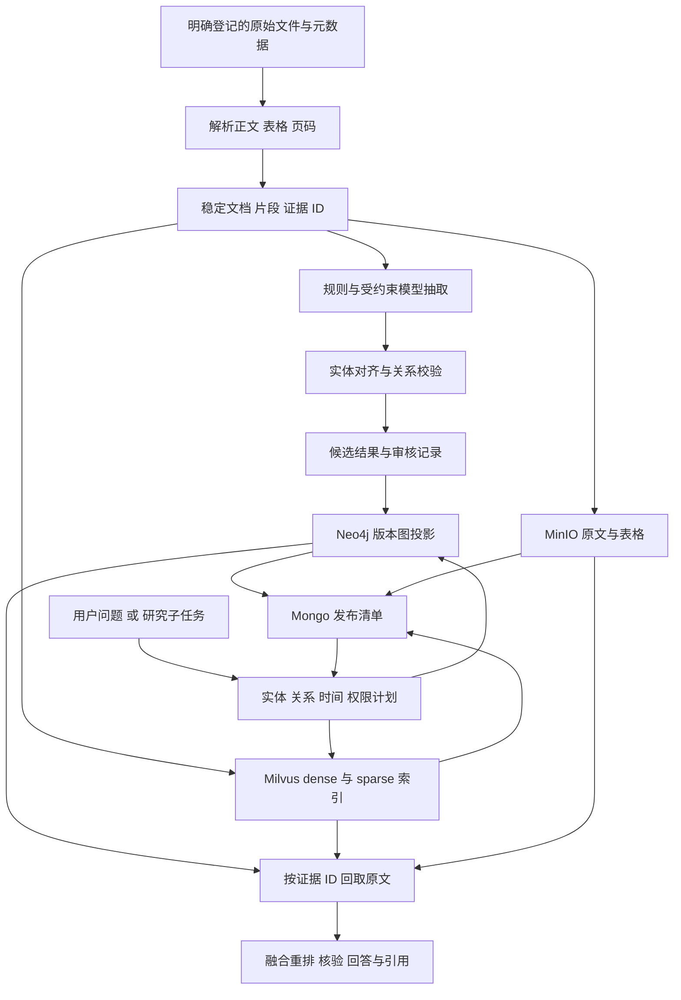
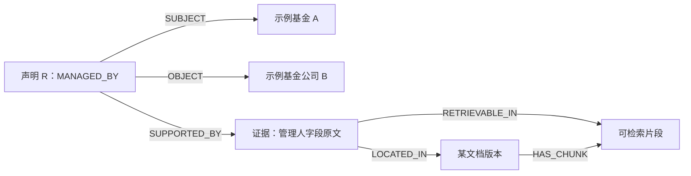

# 掌柜智库实践版：Neo4j 金融知识图谱建设方案

日期：2026-11-05。状态：设计方案，尚未实施本文改造。

需求依据：[需求说明](D:/机器学习/掌柜智库/掌柜智库实践版/需求说明.md)、[金融 RAG 方案](D:/机器学习/掌柜智库/掌柜智库实践版/docs/superpowers/specs/2026-11-03-financial-rag-design.md)、[多 Agent 研究方案](D:/机器学习/掌柜智库/掌柜智库实践版/docs/superpowers/specs/2026-11-04-multi-agent-financial-research-design.md)。本方案依据 11 月 5 日当前源码重新核查；此前文档中的代码现状是当时快照。

**建议：继续使用现有 Neo4j Python Driver，建设“实体—关系声明—原文证据”图谱。Milvus 负责语义和稀疏召回，Neo4j 负责实体关联、关系路径与来源定位，二者通过稳定 ID 联通。**

本轮仅编写方案，不改业务代码、不导入或删除数据库数据。下文 Cypher、接口和模块均为拟议实现；没有连接真实 Neo4j、Milvus 或模型服务验证。

## 1. 先明确：图谱要解决什么问题

用户提问时，图谱应帮助系统找到“谁与谁有关、是什么关系、哪份资料能证明”，随后回取原文回答。

| 用户问题 | Neo4j 的职责 | 后续检索/分析 |
|---|---|---|
| “这个基金的管理人是谁？” | 找基金/份额对应的管理关系及证据 | 展示管理机构、资料日期和原文 |
| “这个管理人还管理哪些基金？” | 沿管理关系反向查找已收录产品 | 回取每个产品的支持资料；说明目录覆盖范围 |
| “平安银行属于哪个集团？” | 查有明确来源的集团/子公司关系 | 核对关系时点；不根据名称相似推断 |
| “比较两家公司的财报” | 解析主体、限定报告版本和期间、定位报告与片段 | RAG 抽取指标，计算服务统一口径 |
| “分析银行行业” | 按指定分类体系、版本和时点找公司集合 | 检查样本覆盖，结合企业、政策和风险资料分析 |
| “什么是基金净值？” | 可通过概念节点定位定义资料；普通文本召回也可直接完成 | 给出通俗解释，不要求先选择产品 |

首版优先完成：**基金管理关系、公司集团关系、报告主体、行业归属、证据回取**。不把每个名词都变成节点，也不把所有财报数字直接存成公司属性。

例如，用一句虚构材料解释建设目标：

> “示例基金 A 的基金管理人：示例基金公司 B。”

系统应保存 A、B 两个实体，一条“管理关系声明”，以及这句话所在文档版本和原文位置。问到 A 的管理人时，返回 B 并引用该句；问到 B 的产品时，可反向找到 A。此例仅用于说明结构，不是真实产品资料。

## 2. 当前项目已经具备什么、还缺什么

### 2.1 已有基础，应当复用

- [上传入口](D:/机器学习/掌柜智库/掌柜智库实践版/web_server.py:214)和[导入图](D:/机器学习/掌柜智库/掌柜智库实践版/upload/main_graph.py:79)已在 Milvus 回填 `chunk_id` 后调用图构建节点。
- [knowledge_graph.py](D:/机器学习/掌柜智库/掌柜智库实践版/upload/knowledge_graph.py:200)已经创建公司、基金、机构、产品、文档和证据，按规则提取管理、发行、控股等关系。
- [写入函数](D:/机器学习/掌柜智库/掌柜智库实践版/upload/knowledge_graph.py:381)使用标签/关系白名单和参数化属性；图故障会记录状态并保留已入库文本。
- [金融问答链](D:/机器学习/掌柜智库/掌柜智库实践版/search/workflow.py:98)已有图关系分支；[测试](D:/机器学习/掌柜智库/掌柜智库实践版/tests/test_corpus_graph.py:71)覆盖明确管理句、共现不造业务边、缺片段 ID、参数化写入和故障降级。

这些证明代码已具备基础能力，不能据此认定数据库中的资料完整、图关系有效或真实问答已通过验收。

### 2.2 本次重点补齐的缺口

| 当前问题 | 源码位置 | 本方案处理 |
|---|---|---|
| 实体依赖固定名单和文件名；查询与导入各有一份目录 | [构建目录](D:/机器学习/掌柜智库/掌柜智库实践版/upload/knowledge_graph.py:28)、[查询目录](D:/机器学习/掌柜智库/掌柜智库实践版/search/query_plan.py:49) | 建立统一实体注册表，导入和查询共用；未知实体进入候选审核 |
| 自动去掉基金名称末尾 C 作为别名 | [别名处理](D:/机器学习/掌柜智库/掌柜智库实践版/upload/knowledge_graph.py:316) | 基金系列与份额类别分别建实体，通过份额关系连接 |
| 图在线读取仅支持全库 `MANAGED_BY`，没有范围和时点参数 | [load_business_edges](D:/机器学习/掌柜智库/掌柜智库实践版/graph_store.py:109) | 按起点、关系模板、KB 版本、权限和时间查询 |
| 关系问句路由覆盖很窄 | [意图判断](D:/机器学习/掌柜智库/掌柜智库实践版/search/query_plan.py:274) | 为管理、发行、集团、报告和行业分别产生关系计划 |
| 图只是与文本候选求交，来源片段不在 TopK 就答不出 | [relation_evidence](D:/机器学习/掌柜智库/掌柜智库实践版/graph_relations.py:46) | 图直接返回证据 ID，按 ID 补取原文，再融合重排 |
| 两跳函数只保留末跳证据，不能表达转向路径 | [query_relations](D:/机器学习/掌柜智库/掌柜智库实践版/graph_relations.py:73) | 使用有限业务路径模板，每一跳都返回完整证据包 |
| 文档按文件名标识，证据依赖 Milvus 自增 ID | [文档/证据 ID](D:/机器学习/掌柜智库/掌柜智库实践版/upload/knowledge_graph.py:220)、[Milvus 主键](D:/机器学习/掌柜智库/掌柜智库实践版/upload/node_import_milvus.py:193) | 增加稳定逻辑 ID、内容版本和物理主键映射 |
| 重导会删旧向量，图仅 MERGE，可能遗留失效引用 | [旧块清理](D:/机器学习/掌柜智库/掌柜智库实践版/upload/node_import_milvus.py:261)、[图写入](D:/机器学习/掌柜智库/掌柜智库实践版/upload/knowledge_graph.py:394) | 新版本构建完成后统一发布；旧版本保留至任务结束再退役 |
| `BusinessRelation` 未显式连到主体和客体 | [关系记录](D:/机器学习/掌柜智库/掌柜智库实践版/upload/knowledge_graph.py:194) | 用 `Assertion` 明确表达主体、谓词、客体及支持证据 |
| 缺少有效期、资料截止日、ACL、发布状态 | [GraphNode/GraphEdge](D:/机器学习/掌柜智库/掌柜智库实践版/upload/knowledge_graph.py:62) | 将这些字段写进数据契约和每条查询模板 |

当前 `REPORTS_ON` 存在方向不一致：运行构建为公司指向文档，准备脚本为文档指向公司。本方案统一为“报告描述哪个公司”，即 **Document → REPORTS_ON → Entity**。准备资料中 `imported=False`、无片段 ID 的记录只当候选，不作为已入库事实。

## 3. 技术架构和选型



| 组件 | 保存什么、负责什么 |
|---|---|
| MongoDB | 实体注册表、文档元数据、审核后的声明记录、导入任务、发布清单、权限和失效状态 |
| MinIO | 原文件、解析正文、原始表格/页面、完整抽取产物；按版本不可变保存 |
| Milvus | 现有 BGE-M3 dense/sparse 向量及片段元数据；可精准按稳定 ID 回取 |
| Neo4j | 实体、文档、证据与已接受关系声明的可查询投影；可从审核记录重建 |
| 检索/研究层 | 选择查询模板、整合图与文本证据、检查覆盖、计算和生成答案 |

首版采用 **官方 Python Driver + 固定参数化 Cypher 模板**。Neo4j 不重复存全部向量；保留现有 Milvus 检索能力。采用 Neo4j 5 可用的基础节点唯一约束、索引、`MERGE` 和 `UNWIND`，具体服务端版本与版本类型实施前确认。

`neo4j-graphrag` 的 KG Builder 提供 schema、切分、抽取和解析等组件，但官方当前仍标为实验性；可参考其分组件结构，本项目先自行控制财务实体身份、原文锚点和失败记录。[官方 KG Builder](https://neo4j.com/docs/neo4j-graphrag-python/current/user_guide_kg_builder.html)

现有 Milvus 的过滤、稀疏召回和 ID 映射需要自己的适配层，不假设安装 SDK 后即可直接完成联通。以后采用 SDK 时仍须实现和验证自定义 Retriever。[官方 RAG 接口说明](https://neo4j.com/docs/neo4j-graphrag-python/current/user_guide_rag.html)

## 4. 图谱模型：五类核心节点

新增投影节点统一带 `KGNode` 标签，再按用途加 `KGEntity / KGDocument / KGChunk / KGEvidence / KGAssertion`。这样可以与当前旧标签并行迁移，避免不加区分地查到旧图。

### 4.1 节点定义

| 节点 | 含义 | 核心字段 |
|---|---|---|
| `KGEntity` | 一个规范业务对象 | entity_id、entity_type、canonical_name、标识码、aliases、registry_revision |
| `KGDocument` | 一份文档的不可变内容版本 | doc_id、doc_version、source_uri、content_hash、publish_date、available_at、report_period、parse_version |
| `KGChunk` | 某解析/切分版本产生的检索片段 | chunk_uid、doc_version、chunker_version、content_type、section、table_id、vector_record_ref |
| `KGEvidence` | 能支持一个声明的原文位置 | evidence_id、doc_version、page、source_span、table/row/column、quote_hash、raw_object_ref |
| `KGAssertion` | 某来源明确提出的一条业务关系 | assertion_id、subject_id、predicate、object_id、qualifiers、polarity、有效时间、来源时点、抽取/审核状态 |

`KGEntity.entity_type` 初始支持：组织、基金系列、基金份额、其他金融产品、行业分类、金融概念。公司与机构是组织的业务角色；同一法人既是上市公司又是金融机构时沿用同一个 ID。行业节点的身份必须包含分类体系、版本和行业代码。

金融数值的主记录继续在事实账本中。需要“公司—指标—期间”查询时，可在第二阶段添加 `KGMetricFact` 投影，保存 `fact_id` 及相关引用；不得用一个 `Company.revenue` 属性反复覆盖不同年份和口径。

### 4.2 结构关系与业务关系

结构关系用固定边表示：

```text
Document -HAS_CHUNK-> Chunk
Evidence -LOCATED_IN-> Document
Evidence -RETRIEVABLE_IN-> Chunk
Entity -MENTIONED_IN-> Evidence
Assertion -SUBJECT-> 主体节点
Assertion -OBJECT-> 客体节点
Assertion -SUPPORTED_BY-> Evidence
```

`MENTIONED_IN` 只表示提及。结构边不能自动提升为管理、控股或行业归属。

业务关系存入 `KGAssertion.predicate`，类型与方向固定：

| 谓词 | 主体 → 客体 | 需要的证据 |
|---|---|---|
| `MANAGED_BY` | 基金/份额/产品 → 管理组织 | 正式资料中的管理人字段或明确句子 |
| `ISSUED_BY` | 产品或文件 → 发行/发布组织 | 发行人或发布主体的明确说明 |
| `SUBSIDIARY_OF` | 子公司 → 母公司 | 明确控制/子公司关系；仅持股不能自动等同控制 |
| `BELONGS_TO` | 公司 → 行业分类节点 | 指定分类体系及日期的正式分类数据 |
| `SHARE_CLASS_OF` | 基金份额 → 基金系列 | 份额类别与基金系列关系、官方代码 |
| `REPORTS_ON` | 报告版本 → 公司 | 封面/正文中的报告主体，不能只依据文件名 |
| `DEFINES` | 文档版本 → 概念 | 明确解释该概念的段落 |
| `APPLIES_TO` | 政策文档版本 → 行业/对象 | 适用范围原文；不自动生成“导致上涨”等影响关系 |

每种谓词登记允许端点类型、关系方向、是否允许多个客体、时间要求、抽取规则与查询模板。主体、客体类型不符合契约时进入待核，不直接入正式图。

### 4.3 为什么把业务关系单独做成声明节点



一条声明完整保存主体、客体、来源和期间，便于保留不同报告中的历史关系及冲突。

同一来源的一组支持片段组成一个声明的**必需证据包**，全部齐备才算支持。不同来源即使表达同一关系，也各建声明，使用相同 `proposition_key` 归组；这样删除一份私有资料不会破坏另一份公开资料的支持，也不会混淆权限。

`polarity` 区分 `affirmed / negated / planned`。“已不再担任”可成为已接受的否定声明，“拟担任”可成为拟议声明，但两者都不能进入肯定关系结果。关系变更处理保留原文和生效日，产生声明修订/冲突记录；不能因拒绝其作为肯定边，就完全忽略它对旧关系的影响。

记录 `origin_source_group / derived_from`：同一公告的 PDF、转载与摘要属于同源材料，不能按文件数量认定独立互证。不同管理人也不必然冲突，需先核对份额对象、共同管理规则、限定条件和有效期是否重叠。集团关系不能自动证明某子公司已纳入某期财报合并范围，仍需查该期报告。

首版直接查询声明节点。若后续压测需要快捷 `MANAGED_BY` 等业务边，只能由有效声明派生并携带 `assertion_id`，可随时重建；没有声明与完整证据的快捷边不能用于回答。

## 5. 身份、时间、权限和版本契约

### 5.1 稳定 ID

| ID | 建议规则 |
|---|---|
| `entity_id` | 注册表分配不可变 ID；官方代码与名称作为可校验映射，名称变更不换实体 |
| `doc_id` | 登记的逻辑文档身份，优先用来源文号/公告 ID；缺少时注册分配 |
| `doc_version` | 对 doc_id 与原始内容 SHA256 组合取哈希；content_hash 另存原始字节哈希，同名不同内容必须区分 |
| `chunk_uid` | 对 doc_version、parse_version、chunker_version、片段位置及内容哈希组合取哈希 |
| `evidence_id` | 对 doc_version、parse_version、原文锚点及 quote_hash 取哈希，独立于 Milvus 自增主键 |
| `assertion_id` | 对规范端点、谓词、极性、限定条件、原文证据 ID 集合及抽取规则版本取哈希 |
| `proposition_key` | 对语义端点、谓词和业务限定条件取哈希；用于归组，不将不同来源强制覆盖 |
| `gid` | Neo4j 投影的物理唯一键：KB、schema_version、build_id、节点类型与逻辑 ID 的组合哈希 |

实体注册表的权威代码需要命名空间，例如交易所+证券代码、基金份额代码、统一社会信用代码；代码相同但命名空间不同不能合并。基金 A/C 类各自有实体，不能通过删后缀做身份合并。

名称、文件名和 Neo4j 内部节点编号不作长期身份。当前 Milvus 自增 `chunk_id` 可继续作为物理主键，通过 `(collection_version, physical_pk) ↔ chunk_uid` 映射；兼容期不要求就地修改旧主键类型。

同一字节内容来自不同逻辑文档或授权来源时，不能仅按 content_hash 合并元数据与权限；保留不同 doc_id/doc_version 的来源记录，必要时复用相同原始对象。文件改名且来源身份、内容未变时，doc_id/doc_version 不变。

切分变化只更新 `chunk_uid` 和证据到片段的映射；原始解析与锚点未变时 `evidence_id` 保持稳定。重新解析导致坐标或正文变化则产生新的 parse_version 和证据 ID，不强行沿用旧偏移。

### 5.2 时间字段

- `publish_date / available_at`：资料发布日与可知时点；导入时间 `ingested_at` 单独记录。
- `report_period`：财报描述的经营期间，不等于发布时间。
- `valid_from / valid_to`：业务关系的有效区间，约定左闭右开。
- `asserted_as_of`：只有“截至某日”的关系事实时，保留该时点。
- `validity_mode`：`interval / as_of / unknown`；未知区间不能因 valid_to 为空就视为永久有效。
- `knowledge_cutoff_at`：问题允许使用资料的最晚时点；历史研究过滤其后的公告与重述。

没有有效期时可以回答“某日期资料列示的管理人为……”，不能无条件回答“当前管理人为……”。关系变更与被证实抽取错误分开处理：前者保留历史区间，后者追加审核修订/失效记录。回顾性分析和历史时点分析分别采用最新适用重述、当时可知版本，规则继承多 Agent 方案。

### 5.3 作用域与权限

所有投影节点含 `kb_id、build_id、schema_version`。证据权限来自源文档；声明可用的前提是其全部必需证据都可读。不能把公开和私有来源的证据列表合并后统一标成公开。

服务端根据身份生成可读文档版本/证据集合，所有查询模板先限制 KB 和 build，再限制证据权限，最终回取原文时再次检查撤权/删除状态。实体候选名称也必须有可读来源支持，不能通过自动补全泄露私有资料中的对象。

缓存包含授权范围摘要、发布版本、查询时点和模板版本。权限失效优先于历史快照可重复读取，旧任务不能继续使用已经撤权的原文。

## 6. 从文档到图谱的构建流程

### 6.1 明确输入

输入为上传任务或显式 manifest 登记的文件和元数据：来源地址/文号、资料类型、发布日、报告期、授权范围、内容哈希。公司环境和本地路径不同，由现有配置或调用参数指定；不增加遍历猜测目录、选择最新文件或替换数据的逻辑。

原文、表格和页码沿用现有解析链。为财报和产品概要保留表头、列名、单位、脚注；解析失败、低质量 OCR、表格列对不齐要记录质量状态，不能让抽取模型自行补全。

### 6.2 分层抽取

1. **元数据与规则优先：**正式产品代码、主体名称、管理人/发行人字段、报告封面信息和结构化分类表先用确定性规则提取。
2. **模型补充：**对复杂正文按固定本体输出实体与关系候选，只允许登记的谓词，要求原文引句和定位；不直接生成 Cypher。
3. **实体对齐：**先匹配权威代码，再查已审核的名称/别名；近似匹配只形成候选，不仅凭向量相似度自动合并。
4. **逐条校验：**引句能回到原文、主体/客体绑定明确、方向正确、时间适用、端点类型正确、没有否定/假设/拟议语气。
5. **接受或待核：**满足规则和证据约束的候选进入 accepted；歧义、冲突和低质量解析进入 pending；错误候选 rejected，并保存原因。
6. **生成发布输入：**保留抽取模型/提示词/schema 版本、规则版本、源产物哈希和审核记录，构造可重放的节点/声明批次。

模型上下文只包含当前段落、必要表头及已校验主体信息；大型文档分批处理。模型调用先于数据库写事务，失败片段进入明确重试清单。无论规则还是模型抽取，都不能把同页共现当成管理/控股。

候选格式示例（虚构数据）：

```json
{
  "subject_mention": "示例基金 A",
  "predicate": "MANAGED_BY",
  "polarity": "affirmed",
  "object_mention": "示例基金公司 B",
  "evidence_refs": ["ev:example-manager-field"],
  "quote": "示例基金 A 的基金管理人：示例基金公司 B。",
  "validity_mode": "unknown",
  "status": "pending"
}
```

`evidence_refs` 必须引用已登记的真实锚点；候选中的文本不自动获得权限或 verified 状态。accepted 代表通过本项目指定检查，不等于证明外部披露绝对真实。

### 6.3 实体注册与审核

入库、查询和研究 worker 读取同一注册表，不继续维护两份 `_CATALOG / _SUBJECTS`。注册表保存名称沿革、官方标识、份额类别、来源和审核版本。

“平安”可能对应不同主体；保留多候选，结合问题、已确认上下文和授权资料解析。只有歧义会改变答案时才问用户。未知主体可以暂存 provisional ID 并保留文本检索；正式业务关系待身份确认后发布。

误合并通过版本化的 merge/split 记录纠正，记录旧 ID 到新 ID 的映射并重建受影响图投影，不能删除一端后把所有历史关系盲目转移。审核界面应展示原文、页码、主体/客体和时间，提供接受、拒绝、改正及重复来源归组操作。

## 7. Neo4j 存储和写入示例

以下为待实现的设计示例，不是本轮已执行命令。参数由服务端校验后传入，标签和边类型来自固定模板。

### 7.1 基础约束与索引

```cypher
CREATE CONSTRAINT kg_gid_unique IF NOT EXISTS
FOR (n:KGNode) REQUIRE n.gid IS UNIQUE;

CREATE INDEX kg_entity_lookup IF NOT EXISTS
FOR (n:KGEntity) ON (n.kb_id, n.build_id, n.entity_id);

CREATE INDEX kg_assertion_lookup IF NOT EXISTS
FOR (a:KGAssertion) ON (a.kb_id, a.build_id, a.predicate);

CREATE INDEX kg_document_lookup IF NOT EXISTS
FOR (d:KGDocument) ON (d.kb_id, d.build_id, d.doc_version);

CREATE INDEX kg_evidence_lookup IF NOT EXISTS
FOR (e:KGEvidence) ON (e.kb_id, e.build_id, e.evidence_id);
```

所有节点必须带 `KGNode`；应用拒绝空 ID 和缺少关键字段。基础设计使用节点唯一约束，不依赖 Enterprise 的存在性、类型或 NODE KEY 约束。仅使用 `MERGE` 不能代替并发唯一约束。[约束语法](https://neo4j.com/docs/cypher-manual/5/constraints/syntax/)、[MERGE 说明](https://neo4j.com/docs/cypher-manual/current/clauses/merge/)

实体全文索引可以补充中文名称/英文名称候选召回。实施前调用 `db.index.fulltext.listAvailableAnalyzers()` 核验可用分词器，并用中文简称、全称、代码样本测试。全文分数用于候选排序，不作为实体正确概率；还需限制或转义 Lucene 查询语法。索引发布前检查 ONLINE，若启用最终一致更新，要确认刷新完成。[全文索引说明](https://neo4j.com/docs/cypher-manual/5/indexes/search-indexes/full-text-indexes/)

### 7.2 批量写入声明

先写实体、文档、片段和证据；下面示例只展示已知端点与证据的声明写入。写入应用在事务内预检全部端点/证据齐备，缺少任何一个即回滚该批，不能依赖 MATCH 自动忽略缺项。

```cypher
UNWIND $rows AS row
MATCH (s:KGNode {gid: row.subject_gid, kb_id: $kb_id, build_id: $build_id})
MATCH (o:KGNode {gid: row.object_gid, kb_id: $kb_id, build_id: $build_id})
MERGE (a:KGNode:KGAssertion {gid: row.gid})
ON CREATE SET
  a.kb_id = $kb_id,
  a.build_id = $build_id,
  a.schema_version = $schema_version,
  a.assertion_id = row.assertion_id,
  a.predicate = row.predicate,
  a.polarity = row.polarity,
  a.proposition_key = row.proposition_key,
  a.status = row.status,
  a.validity_mode = row.validity_mode,
  a.valid_from = row.valid_from,
  a.valid_to = row.valid_to,
  a.available_at = row.available_at,
  a.evidence_count = size(row.evidence_gids),
  a.payload_hash = row.payload_hash
MERGE (a)-[:SUBJECT]->(s)
MERGE (a)-[:OBJECT]->(o)
WITH a, row
UNWIND row.evidence_gids AS evidence_gid
MATCH (e:KGNode:KGEvidence {gid: evidence_gid, kb_id: $kb_id, build_id: $build_id})
MERGE (a)-[:SUPPORTED_BY]->(e)
RETURN count(DISTINCT a) AS assertion_count;
```

同一 gid 已存在时，应用先比较 payload_hash；一致则幂等重放，不一致则拒绝并要求新的声明/构建版本，不能通过追加端点把一个声明变成多个主体客体。`qualifiers` 等复杂对象拆成明确标量字段或规范 JSON 字符串，不把嵌套 dict 直接当 Neo4j 节点属性。

使用 `session.execute_write()` 按有限批次提交，初值可设每批 200 条声明，再按数据体积和事务延迟调优。回调可能重跑，所以回调内只做可重入 Neo4j 写入；LLM、下载、Mongo 状态变更在回调外。批次 ID 和哈希的完成标记与本批数据同事务提交。[Python 事务说明](https://neo4j.com/docs/python-manual/current/transactions/)

Driver 生命周期由服务管理，复用连接池，每个执行上下文创建自己的 session；设置查询期限与总重试时间。不能把关系写入返回的预期数量当成实际成功数量，需消费结果并校验提交数量及完整性。

## 8. 关系查询与原文回取

### 8.1 查询计划

```text
GraphQueryPlan
  kb_manifest_id, kb_id, graph_build_id
  start_entity_ids, template_id
  relation_steps: [{predicate, direction}]
  effective_on / effective_range, knowledge_cutoff_at, vintage_policy
  max_hops, max_paths, max_evidence_count, timeout_ms

GraphQueryResult
  status: ok | partial | empty | unavailable | version_mismatch
  paths: [{ordered_node_ids, ordered_assertion_ids,
           evidence_ids_by_assertion, doc_versions, effective_interval}]
  unresolved_time, conflicts, coverage, truncated, error_code
```

身份与授权集合由服务端注入，不由模型生成。初值限制为最多 2 个**业务关系跳数**、20 条路径、60 条证据和 3 秒查询时间，实际依据压测调整。业务一跳经过 Assertion 需要多条结构边，因此不能简单把 Cypher 的物理边数当作业务跳数。

避免开放 `MATCH p=(n)-[*]-(m)` 任意遍历。先提供明确模板：

| template_id | 路径与用途 |
|---|---|
| `product_manager` | 产品 → MANAGED_BY → 管理机构 |
| `manager_products` | 管理机构 ← MANAGED_BY ← 产品 |
| `same_manager_products` | 产品 → MANAGED_BY → 管理机构 ← MANAGED_BY ← 其他产品 |
| `company_parent` | 公司 → SUBSIDIARY_OF → 母公司 |
| `company_reports` | 公司 ← REPORTS_ON ← 报告版本 |
| `industry_companies` | 行业分类 ← BELONGS_TO ← 公司 |
| `policy_scope` | 政策文档 → APPLIES_TO → 适用对象 |

两跳结果逐跳保留完整声明和证据包，并检查业务有效期存在交集。不能把历史管理关系与现在的其他关系无条件串联，也不能将“母公司控制某公司”自动替换为“母公司就是其产品管理人”。结果被上限截断时必须返回 `truncated=true`，不能声称已列出全部对象。

### 8.2 Cypher 示例：指定日期的管理产品

下面查询仅返回具有明确有效区间、且全部证据都可见的管理关系。日期与时间参数使用服务端传入的 Neo4j 原生 temporal 值；查询前完成参数 schema 校验。`$allowed_doc_gids` 是本次授权并未撤销的文档版本集合，正式返回前仍需复查最新撤权状态。

```cypher
MATCH (manager:KGEntity {
  kb_id: $kb_id, build_id: $build_id, entity_id: $manager_id
})<-[:OBJECT]-(a:KGAssertion {
  kb_id: $kb_id, build_id: $build_id,
  predicate: 'MANAGED_BY', status: 'accepted', polarity: 'affirmed'
})-[:SUBJECT]->(product:KGEntity)
MATCH (a)-[:SUPPORTED_BY]->(ev:KGEvidence)-[:LOCATED_IN]->(doc:KGDocument)
WITH manager, a, product,
     collect(DISTINCT ev) AS evidence,
     collect(DISTINCT doc) AS documents
WHERE product.kb_id = $kb_id AND product.build_id = $build_id
  AND size(evidence) = a.evidence_count AND a.evidence_count > 0
  AND a.validity_mode = 'interval'
  AND a.valid_from IS NOT NULL AND a.valid_from <= $effective_on
  AND (a.valid_to IS NULL OR $effective_on < a.valid_to)
  AND a.available_at IS NOT NULL AND a.available_at <= $knowledge_cutoff_at
  AND all(e IN evidence WHERE e.kb_id = $kb_id AND e.build_id = $build_id)
  AND all(d IN documents WHERE d.kb_id = $kb_id AND d.build_id = $build_id
      AND d.gid IN $allowed_doc_gids
      AND d.available_at IS NOT NULL AND d.available_at <= $knowledge_cutoff_at)
RETURN product.entity_id AS product_id,
       product.canonical_name AS product_name,
       manager.entity_id AS manager_id,
       a.assertion_id AS assertion_id,
       [e IN evidence | e.evidence_id] AS evidence_ids,
       [d IN documents | d.doc_version] AS doc_versions
ORDER BY product_id, assertion_id
LIMIT $limit_plus_one;
```

`$limit_plus_one` 用于识别截断；同一产品有多份来源时在服务层按命题归组并保留来源。首版授权集合较小时可直接传文档 ID 列表；规模增长后需要权限分区/授权索引，不能无限扩大参数列表。

该查询返回肯定关系候选。正式返回前，关系服务还须按相同主体、谓词及限定条件，查询在同一授权、业务时间和可知截止日内可用的否定声明、变更声明及不同客体声明。依据谓词的多值规则处理有效期与冲突，不能把上面筛选出来的肯定行直接视为最终结论。后来发布的变更不能污染历史时点结果；不可见来源的内容和冲突情况不得泄露。

未知有效期或仅截至日的声明由另一个固定模板查询，以“某资料列示”返回，标注 `unresolved_time`；不能把上面查询没返回的对象解释成“没有管理关系”。声明状态、证据数量、端点和文档完整性也在发布前校验，查询示例不是全部数据质量检查的替代。

### 8.3 改造关键：图是独立召回通道

现有流程“先向量召回 → 与图 chunk_id 求交”会丢掉未进入 TopK 的关系证据。目标流程：

1. 用户问题先解析实体、业务关系、时间与授权范围。
2. 图关系查询和 Milvus 语义/稀疏检索按计划独立执行。
3. 图返回的每个 `evidence_id` 通过证据目录解析到文档、原文锚点和 `chunk_uid`，精准回取原文/表格。
4. 与向量结果合并去重，统一重排；必需证据包作为整体保留，不能将表头、限定句或路径中间证据挤掉。
5. 对比提问所需的对象和维度，缺项补查；确认主体、期间和证据完整后生成回答。

`fetch_evidence_by_ids()` 不依赖该片段原先是否被向量召回。向量索引暂不可用时，图定位的原文仍可通过 Mongo 目录和 MinIO 回取；Neo4j 不可用时保留普通文本检索，但不能凭空补全多跳关系。

## 9. 怎样服务多 Agent 和复杂金融问题

### 9.1 公司对比

主协调器先用同一实体目录解析两家公司，再按 `company_reports` 找到报告版本和期间。A、B 研究 Agent 使用相同指标模板、各自的主体/报告范围；必要的集团关系作为补充证据，避免把集团数据当成上市公司数据。

图返回报告及片段范围；指标数值、单位、合并口径、重述和计算仍使用事实账本与确定性计算服务。图上存在集团边不能自动推导业绩，也不能替代跨报表分析。

### 9.2 财报分析

报告节点关联主体、报告期、章节、表格和原文。各研究方向按经营利润、资产负债/现金流、附注风险读取相关证据。

首版可将章节/主题存在于 Chunk metadata 中，用于限定检索。以后需要稳定的“风险主题—主体—报告”查询时，再新增主题或事实引用节点；“风险影响利润”的因果边必须有直接证据，不能仅由模型推测发布。

### 9.3 行业分析

`industry_companies` 固定分类体系、版本、层级和有效日期，得到目标集合后再统计授权可见资料与可比数据覆盖。分类体系、公司集合来源不完整时，报告写“已收录样本”，不能将图中节点数量当成行业公司总数。

跨期趋势使用共同可比样本，单列新增/退出和缺失公司。行业分类关系不能解决财报合并范围重复；集团和子公司可能存在收入重叠，汇总前仍要核对会计范围与指标聚合规则。

### 9.4 Agent 工具边界

Agent 仅可调用 `resolve_entities、get_company_reports、query_relations、get_industry_members、fetch_evidence_by_ids` 等有限工具。工具自行执行作用域/时间过滤和完整性核验，返回紧凑事实与证据 ID。每个研究 run 固定同一 manifest；worker 不能自由拼 Cypher、改变图版本或写入新关系。

## 10. 构建发布、增量更新与删除

### 10.1 首版选择：不可变发布快照

为降低跨库混读风险，首版按显式语料清单构建一个完整图投影：每次生成新的 `build_id`，复用已经校验且内容不变的抽取结果，在 Neo4j 中形成独立投影。不同 build 的物理 gid 不同，同一实体/文档的逻辑 ID 保持稳定。

这会增加图存储量，但当前阶段换来清晰的发布和回退边界；只保留配置数量的发布版本与活动任务仍引用的版本。规模增长后再评估按不可变子图分片复用，不在首版引入复杂的原地增量可见性规则。

向量索引与证据目录也必须能同时保留发布清单引用的版本：优先构建新 collection/显式版本分区，或使用不删除旧版本的 metadata 过滤。不能继续按文件名先删旧块，否则旧图快照也无法真正恢复原文。

### 10.2 发布步骤

1. 在 Mongo 登记 `build_id、schema_version、source_manifest_hash、entity_registry_revision、vector_version、expected_counts`，状态 BUILDING。
2. 解析和抽取结果先形成不可变产物；记录每份文件是否完成、失败原因及所需能力。
3. 写入 Neo4j staging 投影和对应向量索引，有限批次提交，保存批次哈希/完成标记。
4. 核验所有 accepted 声明的主体/客体、完整证据包、原文可回取、文档版本、索引状态、抽取失败范围和实际数量。
5. 检查通过后将 manifest 标成 READY；用 Mongo 条件更新原子切换当前发布指针。客户端读取并固定 manifest，后续每次工具调用携带它。
6. 未通过时标记 FAILED 或显式的 TEXT_ONLY 能力版本；已完成批次可在确认哈希一致后续建，不能把局部图默认当完整图发布。

Neo4j、MongoDB、Milvus、MinIO 之间没有本方案可依赖的跨库原子事务。**先写不可变产物、最后切换发布指针**是应用级可见性协议，不等于四库全局 exactly-once。切换前若进程崩溃，新版本不对外可见；切换响应不明时按 build_id 对账，不能再次重复发布不同内容。

### 10.3 更新与删除

| 操作 | 处理规则 |
|---|---|
| 重复上传相同内容 | 在同一 KB/授权语境核对内容哈希并复用，记录来源映射；不把多个副本算独立证据 |
| 同名新报告/修订报告 | 产生新 doc_version，保留旧版本和适用期间，下一 build 选择所需版本 |
| 管理人变更或公司更名 | 追加来源级声明/注册表修订，处理时间与冲突，不直接覆盖历史 |
| 只改变切分方式 | 生成新 chunk_uid/向量映射，能复用的原文证据继续复用 |
| 删除/撤销源文档 | 立即在权威目录置失效并清缓存、阻止读取；重建图投影，移除失效声明的可用性 |
| 删除某一支持来源 | 失效对应声明；存在另一组完整、可读、有效支持时仍可回答，并只引用它 |
| 回退版本 | 原子切换到仍通过完整性检查的旧 manifest；撤权和删除标记继续生效 |

源文档删除不能简单级联删除共享实体；应检查其他有效来源是否仍使用该实体。旧 build 和存储对象的物理清理只处理显式列出的版本、已不被活动任务使用且超过保留期的对象。

## 11. 错误处理、质量治理与运维

| 错误 | 系统行为 | 用户/运维能看到什么 |
|---|---|---|
| 解析失败/表格错列 | 标记对应文件或字段不完整，不生成已核实声明 | 失败文件、页码或缺失范围 |
| 模型输出非法关系或无原文依据 | schema/证据校验拒绝，有限修正或进入待核 | 原文、拒绝原因、规则版本 |
| 未知或歧义实体 | 保留候选及文本检索，必要时澄清 | 规范主体候选，不展示内部文件名让用户猜 |
| Neo4j 暂时不可用 | 有界重试；构建不发布，查询可用文本部分继续 | 图暂不可用，不能混写为资料不存在 |
| 写到一半失败 | 保留 staging 和成功批次，按哈希重放 | 构建状态与失败批次，无“假 ready” |
| 图命中但原文缺失 | 将该证明标记不完整，补查或停止该关系结论 | 来源暂不可验证 |
| 多份来源冲突 | 按主体、限定条件、时间核对，保留双方 | 可见且相关的冲突说明，不擅自选模型更喜欢的一方 |
| 关系路径或结果达到上限 | 截断并标记，可分页或让协调器收窄范围 | “当前展示已收录范围中的部分结果” |
| 权限变化或文档删除 | 阻止再次读取，失效缓存/相关任务证据 | 不泄露隐藏来源名称、数量和冲突细节 |

入库页面补充 `graph_status、accepted_count、pending_count、rejected_count、graph_build_id、evidence_resolvable_count`，区别图可用、仅文本可用、无关系和构建失败。当前单一“上传成功”不足以说明图谱可用于问答。

观测指标包括构建耗时、模型用量、规则拒绝率、待核比例、声明原文可回取率、悬空引用数、图查询耗时与超时、路径截断、图带来的新增相关证据数。日志保存 ID 和错误分类，敏感正文按授权查看。

基础方案不依赖 APOC、GDS、Neo4j 向量索引或 Enterprise 专有约束。部署时确认 Neo4j 服务端版本、版别、数据规模、备份与恢复方式；客户端版本不能代表服务端版本。Community/Enterprise 的高可用和权限能力分别评估，不默认每个用户都能创建独立数据库。[官方版本介绍](https://neo4j.com/docs/operations-manual/current/introduction/)

## 12. 迁移到当前项目的模块落点

基准目录：`D:/机器学习/掌柜智库/掌柜智库实践版`。以下是拟议改造，不表示这些新模块已经存在。

| 文件/模块 | 改造职责 |
|---|---|
| 新增 `knowledge/contracts.py` | Entity、DocumentVersion、Evidence、Assertion、GraphQueryPlan 等 schema，时间与方向规则 |
| 新增 `knowledge/registry.py` | 统一实体注册表、别名/代码、份额类、身份修订；替代分散硬编码目录 |
| 新增 `knowledge/evidence.py` | 稳定 ID、原文锚点、证据到 chunk/物理主键映射与精准回取 |
| 新增 `knowledge/extract.py` | 规则与模型候选抽取、引句绑定、否定/时间/端点校验 |
| 新增 `knowledge/publish.py` | 构建清单、批次记录、跨库完整性核验和发布/回退 |
| 新增 `knowledge/cypher/` | schema、写入和各业务查询的固定模板及版本 |
| 改造 `upload/knowledge_graph.py` | 消费审核后的声明，分批投影写入；保留导入节点接口 |
| 改造 `upload/node_import_milvus.py` | 保存稳定逻辑 ID 和版本映射，改为新版本发布，避免先删当前可见数据 |
| 改造 `graph_store.py` | 连接池与按作用域的查询模板；停止在线全库加载全部管理边 |
| 改造 `graph_relations.py` | 返回完整逐跳证据、时间交集和截断/不完整状态 |
| 改造 `search/query_plan.py`、`search/entity_resolution.py` | 共用实体目录，覆盖业务关系问句和多跳计划 |
| 改造 `search/financial_retrieve.py`、`search/workflow.py` | 图独立召回、按证据 ID 补取、融合与支持度判断 |
| 改造 `research/tools.py` | 为研究子 Agent 暴露受限图查询与原文回取接口 |
| 改造 `web_server.py` 及上传页面 | 展示真实构图结果、降级和待审核状态 |
| 新增 `tests/knowledge/`、`evals/knowledge_graph/` | schema、ID、查询契约、跨库版本及图增益评测 |

旧 `Item/SourceFile` 和当前直接业务边可暂时保留为回退数据，新增查询只读取明确发布的 KG 标签与版本。旧记录通过显式映射清单迁移；只知道文件名和旧 auto_id 的记录必须重新找到原文并建立锚点，无法验证的保持待核。

准备脚本中的关系表只作为候选输入。迁移适配器统一 `inst:`、`institution:`、公司/机构 ID 和 `REPORTS_ON` 方向，并确认来源与片段已登记；不能把测试构造事实直接发布。

## 13. 分阶段实施与验收

### 13.1 实施顺序

| 阶段 | 交付 | 验收重点 |
|---|---|---|
| G0 定义与标注 | 固定本体、关系方向、时间/权限契约；选择正式资料标注 | 真实证据可回取、基金份额/公司身份清楚 |
| G1 稳定证据底座 | 统一实体注册、稳定文档/证据 ID、向量映射、版本清单 | 重名/重导/切分变化不丢来源 |
| G2 基础图构建 | 五类节点、声明抽取和审核、约束、批写、staging 发布 | 规则正确、重复导入幂等、写到一半不可见 |
| G3 查询闭环 | 管理人/其他产品、集团、报告、行业模板；图原文补取 | 正确关系证据即使不在向量 TopK 也可用于回答 |
| G4 复杂研究 | 两跳完整证明、时间交集、行业覆盖、多 Agent 工具 | 公司/财报/行业任务有可验证的图贡献 |
| G5 评测与发布 | 同预算对照、故障演练、权限/删除、监控、回退 | 质量和成本通过预先确定门槛 |

第一条端到端闭环建议选“基金 → 管理人 → 其他已收录基金”。它能同时检查实体/份额识别、正反向关系、两跳证据、资料覆盖和原文回取，再扩展至公司和行业。

### 13.2 验收用例

| ID | 情形 | 通过条件 |
|---|---|---|
| KG01 | 同页出现基金、银行、管理/托管机构 | 仅按明确语义提取关系，共现不造业务边 |
| KG02 | 资料写“拟由”“曾由”“不再由”某机构管理 | 不发布为当前肯定管理关系，保留语态和时间 |
| KG03 | 新公司/基金不在原硬编码名单 | 经注册/证据校验后可入图并查询，查询与入库目录一致 |
| KG04 | 基金 A/C 类、同名主体、集团与银行 | 不误合并，份额字段和公司范围不串用 |
| KG05 | 同内容重复/并发导入 | 无重复逻辑事实；同 gid 不同内容显式冲突 |
| KG06 | 同名文件内容变化、重新切分 | 版本与证据映射正确，旧任务引用不悬空 |
| KG07 | 图的正确证据不在向量 TopK | 能按图返回的 evidence_id 补取并回答 |
| KG08 | 基金 → 管理人 ← 其他基金 | 路径转向正确，每跳完整证据都保留 |
| KG09 | 两跳缺中间证据或有效期不交叠 | 不输出完整关系结论，说明可见缺口 |
| KG10 | 管理人变更、后来公告、未知有效期 | 业务时间/资料截止日分别约束，未知不冒充当前有效 |
| KG11 | 不同行业分类体系/版本、样本不完整 | 分类不混接，覆盖范围和样本限制清楚 |
| KG12 | 不同来源相同命题、转载与真正冲突 | 保留来源级声明，同源不重复计数，冲突按口径和时间判断 |
| KG13 | 声明证据包含公开与私有片段 | 需要全部获授权才使用；其他完整可见来源可独立支持 |
| KG14 | 查询途中撤权/删除，再恢复旧快照 | 阻止对应原文和关系泄露，缓存与旧任务失效 |
| KG15 | 图写到一半、向量未就绪、发布时进程崩溃 | 不发布不完整混合版本，按清单对账恢复 |
| KG16 | Neo4j 不可用或图证据原文丢失 | 返回明确降级/不完整状态，不伪装无资料或有效证明 |
| KG17 | 模型生成非法谓词、伪造引句或正文含工具指令 | 候选被校验拒绝，无任意 Cypher/工具执行 |
| KG18 | 某管理人产品多于返回上限 | 分页/截断标记生效，不声称已穷尽所有产品 |
| KG19 | 财报指标重述、单位变化、集团与子公司重叠 | 回事实账本核对正确版本与范围，图不维护另一份可编辑数字 |
| KG20 | 源文档删除但实体仍被其他来源引用 | 对应声明失效，共享实体及其他有效证明保留 |

### 13.3 如何证明 Neo4j 有用

建立首批 60 题：单跳关系 20、两跳关系 15、公司/行业/报告范围 15、否定/冲突/缺证据 10。标注完整声明、证据包、方向、有效期及应当拒答/澄清的条件，按文档或事实簇划分开发集和留出集。

对照组使用相同实体目录、同一语料版本、模型、总调用预算和评分标准：

- A：修正后的普通 dense+sparse RAG。
- B：A + 图关系召回与按 ID 原文补取。
- C：B + 完整两跳路径和时间/覆盖检查。

分别报告关系答案正确率、完整证据包召回率、声明支持率、方向/时间正确率、实体错误合并率、原文可回取率、误拒答率、P50/P95 延迟及每题成本。额外记录“图新增且确实支持答案的证据数量”，避免只证明多调用了一次数据库。

初始建议门槛：接受的业务声明精确率至少 98%；可回答关系题的必答关系覆盖至少 90%；发布版本全部 accepted 声明的证据可回取率 100%；错份额、跨权限、未来资料穿越和无证据路径等关键回归全部通过。这些是待验证目标，不是当前测量结果。

图启用组必须在关系/跨文档任务上提高覆盖或正确率，并保持可接受的延迟成本；简单概念题不强制查图。若只是节点数量增加而问答指标不变，应调整图模型/召回集成，不能据此宣称效果提升。

## 14. 本轮结论与实施边界

这份方案的关键变化是：**统一实体身份；将业务关系保存为带原文和时间的声明；让图成为真正的证据召回入口；通过版本发布避免图、向量和原文混用。**

当前代码已有图构建与管理关系查询基础，适合增量改造。沿用现有存储与 Agent 框架；内容和模型版本均未变化、且原向量可读取时可复用向量。需要补齐稳定 metadata 或修复解析的文档按显式清单重建相应索引和图。

本文完成了当前源码核对、官方文档查证和设计审查；没有测量真实数据库中的图规模、正确率、覆盖率或服务性能。下一步应按 G0–G3 建立基金管理关系闭环，再通过同预算评测决定图谱扩展范围。
