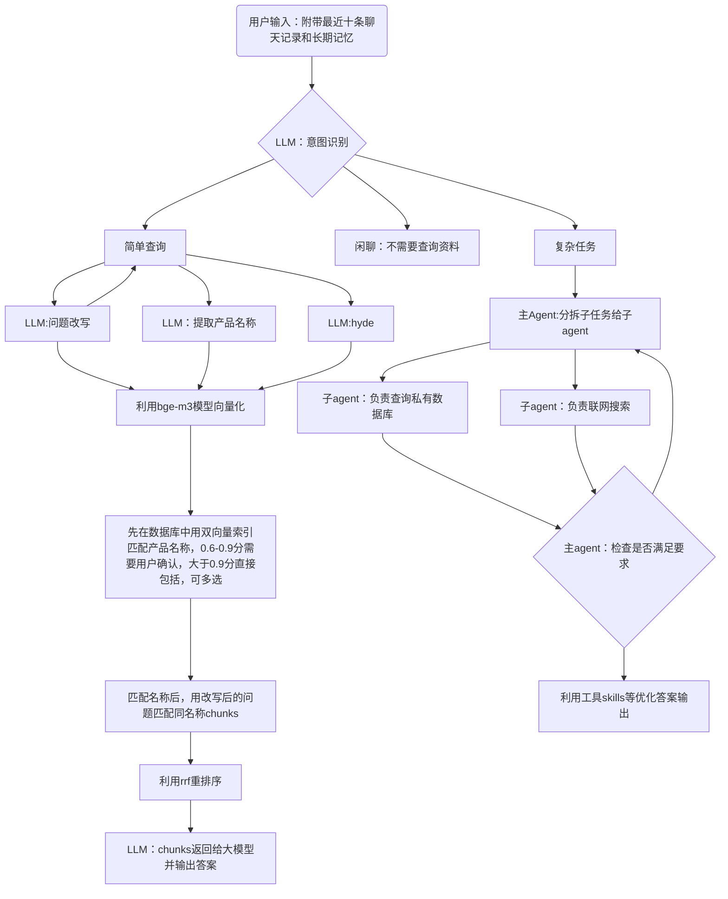

# 注册表最长匹配

对上不了的时候，用注册表做最长匹配，再看还有没有没消解的平安。

## 流程

1. 用户输入：附带最近十条聊天记录和长期记忆
2. 判断：LLM：意图识别
    - 分支 → 复杂任务
        - 主Agent:分拆子任务给子agent
            - 接着 → 子agent：负责查询私有数据库
                - 判断：主agent：检查是否满足要求
                    - 分支 → 回到「主Agent:分拆子任务给子agent」
                    - 分支 → 利用工具skills等优化答案输出
            - 接着 → 子agent：负责联网搜索
                - 回到「判断：主agent：检查是否满足要求」
    - 分支 → 闲聊：不需要查询资料
    - 分支 → 简单查询
        - 接着 → LLM:问题改写
            - 接着 → 回到「简单查询」
            - 接着 → 利用bge-m3模型向量化
                - 先在数据库中用双向量索引匹配产品名称，0.6-0.9分需要用户确认，大于0.9分直接包括，可多选
                    - 匹配名称后，用改写后的问题匹配同名称chunks
                        - 利用rrf重排序
                            - LLM：chunks返回给大模型并输出答案
        - 接着 → LLM：提取产品名称
            - 回到「利用bge-m3模型向量化」
        - 接着 → LLM:hyde
            - 回到「利用bge-m3模型向量化」

## 图

<!-- easy-flow
{"title":"注册表最长匹配","intent":"对上不了的时候，用注册表做最长匹配，再看还有没有没消解的平安。","nodes":[{"id":"nvavvub","type":"terminal","x":536,"y":40,"text":"用户输入：附带最近十条聊天记录和长期记忆"},{"id":"njhdxu1","type":"decision","x":304,"y":168,"text":"LLM：意图识别"},{"id":"nc0i9z9","type":"process","x":312,"y":416,"text":"简单查询"},{"id":"nte0g63","type":"process","x":-16,"y":352,"text":"闲聊：不需要查询资料"},{"id":"ne406nt","type":"process","x":1304,"y":304,"text":"复杂任务"},{"id":"nxk88vq","type":"process","x":120,"y":552,"text":"LLM:问题改写"},{"id":"noph8xj","type":"process","x":376,"y":552,"text":"LLM：提取产品名称"},{"id":"nwoeywm","type":"process","x":224,"y":672,"text":"利用bge-m3模型向量化"},{"id":"ne5zj22","type":"process","x":624,"y":552,"text":"LLM:hyde"},{"id":"n80fq8m","type":"process","x":176,"y":800,"text":"先在数据库中用双向量索引匹配产品名称，0.6-0.9分需要用户确认，大于0.9分直接包括，可多选"},{"id":"neaw7re","type":"process","x":176,"y":976,"text":"匹配名称后，用改写后的问题匹配同名称chunks"},{"id":"nztv2k7","type":"process","x":200,"y":1112,"text":"利用rrf重排序"},{"id":"nvj9gn3","type":"process","x":176,"y":1232,"text":"LLM：chunks返回给大模型并输出答案"},{"id":"n0menmw","type":"process","x":1256,"y":448,"text":"主Agent:分拆子任务给子agent"},{"id":"n54gh7v","type":"process","x":1072,"y":608,"text":"子agent：负责查询私有数据库"},{"id":"n4abop6","type":"process","x":1408,"y":608,"text":"子agent：负责联网搜索"},{"id":"n5qkfa3","type":"decision","x":1264,"y":752,"text":"主agent：检查是否满足要求"},{"id":"np4xw9t","type":"process","x":1248,"y":992,"text":"利用工具skills等优化答案输出"}],"edges":[{"id":"ev14qar","from":"nvavvub","to":"njhdxu1","label":""},{"id":"e03rkv3","from":"njhdxu1","to":"nc0i9z9","label":""},{"id":"ee7hb0i","from":"njhdxu1","to":"ne406nt","label":""},{"id":"ehdc1c1","from":"njhdxu1","to":"nte0g63","label":""},{"id":"eqeadtg","from":"nc0i9z9","to":"nxk88vq","label":""},{"id":"esye8fz","from":"nc0i9z9","to":"noph8xj","label":""},{"id":"exs5wti","from":"nxk88vq","to":"nc0i9z9","label":""},{"id":"emofv62","from":"nxk88vq","to":"nwoeywm","label":""},{"id":"e950aci","from":"noph8xj","to":"nwoeywm","label":""},{"id":"e8vdk4f","from":"nc0i9z9","to":"ne5zj22","label":""},{"id":"ee2mf9z","from":"nwoeywm","to":"n80fq8m","label":""},{"id":"eob2bv3","from":"n80fq8m","to":"neaw7re","label":""},{"id":"e01tdwq","from":"ne5zj22","to":"nwoeywm","label":""},{"id":"epwtvg8","from":"neaw7re","to":"nztv2k7","label":""},{"id":"evd04tm","from":"nztv2k7","to":"nvj9gn3","label":""},{"id":"eiwbt89","from":"ne406nt","to":"n0menmw","label":""},{"id":"eerio7z","from":"n0menmw","to":"n54gh7v","label":""},{"id":"e0m9sa7","from":"n0menmw","to":"n4abop6","label":""},{"id":"eb9y54f","from":"n54gh7v","to":"n5qkfa3","label":""},{"id":"e3mjjj5","from":"n4abop6","to":"n5qkfa3","label":""},{"id":"e88bq5y","from":"n5qkfa3","to":"n0menmw","label":""},{"id":"emegh6i","from":"n5qkfa3","to":"np4xw9t","label":""}]}
-->
